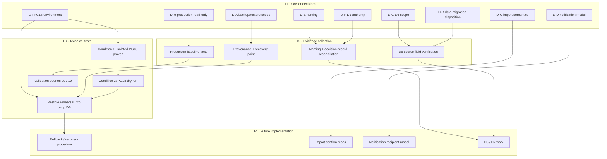

# Phase 12 — R-136: Final Evidence Consolidation & Owner Decision Pack

**Status:** `DOCUMENTATION ONLY — CONSOLIDATION — PHASE 12 REMAINS OPEN`
**Baseline verified before reading any claim:** repository root `D:/Default Project/company-ops-system`; branch `main`; HEAD `f91ed2f9e81db3937e3bcbb1b44e5e2c44e175cf`; remote `https://github.com/mamin144/company-ops-system.git`; working tree 27 porcelain entries (24 modified, 3 untracked).
**Precedence:** R-135 > R-134 > R-133 > R-132. Where two documents disagree, the later correction wins and the earlier claim is retained only as a superseded record.
**Scope:** consolidation of evidence already produced. R-136 did **not** re-open application source files to re-verify code findings, did not execute a test, did not contact a database, and asserts no new source observation. Every inherited classification is preserved, never promoted.
**Supersedes:** nothing. R-136 consolidates; it does not replace R-132, R-133, R-134, or R-135.

**Evidence labels used throughout (unchanged vocabulary):** `Verified` · `Owner-Confirmed` · `Historical` · `Inferred` · `Proposed` · `Unknown` · `Contradicted` · `Not Authorized`.

---

## 0. How to use this document

| Section | What it settles |
|---|---|
| **A** | The single decision-grade verdict, and what would be required to change it |
| **B** | One canonical findings register, five categories, every historical ID traceable as an alias |
| **C** | The authoritative backup/restore account, corrected by R-135 |
| **D** | All fifteen Owner Acceptance conditions, with statuses preserved and arithmetic reconciled |
| **E** | The nine owner decisions D-A … D-I |
| **F** | Dependency and sequencing graph: decisions, evidence, tests, implementation are not the same track |
| **G** | Nine proposed work packages — none authorized |
| **H** | The explicit authorization matrix |
| **I** | The fillable owner-decision record |

**Rules of reading.**

1. A **decision** is not a task. A **proposal** is not an authorization. A **recommendation** is not an owner instruction.
2. No recommendation in this document may be executed. Section H is the only statement of what is permitted.
3. Four reports are four documents, not four independent confirmations. Agreement between them is not corroboration; only direct evidence is.
4. Where R-136 says a thing is `Verified`, it means "so classified by the cited report", not "re-verified by R-136".
5. `Not Authorized` is a status, not an omission. It means the evidence cannot be obtained inside the current envelope.

**What this document is not:** it is not Phase 12 closure, not a remediation authorization, not Stage 3 entry, and not Phase 13 chartering.

---

# A. Executive Phase 12 verdict

## A.1 Verdict

> ## `BLOCKED — ADDITIONAL EVIDENCE REQUIRED — PHASE 12 REMAINS OPEN`

Phase 12 is **OPEN**. This verdict is unchanged from R-132, R-133, R-134, and R-135. R-136 found no basis to move it, and no exit condition is satisfied that was not satisfied before.

## A.2 Why the verdict cannot move on the present record

The exit criteria are **capability** criteria, not documentation criteria. Three independent facts are each sufficient on their own:

1. **No executed, version-compatible database restore exists.** Fourteen archives show valid headers and readable TOCs (L1–L3), but no archive has been restored (L6 `Not Authorized`), no data-block or compression integrity was tested (L4–L5 `Unknown`), and the repository's configured restore consumer is PostgreSQL 16 while the archives are format `1.16.0` written by a 18.4 client — a version the PG 16 reader rejects in `ReadHead` before the TOC is read. Condition 10 remains `Not met`. Condition 11 remains `Not met`.
2. **No applied-migration rollback path exists.** Sixteen of nineteen migrations have no `down/` script, and the runner has no applied-migration rollback mode. "Rollback" currently means "restore a verified dump", and no verified dump-to-restore chain exists. Condition 11 cannot be closed by documentation.
3. **The isolated PG 18 environment does not exist.** The local attempt failed with `0xC0000142`; conditions 1 and 2 are blocked at the environment layer, and a substantial part of the remaining evidence (dry run, restore test, migration comparison) is downstream of that environment.

Two further conditions are structurally unmet rather than merely undocumented: condition 5 (D5 secret-handling plan, with a credential literal still present in `scripts/backup-db-local.ps1:9`) and condition 6 (D6 field mapping, whose stated premise — "JSON → PostgreSQL migration" — does not describe the runtime, per F-16).

## A.3 What would change the verdict — categories, not commitments

| Change | Would move | Still would not close |
|---|---|---|
| An owner-signed scope decision that accepts untested recovery in writing | The *treatment* of conditions 10/11, not their status | Phase 12 — conditions 1, 2, 5, 6, 7, 8, 9, 12, 14 remain |
| An isolated PG 18 environment provisioned and proven | Conditions 1 and 2 become testable | Conditions 3–15 |
| One authorized restore into a temporary PG 18 database with recorded output | Condition 10 could be re-assessed | Condition 11's four named elements |
| A repair/retire decision on `data-migration.ts` plus a D6 scope restatement | D-B and D-G become decidable | Condition 6, which also requires idempotency and rollback evidence |
| A superseding D1 instruction filed in the repository | F-19 / D-F | Everything else |

No item in this table is authorized by R-136. They are listed so that the owner can see the shape of the path, not to imply that any step has begun.

## A.4 What R-136 explicitly did not do

- No source file was re-read to confirm a code finding; all code claims are inherited and labelled as inherited.
- No test, build, typecheck, lint, migration, query, backup, restore, or service action was executed.
- No database, container, Task Scheduler entry, `.env` file, or secret store was opened.
- No existing file was modified. No Git write was performed.
- No Stage 3, Phase 13, D5, D6, or D7 work was started.
- No recommendation was converted into an authorization.

---

# B. Canonical findings register

## B.1 Register schema, ID policy, and category rule

Every row in B.2–B.5 carries the same **eleven required fields**:

| # | Field | Meaning |
|---:|---|---|
| 1 | **Canonical ID** | The stable ID used from R-136 onward |
| 2 | **Finding** | One-line statement of the defect or condition |
| 3 | **Severity** | Highest correctly supported severity after all corrections |
| 4 | **Classification** | One of the eight evidence labels |
| 5 | **Evidence** | File, line, or document location |
| 6 | **Observation** | What the evidence shows |
| 7 | **Significance** | Why it matters to Phase 12 or to a decision |
| 8 | **Residual unknown** | What remains unproven, with its own label where material |
| 9 | **Recommended action** | A proposal only; carries no authority |
| 10 | **Owner decision required** | `Yes` / `No`, and which decision ID where applicable |
| 11 | **Aliases** | Every historical ID that refers to this row |

**ID policy.**

- New canonical series: `PB-` direct blocker, `TR-` technical risk, `NB-` non-blocking defect, `UN-` unknown.
- `DI-` is used for standing documentary findings. The **superseded-claim register** in B.6 keeps its original IDs (`X-`, `R134-C`, `CR-`) because those IDs are already globally unique and stable; they are canonical for correction rows, with their source documents recorded as aliases.
- A historical ID appears **exactly once** in this register, either as a canonical ID or in exactly one alias cell. It never appears twice.
- `G-03` is retained as **withdrawn** (B.7), not deleted, so earlier references stay traceable.
- Where a `G-` finding duplicates an `F-` finding, the `F-` row is canonical and the `G-` ID is the alias. No duplicate rows.

**Category rule.** The five categories are exclusive and reflect **impact on exit**, not intrinsic severity:

1. **Direct blockers** — cannot be resolved by reading; each prevents at least one condition from closing.
2. **Technical risks** — real defect with security, integrity, or availability impact; does not by itself hold a condition closed.
3. **Non-blocking defects** — accuracy or low-severity behavioural defects with no exit consequence.
4. **Documentary inconsistencies** — the record disagrees with itself or with evidence; includes superseded claims.
5. **Unknowns** — facts absent from the tree that no amount of re-reading can supply.

## B.2 Category 1 — Direct blockers (7)

| ID | Finding | Sev. | Label | Evidence | Observation | Significance | Residual unknown | Action (proposal) | Owner? | Aliases |
|---|---|---|---|---|---|---|---|---|---|---|
| **PB-01** | No executed, version-compatible database restore | Critical (recoverability) | `Verified` (capability gap) / `Unknown` (restorability) | `apps/api/src/services/backup.service.ts:1-76`; `backups/` (14 archives); R-135 §8–§11 | Application backup copies only `data/` and `storage/`; no `pg_dump`/`pg_restore`; 14 external archives have valid L1–L3 but no executed restore; configured consumer is PG 16 vs format `1.16.0` | Conditions 10 and 11 cannot close; no cutover rehearsal is meaningful; Migrations 09 and 19 remain effectively irreversible | Whether any archive restores (L6); whether payload/compression are intact (L4/L5); producer identity | Authorize a PG 18 end-to-end restore test into a temporary database, or record written risk acceptance | **Yes — D-A** | F-02; G-06 (route shape only); X-07 (scope); X-08; C-28 |
| **PB-02** | No applied-migration rollback path | High (recoverability) | `Verified` | `apps/api/src/database/migrations/down/` (`19_`, `20_`, `21_` only); `migrate.ts:47-59` | 16 of 19 migrations have no `down/`; the runner rolls back a failed migration but has no rollback mode for an applied one | "Rollback" means "restore a snapshot", and no verified snapshot chain exists | Whether rollback was ever intended to be script-driven (`Unknown`) | State the position explicitly: rollback = restore a verified PG 18 dump; do not imply script rollback | **Yes — D-A** | F-17; X-17 |
| **PB-03** | `data-migration.ts` is non-functional and fails silently | Critical **as planning** / None **as runtime** | `Verified` | `apps/api/src/database/data-migration.ts:77` vs `migrations/001_initial_schema.sql:57-63`; failure path `:203-211`; single `BEGIN` `:35` / `COMMIT` `:201` | Inserts `name`, `client_name`, `consultant_name` into a table with `project_name`, `client`, `main_contractor`, `site_location`; catches failure and exits 0; never invoked; **no partial writes** because one transaction wraps the run | Any plan that treats it as a working migration asset is unsound; the runtime blast radius is zero while it stays unwired | Whether it ever matched an earlier schema (`Unknown`); whether a live run rolls back correctly (`Not Authorized`) | Reclassify as `NON_FUNCTIONAL — NOT WIRED`; choose repair or retire; do not repair inside Phase 12 | **Yes — D-B** | F-01; X-05 (`crypto` leg contradicted); X-06; C-08 |
| **PB-04** | D6 premise does not describe the runtime | High (planning) | `Verified` | `audit.service.ts:5`; `notification.service.ts:4`; `session.service.ts:19`; `repositories/audit-log.repository.ts`, `notification.repository.ts` | JSON persistence layers are imported or instantiated but never invoked; the runtime already uses PostgreSQL | The stated D6 scope ("migrate JSON → Postgres") would direct work at dead code and miss the real read-path defects | Whether any external tool reads those JSON files (`Unknown`) | Restate D6 as "delete the dead JSON path after a verified grep + fix the Postgres read paths" | **Yes — D-G** | F-16; C-27 |
| **PB-05** | HTTP transport cannot authenticate and cannot upload | Medium now; blocking for D7 | `Verified` | `src/services/api/client.ts:32-47`; `configuration.ts:10-19`; `index.ts:16-18`; `errors.ts:5-6` | No `credentials: 'include'`; JSON-only body; throws on 4xx contrary to its own error contract; adapter mode is a literal `const` | An HTTP adapter built on this scaffold fails at login and upload — the two most important surfaces | Which auth transport the target UI will use, cookie or bearer (`Proposed` only) | Record as D7 entry conditions; do not treat as a Phase 12 code repair | **Yes — D7 remains Not Authorized** | F-15; C-25 |
| **PB-06** | D1 architecture direction is recorded two ways | High (governance) | `Contradicted` (text) / `Unknown` (authority) | `phase-12-owner-decision-record.md:20` vs `phase-12-prototype-live-api-contract-map.md:100`, `:1614-1618` | ODR records Option B as direction; contract map records Option A as the operative instruction for current scope; the divergence is preserved, not resolved | Phase 12 cannot declare "architecture aligned" while the operative direction is ambiguous | Whether a superseding owner instruction exists outside the tree (`Unknown`) | File the superseding instruction, or downgrade the alignment claim | **Yes — D-F** | F-19; X-18; Q-4 |
| **PB-07** | Isolated PG 18 environment is unavailable | Critical (environment) | `Verified` (failure) / `Not Authorized` (resolution) | `phase-12-stage-2b-report.md` (`0xC0000142`); Stage 2C §9 | Local PG 17/18 provisioning crashed; no VM/separate host/approved container exists | Conditions 1 and 2 are blocked; dry run, restore test, and schema comparison are downstream | Whether a container or remote host is available and authorized | Provision an isolated PG 18 environment (VM, separate host, or approved container) | **Yes — D-I** | U-R132-01; Stage 2B; condition 1 |

## B.3 Category 2 — Technical risks (16)

| ID | Finding | Sev. | Label | Evidence | Observation | Significance | Residual unknown | Action (proposal) | Owner? | Aliases |
|---|---|---|---|---|---|---|---|---|---|---|
| **TR-01** | Restore endpoint is destructive and audits after execution | High | `Verified` | `system.routes.ts:36-45`; `backup.service.ts:51-71` | Handler runs `restore()` first and `auditService.log(...)` afterwards; no confirmation token, no dry run, no reversal without a second restore | An accidental call destroys current state; the audit record exists only if the process survives | Whether an out-of-band confirmation is intended (`Unknown`) | Audit before execution; require an explicit confirmation parameter | No for defect; **Yes** for endpoint-shape change | F-03; G-06 |
| **TR-02** | `sessionService.findById` ignores revocation and expiry | High (defence-in-depth) | `Verified` | `session.service.ts:68-76`; compensating check `middleware/auth.ts:74-83` | Returns the session row without checking `revoked_at` or `expires_at` | Single-layer enforcement; a future caller that trusts `findById` reopens the hole; not a live bypass today | Whether a non-`requireAuth` caller exists (`Inferred`: none) | Push the checks into `findById`; document the compensating control | No | F-04 |
| **TR-03** | Notification recipient model is unresolved | Medium (after X-01) | `Verified` | `notification.service.ts:19-47`, `:49-62`, `:72-77`; `NotificationBell.tsx:59`; `system.routes.ts:61` | No recipient supplied on insert; `list()` is global with `LIMIT 100`; `markAllRead` appends only the caller — **no cross-user mutation**; UI styling uses "anyone read it" while the badge is per-user | Correctness failure visible to every user, plus a design question the record treats as a defect | Whether broadcast notification is intended (`Unknown`); whether per-item mark-read partially mitigates | Add a recipient column or join table; scope read state; fix UI predicate | **Yes — D-D** | F-05; X-01; X-02; X-03; X-04; N-01 |
| **TR-04** | `GET /api/folders` is unguarded beyond authentication | High | `Verified` | `folders.routes.ts:9-14`; guarded siblings `:15-27`, `:29-41`, `:43-51` | `requireAuth` only; no `archive.view`; no project scoping; returns the whole tree | Read exposure of folder names and structure to any authenticated user | Whether folder names are sensitive (`Unknown`, business) | Add `archive.view`; scope the tree to visible projects | No for fix; **Yes** if response contract changes | F-06; G-01 |
| **TR-05** | Document link deletion is unscoped | High | `Verified` | `documents.routes.ts:298-304` | `requirePermission('archive.edit')` then `findById(linkId)` then `delete(linkId)`; parent document's project never resolved | An `archive.edit` holder on project A can sever links on project B | Whether links carry a `project_id` that makes scoping trivial (`Unknown`) | Resolve the parent document and apply `scopeDocumentRow()`; nest the route | No | F-07; G-02 |
| **TR-06** | Project export is unscoped | High | `Verified` | `projects.routes.ts:68-73` | `projectRepository.list()` with no `filterVisible`; exports every project | Bulk exfiltration path that the list endpoint itself does not have | Whether `reports.view` is broadly granted (`Unknown`) | Apply `filterVisible` before export | No | F-08; G-04 |
| **TR-07** | Financials endpoint is unscoped | High | `Verified` | `projects.routes.ts:25-55` | One SQL statement aggregates BOQ, approved IPC net, deductions, and linked documents across all projects, gated only by `projects.view` | The most commercially sensitive read has no membership predicate; blocks the Option-2 dashboard | None material | Add a membership join or post-filter; note the query-shape change | **Yes** — performance implication | F-09; G-08 |
| **TR-08** | Audit read path transfers the whole table | High (availability) | `Verified` | `audit.service.ts:69-95` | `SELECT … ORDER BY created_at DESC` with no `LIMIT`/`OFFSET`; paging in memory; `MAX_LOGS` unused | Append-only table grows without bound; latency and memory grow with it | Current production row count (`Unknown`) | Push `LIMIT`/`OFFSET` into SQL; add `COUNT(*)` | No | F-10 |
| **TR-09** | Audit redaction is incomplete | Medium-High | `Verified` | `audit.service.ts` `sanitize()` | Removes only top-level `passwordHash`, `password`, `token`; not `newPassword`, `refreshToken`, `password_hash`, `secret`, or nested keys | A future handler logging a reset body persists a credential in an append-only table | Whether any current handler passes such a body (`Inferred`: no) | Denylist by key pattern, recursively; add a regression test | No | F-11 |
| **TR-10** | Import upload is unbounded and pre-authorization | High (DoS) | `Verified` | `import.routes.ts:33`, `:203`, `:226`, `:375`, `:365` | `multer({ storage: memoryStorage() })` with no `limits`; upload middleware before authorization on three routes; template route has no authorization | Permission-free memory exhaustion; the template route is an open door | Maximum practical upload before OOM (`Unknown`) | Add `limits.fileSize` and `files: 1`; move permission checks first; guard template route | No | F-12 |
| **TR-11** | Import confirm is non-transactional and ledger-after-the-fact | High (after X-10) | `Verified` | `import.routes.ts` `:entity/confirm` (~`:392-470`), `smart/confirm` (~`:286-360`); ledger `:348-359`, `:458-469` | No `BEGIN`/`COMMIT`; row-by-row inserts; ledger written after the loop; a ledger failure becomes HTTP 500 via `express-async-errors@3.1.1` + `errorHandler`, with rows already committed and retry able to duplicate | Partial imports that are unauditable on crash; a failed ledger write does not roll data back | Whether atomic or explicitly-partial is the intended product semantics (`Proposed` designs exist) | Wrap in a transaction, or accept partial semantics explicitly and record them in the ledger | **Yes — D-C** | F-13; X-10; X-11; X-12; R134-C15; N-02; N-03 |
| **TR-12** | Document status has no allowed-transition matrix | Medium | `Verified` | `documents.routes.ts:345-361` | Schema validates the enum only; any status can be written from any other | Workflow integrity is client-enforced at best | The matrix itself (`Q-05`, `Unknown`) | Enforce allowed transitions server-side once the matrix is owned | No (matrix content may need owner input) | G-05 |
| **TR-13** | IPC single-row permission check is handler-level only | Low (consistency) | `Verified` | `ipc.routes.ts:50-57`; sibling routes | No route-level permission middleware, but the handler performs `can(ctx,'projects.view', ipc.projectId)` and 404-hides on failure | Not an access hole; a uniformity defect that invites future drift | None material | Move the check to explicit middleware; behaviour must not change | No | G-07 |
| **TR-14** | `notificationService.create(...)` is called without `await` at three sites | Medium | `Verified` (call shape) / `Inferred` (crash outcome) | `documents.routes.ts:352`; `material-requests.routes.ts:98`; `modules/stock/stock.factory.ts:105` | A rejection becomes an unhandled promise rejection | Depends on process-level rejection handling, which is absent | Whether the compiled service crashes on rejection (`Inferred`) | Await or explicitly `.catch()` at all three sites | No | N-02 |
| **TR-15** | Import ledger write is unguarded and there is no process-level rejection handler | High (reliability) | `Verified` (shape) / `Inferred` (outcome) | `import.routes.ts:349`, `:459`; Express 4.22.2; zero handler hits | A ledger failure yields no response and a fatal rejection by default; with `express-async-errors` the request becomes HTTP 500 | Rows committed but unrecorded; retry can duplicate | End-to-end runtime behaviour without inducing failure (`Inferred`) | Guard the ledger write; add a process-level rejection handler | No | N-03; X-11 |
| **TR-16** | A credential literal is hard-coded in a backup script | High (secret hygiene) | `Verified` (literal present) / `Unknown` (live) | `scripts/backup-db-local.ps1:9` — `<REDACTED — literal not reproduced>` | A local database password is set literally in the script | Relevant to D5; the value must never be reproduced in documentation | Whether it was ever a live credential (`Unknown`) | Treat as a D5 input; rotate only under explicit authorization | **Yes — D5 scope** | X-09; N-07; U-R134-10; Q-6 |

## B.4 Category 3 — Non-blocking defects (3)

| ID | Finding | Sev. | Label | Evidence | Observation | Significance | Residual unknown | Action (proposal) | Owner? | Aliases |
|---|---|---|---|---|---|---|---|---|---|---|
| **NB-01** | Notification item styling and badge disagree per user | Medium (user-visible) | `Verified` | `NotificationBell.tsx:59`; `system.routes.ts:61` | Item styling uses `!n.readBy.length` ("anyone read it"); the badge uses `!n.readBy.includes(username)` ("I read it") | A notification can look read while the badge says unread; a fourth defect R-132 missed | None material | Derive both from the per-user predicate | No | N-01; X-03 |
| **NB-02** | `total_rows` undercounts by skipped duplicate rows | Low-Medium (accuracy) | `Verified` | `import.routes.ts:355`, `:465` vs `:301` | `totalRows: imported + failures.length` excludes skipped duplicates | The ledger is present but understates the rows processed | None material | Count skipped duplicates explicitly in the ledger | No | N-04; X-12 |
| **NB-03** | Condition 11 carries four named recovery elements beyond "a restore worked" | Low (record clarity) | `Verified` | `phase-12-owner-acceptance-record.md:182` | Condition 11 names: named recovery point, post-cutover write policy, file-attachment recovery, audit-trail evidence | A successful temporary restore alone cannot close condition 11 | None material | Assess condition 11 against all four elements, not the restore alone | No | N-08 |

## B.5 Category 4a — Standing documentary inconsistencies (4)

| ID | Finding | Sev. | Label | Evidence | Observation | Significance | Residual unknown | Action (proposal) | Owner? | Aliases |
|---|---|---|---|---|---|---|---|---|---|---|
| **DI-01** | Adapter inventory is 68, not 65 | Medium (evidence accuracy) | `Verified` | Contract map §6.1 (`:689-701`); `adapters/mock/api.ts:721`, `:961`, `:966` | `mrApi` = 9, `userApi` = 11; total 68 actual vs 65 documented | Coverage figures derived from 65 are wrong; the ≈29-operations estimate needs recomputation | None | Correct the three figures and the derived coverage statement | No | F-14; X-14; C-22 |
| **DI-02** | Schema nomenclature diverges from the target design | Low-Medium (after X-13) | `Verified` (divergence) | Live: `project_members`, `stock_transactions`, `stock_transaction_lines`; target: `project_memberships`, `stock_movements`, `stock_movement_lines` | Code and design documents use different names for the same concepts; the contract map is design-only, no DDL | An adapter or migration written from the target document will not match reality — the same class of error as PB-03 | Which naming is intended to survive (`Unknown`) | Pick one, record it, align the contract map | **Yes — D-E** | F-18; X-13; C-23 |
| **DI-03** | The `projectScope` invariant is over-stated | Medium (documentation) | `Contradicted` (as written) | `projectScope.ts:6-12` vs TR-04/TR-05/TR-06/TR-07 | Module states scope resolution is "the ONLY place that answers which project does this request target"; four high-value routes never call it | The absolutism is why the gaps survived review | Whether additional unguarded routes exist outside the contract map (`Unknown`) | Narrow the claim to "where used"; add a route-inventory check | No | F-20; C-26 |
| **DI-04** | Two PostgreSQL majors are referenced concurrently | Medium (record inconsistency) | `Verified` (references) / `Unknown` (production) | `docker-compose.yml:4` (`16-alpine`); `backup-db-local.ps1:8`; `install-service.ps1:33` (18) | The repository pins PG 16 for the container while the backup and service scripts declare PG 18 | The same tree cannot answer "which major is the operating target", which affects D-A and conditions 1/2/10 | Which major runs in production (`Unknown`); whether the live image matches the pin (`Unknown`) | Record the operating target explicitly as part of D-A/D-I | **Yes — D-A / D-I** | N-05; U-R135-02; Q-2 |

## B.6 Category 4b — Superseded-claim register (52 correction rows)

This register is the canonical home of every correction issued by R-133, R-134, and R-135. Each row preserves the original claim, records the correction, names the superseding report, and states the severity and exit impact. Correction IDs are already globally unique, so they are retained as canonical IDs; the source report is recorded in the last column.

**Reading rule:** the "Corrected statement" column is authoritative. The "Original claim" column is historical only and must never be quoted as current.

### B.6.1 R-133 corrections to R-132 — `X-01` … `X-19` (19 rows)

| ID | Original claim (source) | Evidence | Corrected statement | Label | Severity / decision impact | Exit impact | Residual unknown | Action (proposal) | Owner? | Superseding report / alias |
|---|---|---|---|---|---|---|---|---|---|---|
| **X-01** | `markAllRead` clears every user's unread state (R-132 §1 item 3, §5.3, F-05) | `notification.service.ts:72-77` appends only `$1` (caller); never removes or rewrites another user's entry | Per-user append; **no cross-user mutation**. Real defects are the UI predicate, the 100-row truncation, dedupe, and the unresolved recipient model | `Contradicted` | F-05 High→Medium; D-D re-worded | None | Whether broadcast is intended | Reword D-D; do not describe a cross-user write | **Yes — D-D** | R-133 §10; TR-03 |
| **X-02** | Notification line ranges `:19-30`, `:36-52`, `:60-70` | Actual: `create` 19-47, `list` 49-62, `markAllRead` 72-77 | Citations had drifted; correct ranges supplied | `Verified` | None | None | None | Correct the citations | No | R-133 §10 |
| **X-03** | Notification subsystem has "three distinct defects" | `NotificationBell.tsx:59` vs `system.routes.ts:61` | A fourth, user-visible defect exists: item styling and badge disagree per user | `Verified` | Adds a Medium defect R-132 missed | None | None | Record as NB-01 | No | R-133 §10; NB-01 |
| **X-04** | Dedupe stops after the first reader | `notification.service.ts:22-28` `array_length(read_by,1) IS NULL` | Correct as stated | `Verified` | None | None | None | Keep | No | R-133 §10 |
| **X-05** | `crypto.randomUUID()` fails; nothing provides `crypto` | `@types/node` 24.13.3 `web-globals/crypto.d.ts:31` global `var crypto`; `tsconfig.json` `types:["node"]` | The global is declared and available; `crypto` is **not** a defect | `Contradicted` | F-01 severity split: planning vs runtime; D-B repair is smaller | None | Whether the compiled runtime resolves it (`Inferred`: yes) | Remove the `crypto` leg from F-01/PB-03 | **Yes — D-B** | R-133 §10; PB-03 |
| **X-06** | Failure swallowed, exit 0 | `:203-205` catch + `ROLLBACK`; `:211` `.catch(console.error)`; single `BEGIN` `:35` / `COMMIT` `:201` | Correct; additionally there are **no partial writes** | `Verified` | Bounds blast radius; "Critical (integrity)" invites a wrong reading | None | Execution (`Not Authorized`) | Keep the transactional boundary explicit | No | R-133 §10; R134-C06 |
| **X-07** | No DB backup/restore "anywhere"; condition 10 unsatisfiable | `backup-db.ps1:16-28`; `backup-db-local.ps1:8-14`; `restore-db.ps1:24-40`; `install-service.ps1:44-49`; 14 dumps | **Application** lacks backup/restore; **repository** contains scripts and dumps. Condition 10 is unmet for want of a recorded, compatible restore test | `Contradicted` (scope) | F-02 Critical→High; D-A re-worded | Conditions 10/11 remain `Not met` | Restorability; provenance | Restate F-02/PB-01 as a capability-and-test gap, not "nothing exists" | **Yes — D-A** | R-133 §10; PB-01 |
| **X-08** | Dumps are evidence of capability | Timestamps 12:00/11:00 vs 02:00 schedule; PG 18 host vs PG 16 container | Existence `Verified`; provenance and restorability `Unknown`; version mismatch `Inferred` (later `Verified` structurally by R-134/R-135) | `Inferred` | Restore test must target a version-matched environment | None | Producer identity; L4–L6 | Use R-135's L1–L3 status, not "capability" | **Yes — D-A** | R-133 §10; PB-01 |
| **X-09** | (not mentioned in R-132) | `backup-db-local.ps1:9` — `<REDACTED — literal not reproduced>` | A hard-coded local DB password literal is present in the script | `Verified` | Relevant to D5; new item | None | Whether it was ever live (`Unknown`) | Treat as a D5 input; never reproduce the value | **Yes — D5** | R-133 §10; TR-16 |
| **X-10** | Failure before the ledger write means "no ledger record at all" | Ledger written at `:348-359` and `:458-469` on the normal path | True only for mid-loop death or ledger-insert failure; the normal path does write a ledger row | `Contradicted` (as stated) | F-13 Critical→High; D-C unchanged | None | Crash-path frequency (`Unknown`) | Restate F-13/TR-11 | **Yes — D-C** | R-133 §10; TR-11 |
| **X-11** | (not mentioned in R-132) | Ledger `await` unguarded; Express 4.22.2; no process-level rejection handler | The ledger write is unguarded; a failure has no defined response path | `Verified` (shape) / `Inferred` (outcome) | New reliability finding | None | Runtime response; later corrected by R134-C15 | Merge into TR-15; R-135 confirms X-11 is unaffected by the archive correction | No | R-133 §10; TR-15 |
| **X-12** | "imported 40 of 100 is indistinguishable from imported 40 then crashed" | `totalRows: imported + failures.length` excludes skipped duplicates (`:355`, `:465`) | A ledger exists but undercounts by skipped duplicates | `Verified` | New accuracy defect | None | None | Record as NB-02 | No | R-133 §10; NB-02 |
| **X-13** | F-18 classification `Contradicted` | Contract map §9 preamble: design only, no DDL; no column asserted to exist | Naming **divergence**, not contradiction | `Verified` (divergence) | F-18 Medium→Low-Medium; D-E re-framed | None | Which naming survives (`Unknown`) | Restate DI-02 | **Yes — D-E** | R-133 §10; DI-02 |
| **X-14** | §1 item 4 cites `F-15` for the adapter count | F-14 is the adapter-count finding; F-15 is HTTP transport | Mis-citation | `Verified` | None | None | None | Correct the citation | No | R-133 §10; DI-01 |
| **X-15** | "11 of 21" closed; "5" IDs listed | Recomputation from R-132's own table | 10 pure `Verified` (12 with dual halves); the bullet lists six under "5"; C-15 wrong; C-02 omitted; C-13 unaccounted | `Contradicted` | §18's "eleven" must not be quoted | Verdict unchanged | None | Use the reconciled arithmetic in DI rows, not the summary | No | R-133 §10 |
| **X-16** | "1 substantially met, 1 historical, 13 not met" | Same table: 1 / 1 / 1 partial / 11 not met / 1 not authorized | The summary compressed the matrix incorrectly; two basis cells were wrong | `Contradicted` | Correct work description | Conditions 10/11 remain `Not met` | None | Use Section D arithmetic | No | R-133 §10; Section D |
| **X-17** | Runner has "no rollback mode at all" | `migrate.ts:47-59` wraps each migration in a transaction with `ROLLBACK` on failure | No **applied-migration** rollback; failure rollback exists | `Verified` (with qualifier) | Precision only | F-17/PB-02 stands | Whether script rollback was intended (`Unknown`) | State the qualifier | **Yes — D-A** | R-133 §10; PB-02 |
| **X-18** | D1 statements are "mutually consistent = `Contradicted`" | ODR `:20` (B = direction); contract map `:100` (A = operative for current scope) | Reconcilable by scope; the unsupported element is the **Option A instruction** | `Unknown` (authority) | F-19 severity unchanged; D-F unchanged | None | Whether an owner issued Option A (`Unknown`) | Record as PB-06 | **Yes — D-F** | R-133 §10; PB-06 |
| **X-19** | 24 uncommitted modifications | Current `git status --porcelain` = 27 (24 modified + 3 untracked) | Baseline drifted; not an error at R-132's time | `Verified` | None | None | None | State R-136's own baseline | No | R-133 §10; R-136 header |

### B.6.2 R-134 corrections to R-133 — `R134-C01` … `R134-C21` (21 rows)

| ID | Original claim (source) | Evidence | Corrected statement | Label | Severity / decision impact | Exit impact | Residual unknown | Action (proposal) | Owner? | Superseding report / alias |
|---|---|---|---|---|---|---|---|---|---|---|
| **R134-C01** | `Contradicted` = 7, including X-18 (R-133 §3 `:99`) | R-133 §10 `:586` labels X-18 `Unknown` (authority) | `Contradicted` = **6**: X-01, X-05, X-07, X-10, X-15, X-16. X-18 is `Unknown` | `Verified` | None | None | None | Use the reconciled count | No | R-134 §9 |
| **R134-C02** | `Verified` = 10, including X-08 (R-133 §3 `:100`) | R-133 §10 `:576` labels X-08 `Inferred` | X-08 moves to `Inferred`; `Verified` = **11** (adding X-14, X-19) | `Verified` | None | None | None | Use the reconciled count | No | R-134 §9 |
| **R134-C03** | `Unknown`/`Inferred` row contains X-14 and X-19 (R-133 §3 `:101`) | R-133 §10 `:582`, `:587` — both `Verified` | Row has zero members; the `Unknown`/`Inferred` row holds X-08 and X-18 only | `Verified` | None | None | None | Use the reconciled distribution | No | R-134 §9 |
| **R134-C04** | "Substantive reversal count is six, plus one mis-classification and one arithmetic pair" | X-15 and X-16 are two of the six `Contradicted` | Four mechanism reversals (X-01, X-05, X-07, X-10) plus two arithmetic reversals (X-15, X-16) **equals** six | `Verified` | None | None | None | Remove the double count | No | R-134 §9 |
| **R134-C05** | "It type-checks and runs" (R-133 §1, §5.2, X-05) | No typecheck or execution was authorized in R-133 or R-134 | API availability, declarations, and runtime configuration are `Verified`; compilation and execution are `Not Authorized` and therefore `Inferred` | `Not Authorized` (execution) / `Verified` (preconditions) | F-01 unchanged; D-B unchanged | None | Whether it compiles (`Not Authorized`) | Use the bounded wording | **Yes — D-B** | R-134 §9 |
| **R134-C06** | "A single transaction wraps the whole script … `Verified`"; "No partial writes" | `data-migration.ts:31` `pool.connect()`, `:35` `BEGIN`, all inserts + `:201` `COMMIT`, `:204` `ROLLBACK`, `:207` `release()`; no `pool.query` | Confirmed at source. Every transaction statement uses the one dedicated client. Boundary: `Verified` (source) / `Not Authorized` (execution) | `Verified` (source) | None; R-133 stands | None | Live rollback (`Not Authorized`) | Keep the boundary | No | R-134 §9; PB-03 |
| **R134-C07** | "Caught, logged, rolled back, process exits 0" | `:211` `.catch(console.error)`; `connection.ts:18` `idleTimeoutMillis: 30000` | "Exits 0" is `Verified`. On failure `pool.end()` is never called, so the process lingers ~30 s (`Inferred`) before exiting 0 | `Verified` / `Inferred` (duration) | None | None | Exact linger duration | Describe the observed supervisor behaviour | No | R-134 §9 |
| **R134-C08** | "The repository ships … a daily 02:00 scheduled task"; "Daily schedule `Verified`" | `install-service.ps1:44-50` defines the task; no installation or execution evidence | The repository ships a **script that would register** a daily 02:00 task. Installation and execution are `Unknown` | `Verified` (script) / `Unknown` (install, execution) | D-A unchanged; wording becomes "authorize and supervise" | None | Whether the task is installed (`Not Authorized`) | Never state that the task runs | **Yes — D-A** | R-134 §9 |
| **R134-C09** | "Which major produced them? `Verified` (references) / `Unknown` (production)" | All 14 dumps: `PGDMP`, `1.16.0`, header version `18.4`, `Arabic_Egypt.utf8` | Producer major = **PostgreSQL 18.x**, `Verified`. Which server the API targets remains `Unknown` (`.env` not read) | `Verified` (producer) / `Unknown` (target) | Narrows D-A: restore target must be PG 18 | None | API target | Name PG 18 explicitly in D-A | **Yes — D-A** | R-134 §9; R-135 §5 |
| **R134-C10** | "Is the restore path version-matched? … `Inferred`" | Producer PG 18.4 / `1.16.0`; consumer `postgres:16-alpine` (`docker-compose.yml:4`), `pg_restore` in that container (`restore-db.ps1:28-32`) | Mismatch is **`Verified` structurally**; the actual rejection was `Inferred` at R-134 and is `Verified` from source in R-135 | `Verified` (structure) / `Inferred` (execution) | Raises confidence in the top recovery risk | Condition 10 stays `Not met` | No runtime rejection observed | Use R-135's source-level finding | **Yes — D-A** | R-134 §9; R-135 §8; CR-10 |
| **R134-C11** | "Every archive carries a `DATABASE` TOC entry, which requires `--create`; neither script passes `-C`" | R-135 CR-01/CR-03: `dumpDatabase()` writes the `DATABASE` entry unconditionally; `-C` is a `pg_restore` option and is ignored for archive output | The entry is present in 14/14, but it does **not** require `--create`; "flag mismatch" is not a verified fact. Attribution stays `Unknown` for other reasons (timestamps, no log) | `Unknown` (attribution) / `Contradicted` (flag-mismatch clause) | Withdraws the strongest stated exclusion of `backup-db-local.ps1` | None | Producer identity | Replace with R-135's corrected provenance statement | **Yes — D-A** | R-134 §9 → **superseded by R-135 CR-01…CR-04** |
| **R134-C12** | "Has a backup ever run? Yes — 14 dumps exist — `Historical`" | 14 files; no run log, no transcript | At least fourteen dump-producing operations completed — `Verified` (artefact). Whether any was the scheduled task — `Unknown` | `Verified` / `Unknown` (agent) | None | None | Agent identity | Correct the label | **Yes — D-A** | R-134 §9 |
| **R134-C13** | "The gap is an unproven restore **and a version mismatch**" | C09–C10 | The mismatch is no longer a hedge: producer 18.4 vs consumer 16 is `Verified`. The gap is an unproven, currently mis-targeted restore | `Verified` | F-02 stays High; remediation includes editing `restore-db.ps1` or replacing the consumer | None | None | Carry into C.6 | **Yes — D-A** | R-134 §9; R-135 |
| **R134-C14** | "Express 4.22.2 does not catch rejected async handlers — `Verified`" | `app.ts:1` `import 'express-async-errors'`; `package.json:21` `^3.1.1`; installed v3.1.1 | True of Express alone, **not dispositive**: the application installs async-error forwarding before any router is constructed | `Verified` (fact) / material omission | Invalidates the inference built on it (C15) | None | Compiled `dist/` behaviour (`Inferred`) | Never cite the Express fact without the forwarding fact | No | R-134 §9 |
| **R134-C15** | "No response is sent; the request hangs, and the rejection is fatal by default" | `app.ts:1` + `middleware/errors.ts:7-32` (`res.status(status).json({ message })`, default 500) | A ledger-write rejection is answered with **HTTP 500 JSON**. The request does not hang; the process does not die. Rows remain committed with no ledger row, and retry can duplicate | **`Contradicted`** | F-13 stays High; D-C re-worded (C16) | None | None | Correct every "hangs/fatal" statement | **Yes — D-C** | R-134 §9; TR-11 |
| **R134-C16** | "The ledger write must be guarded and must not turn a completed import into a hung request" | As C15 | "…must be guarded so a ledger failure cannot leave committed rows unrecorded, and must not invite a duplicate-producing retry" | `Verified` (requirement) | Changes what the owner asks for; D-C still required | None | None | Use the corrected requirement in D-C | **Yes — D-C** | R-134 §9 |
| **R134-C17** | "No `unhandledRejection`/`uncaughtException` handler exists in `apps/api/src`" | Recursive scan of `apps/api/src/**/*.ts` — zero matches | Correct, and correctly bounded: absent, but not load-bearing for route-level rejections because `express-async-errors` handles them. Still absent for rejections outside a request | `Verified` (absence) / `Inferred` (non-route crash) | N-02 survives; N-03 does not | None | Non-route rejection behaviour | Keep the boundary | No | R-134 §9; TR-14/TR-15 |
| **R134-C18** | "`totalRows` omits skipped duplicates — `Verified`" | `:301` `continue` before any counter; `:355`, `:465` `totalRows: imported + failures.length` | Confirmed. Duplicates skipped under `skipDuplicates` are counted in neither successes nor failures | `Verified` | Unchanged; N-04 stands | None | None | Record as NB-02 | No | R-134 §9; NB-02 |
| **R134-C19** | Condition 4 basis cites **X-05**, X-13 (R-133 §14 `:700`) | Adapter recount 68 vs 65 (§8.1); X-14 is the register mis-citation; X-13 is F-18 | Basis = "adapter count 68 vs 65 (X-14); F-18 labelling (X-13)". **X-05 is unrelated and must be removed** | `Verified` | Condition 4 stays **`Substantially met`** | No status change | None | Repair the citation in Section D | No | R-134 §9; Section D |
| **R134-C20** | "Did not read or print `.env`, credentials, tokens, or secrets" | §6.6 `:345` establishes the literal at `backup-db-local.ps1:9` was observed and cited by line | The containing line was read to establish and cite the literal. The value was **not reproduced**. No `.env` was opened | `Verified` (S1+S2) / `Contradicted` (S4) | None | None | Whether the literal is live (`Unknown`) | Keep the four states separate | **Yes — D5** | R-134 §9; TR-16 |
| **R134-C21** | "No secret value was printed" | As C20 | Accurate as written. It does **not** establish "not read", and must not be cited as if it did | `Verified` | None | None | None | Never conflate "not printed" with "not read" | No | R-134 §9 |

### B.6.3 R-135 corrections to R-134 — `CR-01` … `CR-12` (12 rows)

| ID | Original claim (source) | Evidence | Corrected statement | Label | Severity / decision impact | Exit impact | Residual unknown | Action (proposal) | Owner? | Superseding report / alias |
|---|---|---|---|---|---|---|---|---|---|---|
| **CR-01** | "`pg_dump` emits the `DATABASE` entry only under `--create`" (R-134 §5.3 `:292`) | `dumpDatabase()` calls `ArchiveEntry(… .description = "DATABASE", .createStmt = creaQry->data …)` with no `-C` gate; docs: `-C` "is ignored when emitting an archive (non-text) output file" | `pg_dump` writes the `DATABASE` entry into custom archives **unconditionally**. No producer flag is required | **`Contradicted`** | Removes the asserted flag mismatch from D-A (iii) and from the condition-10 rationale | None | None | Delete every "requires `--create`" statement | **Yes — D-A** | R-135 §10 |
| **CR-02** | "The producing command therefore passed a flag that neither repository script passes" (R-134 §5.3 `:292`) | Same as CR-01; `-C` is a `pg_restore` restore-policy flag, not an archive-content prerequisite | Nothing follows about the producing command from the entry's presence. The inference is void | **`Contradicted`** | Collapses the exclusion of `backup-db-local.ps1`; provenance doubt weakens but does not disappear | None | Producer command | Never infer producer flags from archive content | **Yes — D-A** | R-135 §10 |
| **CR-03** | "Every archive carries a `DATABASE`/`CREATE DATABASE` TOC entry, which requires `--create`"; label "`Verified` (flag mismatch)" (R-134-C11 `:494`) | Same as CR-01; 14/14 contain the entry; `--list --create` reveals it in 14/14 | The entry is present in 14/14. The "requires `--create`" clause is false; "flag mismatch" is not a verified fact. The `Unknown` attribution label survives on other grounds | **`Contradicted`** | The row's rationale is rewritten; the conclusion "provenance `Unknown`" survives | None | Producer identity | Rewrite R134-C11 | **Yes — D-A** | R-135 §10 → supersedes R134-C11 |
| **CR-04** | "**Not** reproducible by `backup-db-local.ps1` as written (no `--create`, and every archive carries a `DATABASE` TOC entry)" (R-134 §12 item 6 `:608`) | CR-01 + §7.2: PG 18 client, `-Fc`, host 5432, Windows locale, retention 14 — all consistent | `backup-db-local.ps1` **is capable** of producing these archives as written. It is not excluded by the archive evidence; execution remains `Unknown` | **`Contradicted`** | The strongest stated exclusion is withdrawn; the script becomes the leading candidate | None | Whether it actually ran | State "capable, execution `Unknown`" | **Yes — D-A** | R-135 §10 |
| **CR-05** | "Producer command carried `--create`, which no repository script passes" (U-5, R-134 §12 `:528`) | CR-01/CR-02 | The producer did not need `--create`; U-5's stated basis is invalid. U-5 remains `Unknown` for timestamps and absence of a log | **`Contradicted`** (basis) | Weakens the provenance doubt; does not close it | None | Producer identity | Replace the rationale, keep `Unknown` | **Yes — D-A** | R-135 §10; UN-15 |
| **CR-06** | "Why do the dumps carry `--create`, and what command produced them?" (U-6, R-134 §12 `:529`) | CR-01 | The premise is false; the dumps need not carry `--create` | **`Contradicted`** (question void) | None | None | "Which job or command produced them, and on what schedule?" | Replace the question | **Yes — D-A** | R-135 §10; UN-15 |
| **CR-07** | `DATABASE` TOC entry "present, containing `CREATE DATABASE cos_db WITH TEMPLATE = template0 …`" (R-134 §5.2 `:279`) | Byte-level: literal at offset 611; entry `5465; 1262 16389 DATABASE - cos_db cos`; defn includes `LOCALE_PROVIDER = libc LOCALE = 'Arabic_Egypt.utf8'` and `DROP DATABASE cos_db;` | Correct as stated | `Verified` (unchanged) | None | None | None | Keep | No | R-135 §10 |
| **CR-08** | "Valid PostgreSQL custom-format archives"; "structurally valid … produced from a PostgreSQL 18.4 server" (R-134 §5.1 E, §5.2 `:286`) | L1–L3 verified; L4–L5 not inspected; L6 not authorized (R-135 §9) | Header and TOC are valid and readable. Payload presence, compression integrity, and restorability are **not** established | **`Partially Verified`** (over-stated) | Condition 10 cannot be treated as met on this wording | Condition 10 stays `Not met` | L4–L6 | Never say "fully intact" or "restorable" | **Yes — D-A** | R-135 §10; Section C |
| **CR-09** | "That its position in the header is the source-server version field is `Inferred`" (R-134 §5.2 `:284`) | `WriteHead()` writes `remoteVersionStr` immediately after the dbname and before `PG_VERSION`; parse lands at offset 76 in all 14 | The field position is established by source and confirmed by byte parsing | **`Upgraded`** to `Verified` | Strengthens the producer-major conclusion | None | None | Cite as `Verified` | No | R-135 §10 |
| **CR-10** | Compatibility gate "`pg_restore` refuses an archive whose format version exceeds the one it was built for" — `Inferred`; rejection `Not Authorized` (R-134 §5.4 `:306`) | `ReadHead()` `AH->version > K_VERS_MAX` → `pg_fatal("unsupported version (%d.%d) in file header")`; PG 16 max `1.15.255` | The PG 16 refusal is a deterministic code path, `Verified` from source. It remains **not executed** (no PG 16 binary) | **`Upgraded`** (source-verified), still `Not Authorized` to execute | Strengthens the case that `restore-db.ps1` cannot consume these archives | Condition 10 stays `Not met` | No runtime rejection observed | Cite as source-verified, not observed | **Yes — D-A** | R-135 §8, §10 |
| **CR-11** | "A dump taken inside that container cannot carry a `1.16.0` archive header or a `18.4` source version" (R-134 §5.3 `:293`) | `REL_16_STABLE` `K_VERS_MINOR = 15`; `postgres:16-alpine` pin at `docker-compose.yml:4` | Correct for the repository-pinned image. The live image was not inspected | `Verified` (unchanged), residual `Unknown` on the live image | Reaffirms `backup-db.ps1` is not the producer *as configured* | None | Live image identity | Keep the qualifier | No | R-135 §10; UN-21 |
| **CR-12** | "`1.16.0` is the **archive format** version … not evidence, by itself, that the server was 18.x" (R-134 §5.2 `:283`) | `REL_17_STABLE` and `REL_18_STABLE` both have `K_VERS_MINOR = 16` and both write `1.16.0` | Correct, and stronger: `1.16.0` does not even identify the **client** as 18.x; it is written by 17 and 18 | `Verified` (unchanged, strengthened) | Producer major 18 rests on the version strings, not the format code | None | None | Do not derive the major from `1.16.0` | No | R-135 §10 |

## B.7 Withdrawn finding — recorded, not deleted

| ID | Original claim | Status | Evidence | Why withdrawn | Consequence |
|---|---|---|---|---|---|
| **G-03** | `GET /api/sites` ignores `projectId` and returns all sites | **`WITHDRAWN — NOT A GAP`** | `sites.routes.ts:22-31` applies `filterVisible`, validates an explicit `projectId` through `checkFilterProject` (403), and filters by it | The corrected read is unambiguous: the earlier claim was false | No security fix needed. Remaining item is structural only: the list is global-shaped, so the target may nest it under the project for clarity |

`G-03` is deliberately retained so that any document that cites it can be traced and corrected. It is **not** an open finding and must not be counted in any tally.

## B.8 Register reconciliation

| Group | Canonical rows | Historical IDs absorbed as aliases | Unaccounted |
|---|---:|---|---:|
| Direct blockers `PB` | 7 | F-01, F-02, F-15, F-16, F-17, F-19, U-R132-01 | 0 |
| Technical risks `TR` | 16 | F-03…F-13, G-01, G-02, G-04, G-05, G-06, G-07, G-08, N-02, N-03, N-07, X-09, X-11 | 0 |
| Non-blocking defects `NB` | 3 | N-01, N-04, N-08 | 0 |
| Documentary `DI` (standing) | 4 | F-14, F-18, F-20, N-05 | 0 |
| Superseded claims `X` | 19 | X-01…X-19 | 0 |
| Superseded claims `R134-C` | 21 | R134-C01…C21 | 0 |
| Superseded claims `CR` | 12 | CR-01…CR-12 | 0 |
| Unknowns `UN` | 27 | U-R132-01…14, U-R134-01…11, U-R135-01…10, Q-1…Q-6, N-06 | 0 |

**Coverage check.** All of `F-01…F-20` (20), `G-01…G-08` (8, including withdrawn `G-03`), `X-01…X-19` (19), `R134-C01…C21` (21), `CR-01…CR-12` (12), `N-01…N-08` (8), and all 35 `U-` IDs are present exactly once. The `U-` ID collision across R-132, R-134, and R-135 is resolved by namespace prefixes in the `UN` table; no bare `U-1` is used from R-136 onward.

## B.9 Category 5 — Unknowns (27)

An unknown is a fact that is **absent from the tree**, not a fact that was overlooked. Re-reading cannot close any row below. The `U-` namespace collision across R-132, R-134, and R-135 is resolved here: the aliases column carries the namespaced original.

| ID | Unknown | Why it remains open | Label | Closing action (proposal) | Owner? | Aliases |
|---|---|---|---|---|---|---|
| **UN-01** | Whether PostgreSQL 18 can be exercised at all in an isolated environment | Local provisioning crashed with `0xC0000142`; no VM, separate host, or approved container exists | `Not Authorized` / `ENVIRONMENT_BLOCKED` | Provision an isolated PG 18 environment | **Yes — D-I** | U-R132-01 |
| **UN-02** | Production PostgreSQL identity — version, dataset size, applied migrations — and which server the running API targets | `.env` not opened; `install-service.ps1:33` is suggestive only | `Unknown` | Authorized read-only production assessment | **Yes — D-H** | U-R132-02; U-R134-03; U-R135-07; Q-2 |
| **UN-03** | Production CORS configuration | Requires reading production configuration | `Not Authorized` | Read-only assessment | **Yes — D-H** | U-R132-03 |
| **UN-04** | Effective `search_path` in test sessions | Session-level capture not performed | `Not Authorized` | Capture at session level | No | U-R132-04 |
| **UN-05** | Extension availability on the target server | Runtime check not performed; Migration 001 may depend on it | `Not Authorized` | Runtime check in the isolated environment | No | U-R132-05 |
| **UN-06** | Required source fields for D6 | No schema verification against live data | `Unknown` | Verify source schema before quarantine rules are written | **Yes — D-G** | U-R132-06 |
| **UN-07** | Composite uniqueness needed for deterministic IDs | Constraint inspection not performed | `Unknown` | Inspect constraints | **Yes — D-G** | U-R132-07 |
| **UN-08** | `excelService.preview()` response envelope | Documented as open; not read in this cycle | `Unknown` | Read the service; define the preview contract | No | U-R132-08 |
| **UN-09** | Identity of the 2026-11-01 test service | Metadata no longer sufficient | `Unknown` | Owner/environment confirmation | No | U-R132-09 |
| **UN-10** | Whether any external tool reads the dead JSON files | No repository reader; external consumers unknowable from the tree | `Unknown` | Grep plus owner confirmation before deletion | **Yes — D-G** | U-R132-10 |
| **UN-11** | Actual production role → user assignment | Read-only query not authorized | `Not Authorized` | Read-only query | **Yes — D-H** | U-R132-11 |
| **UN-12** | Typecheck/test state of the current working tree | D4 "green" is `Historical`; not re-run | `Not Authorized` | Run typecheck under authorization | No | U-R132-12 |
| **UN-13** | Database-level immutability of `import_history` | Trigger/grant inspection not performed | `Unknown` | Inspect triggers and grants | No | U-R132-13 |
| **UN-14** | Whether `phase-12.zip` (113,458 B) contains evidence absent from the tree | Owner has not authorized opening it | `Unknown` | Owner decision to open | No | U-R132-14 |
| **UN-15** | Whether broadcast notification is a defect or an intended product decision | Business decision, not a technical fact | `Unknown` | Owner ruling | **Yes — D-D** | Q-3 |
| **UN-16** | Whether an owner ever issued the Option A instruction | No artefact in the tree | `Unknown` | File the instruction or withdraw the claim | **Yes — D-F** | Q-4 |
| **UN-17** | Which process or job produced the fourteen archives, on what schedule | No run log; filenames are 12:00/11:00 while the task triggers at 02:00 | `Unknown` | Record the producer, or accept provenance as unestablished | **Yes — D-A** | U-R134-05; U-R134-06; U-R135-01; Q-5; N-06 |
| **UN-18** | Whether any archive restores successfully (L6) | Restore is `Not Authorized`; no target environment exists | `Not Authorized` | Authorized restore into a temporary PG 18 database | **Yes — D-A** | U-R134-01; U-R135-06; Q-1 |
| **UN-19** | Whether a real PG 16 binary emits exactly `unsupported version (1.16) in file header` | PG 16 is not installed; conclusion is source-derived | `Verified` from source / not observed | Execute once against PG 16, or accept source proof | **Yes — D-A** | U-R134-02; U-R135-03 |
| **UN-20** | Whether `CompanyOps-Backup` is installed, enabled, and succeeding | Task Scheduler not inspected | `Not Authorized` | Inspect the task, read-only | **Yes — D-A** | U-R134-04; U-R135-09 |
| **UN-21** | Whether `express-async-errors` behaves identically in the compiled `dist/` used by the Windows service | Requires building and running | `Inferred` | Verify in the service build under authorization | **Yes — D-C** | U-R134-07 |
| **UN-22** | What a ledger-write failure actually returns, end to end | Requires deliberately inducing the failure; the mechanism (HTTP 500 via `errorHandler`) is established | `Inferred` | Fault-inject in an isolated environment | **Yes — D-C** | U-R134-08 |
| **UN-23** | Whether `data-migration.ts` rolls back correctly against a live server | Requires execution | `Not Authorized` | Execute against a throwaway database, if D-B keeps it | **Yes — D-B** | U-R134-09 |
| **UN-24** | Whether the credential literal at `backup-db-local.ps1:9` was ever a live credential | Owner/D5 input required; must not be inferred | `Unknown` | Owner statement; rotate only under D5 | **Yes — D5** | U-R134-10; Q-6 |
| **UN-25** | Whether condition 4's "per-endpoint HTTP method/request shapes" clause fails because of F-15 | F-15 was outside the audited scope | `Unknown` | Assess F-15 against the condition-4 clause | No | U-R134-11 |
| **UN-26** | Whether the live container image matches the `postgres:16-alpine` pin | Docker was not queried | `Unknown` | Inspect the running image, read-only | **Yes — D-A / D-I** | U-R135-02 |
| **UN-27** | Whether the archives' TOC covers the expected application schema, whether data blocks and compression are intact (L4/L5), and whether condition 10 was ever satisfied outside the tree | `--list` reads the TOC only; no comparison against a live or reference database; no external evidence supplied | `Unknown` | Restore into an isolated PG 18 database and compare schema and counts | **Yes — D-A** | U-R135-04; U-R135-05; U-R135-08; U-R135-10 |

**Unknowns are not tasks.** Each closing action above is a proposal of the *evidence* that would settle the question; none is authorized by R-136.

---

# C. Backup and restore — the authoritative account (R-135)

## C.1 Why this section is written from R-135 and not R-134

R-134 contained a claim that the archives proved something about the producing command. R-135 re-read the PostgreSQL source and the archive bytes and **contradicted** that claim. R-136 therefore takes R-135 as authoritative and records R-134's version only as a superseded statement in B.6.

| R-134 said | R-135 established | R-136 records |
|---|---|---|
| "Every archive carries a `DATABASE` TOC entry, which requires `--create`" | `dumpDatabase()` writes the entry **unconditionally**; `-C` is a `pg_restore` restore-policy option and is ignored for archive output | The entry is present in 14/14 **without** any producer flag. The "requires `--create`" statement is **false** and appears nowhere in this document except as a quoted correction |
| "No repository script passes `-C`, therefore `backup-db-local.ps1` is not the producer" | The premise is void; every observable property of the archives is consistent with `backup-db-local.ps1` | The script is **capable** of producing these archives. Execution remains `Unknown` |
| "The archives are valid, structurally sound PostgreSQL 18.4 dumps" | Only header and TOC were examined; payload, compression, and restorability were not | The archives are **readable**, not **restorable**. Never described as "fully intact" |

## C.2 What exists

| Fact | Value | Label |
|---|---|---|
| Archive count | 14 | `Verified` |
| Location | `backups/` (gitignored; read-only during the review) | `Verified` |
| Size range | 275,691 – 285,743 bytes | `Verified` |
| Naming | `cos_db_YYYY-MM-DD_HH-mm.dump` | `Verified` |
| Format | custom (`-Fc`); magic `PGDMP`; archive version `1.16.0` | `Verified` |
| Header source version | `remoteVersionStr = 18.4`; `PG_VERSION` field `18.4` | `Verified` |
| Encoding | `Arabic_Egypt.utf8`; `LOCALE_PROVIDER = libc` | `Verified` |
| TOC entry count | 164 total; 160 default; 161 with `--create` — identical across all 14 | `Verified` |

## C.3 The six integrity levels

"Valid archive" is not a single property. R-135 separated six levels and assessed only the first three.

| Level | Property | Result | Label |
|---|---|---|---|
| **L1** | File exists, plausible size and name | 14 files, sizes above | `Verified` |
| **L2** | Magic and header coherent | `PGDMP`, `1.16.0`, format 1, gzip, dates consistent, header end at offset 76 — all 14 | `Verified` |
| **L3** | TOC readable by a compatible reader | PG 18.4 `pg_restore --list` in three modes, exit 0, on all 14 (42 runs, 0 failures) | `Verified` |
| **L4** | Data blocks present, offsets intact | Not performed — `--list` reads the TOC only | `Unknown` |
| **L5** | Compression streams decompress fully | Not performed | `Unknown` |
| **L6** | Restores into a database | Not performed; no authorized target | `Not Authorized` |

L3 does not promote L4, L5, or L6. A readable table of contents says nothing about whether the bytes it points at are present, compressed correctly, or loadable.

## C.4 Reader compatibility — three distinct questions

The record has repeatedly conflated three different failure modes. They are separate, and only one of them is the repository's actual path.

| Case | Configuration | Outcome | Label |
|---|---|---|---|
| **A** | PG 16 `pg_restore` reads an `1.16.0` archive | **Rejected** in `ReadHead`: `AH->version > K_VERS_MAX` → `unsupported version (1.16) in file header`; PG 16's `K_VERS_MAX = 1.15.255` | `Verified` from source; **not executed** (`Not Authorized`) |
| **B** | PG 17.11 or PG 18.4 `pg_restore` reads the same archive | **Accepted**; both release branches set `K_VERS_MINOR = 16`, so `K_VERS_MAX = 1.16.255` | `Verified` (18.4 executed; 17 source-derived) |
| **C** | PG 18.4 client restores into a PG 16 **server** | Attempt is permitted — `minRemoteVersion = 0`, `maxRemoteVersion = 9999999` — but success is explicitly not guaranteed | `Unknown`; `Not Authorized` to attempt |

**The repository's actual path is A, not C.** `restore-db.ps1` runs `pg_restore` **inside** the `postgres:16-alpine` container, so the client and the server are both PG 16. That produces a definite rejection at header-read time, before any object is considered.

Two consequences follow, and both matter to D-A:

1. **Raising only the client is insufficient.** A PG 18 client pointed at a PG 16 server moves the problem from A to C — from a clean rejection to an unsupported attempt.
2. **A PG 16 archive cannot be regenerated from this source.** `pg_dump` refuses to dump a server newer than itself; a PG 16 client cannot dump an 18.4 server. Downgrading the source is out of scope.

The version-consistent path is: **PG 18 (or newer) client and PG 18 (or newer) target**.

## C.5 Provenance

| Question | Answer | Label |
|---|---|---|
| Do fourteen archives exist? | Yes | `Verified` |
| Did at least fourteen dump operations complete? | Yes | `Verified` (artefact) |
| Which command produced them? | Not recorded | `Unknown` |
| Did the scheduled task produce any of them? | No evidence either way | `Unknown` |
| Is `CompanyOps-Backup` installed or succeeding? | Not inspected | `Not Authorized` |
| Is `backup-db-local.ps1` capable of producing them? | Yes, as written | `Verified` (capability) |
| Did `backup-db-local.ps1` actually run? | Not recorded | `Unknown` |
| Do timestamps match the configured trigger? | No — files are 12:00/11:00; the trigger is 02:00 | `Verified` (mismatch) |

Provenance remains `Unknown` for two surviving reasons only: the timestamp mismatch and the absence of any execution log. The withdrawal of the `--create` argument removed the third reason and **weakened** the doubt; it did not strengthen the conclusion.

## C.6 State of conditions 10 and 11

| Condition | Status | Why |
|---|---|---|
| **10 — backup procedure tested and verified (pg_dump + restore to temporary DB)** | `Not met` | A procedure and artefacts exist; no restore was executed; the configured consumer cannot read the archives |
| **11 — rollback/recovery procedure tested and verified** | `Not met` | No applied-migration rollback exists, and four named recovery elements are unaddressed |

A temporary restore executed tomorrow would supply **one** of condition 10's five sub-elements and **none** of condition 11's four. That distinction is carried into Section D.

## C.7 Statements that must not appear in any Phase 12 document

Each of these was either asserted and then contradicted, or is an over-reading of L1–L3.

| Prohibited statement | Why |
|---|---|
| "The archives require `--create`" | The entry is written unconditionally; `-C` is ignored for archive output |
| "The archives are fully intact" | L4 and L5 were never examined |
| "The archives are restorable" | No restore was executed; L6 is `Not Authorized` |
| "The scheduled job produced the archives" | No log; timestamps contradict the trigger |
| "`backup-db-local.ps1` is excluded as the producer" | The exclusion rested on the void flag argument |
| "The PG 16 rejection was observed" | It is source-verified, not executed |
| "A restore works, therefore condition 11 is closed" | Condition 11 has four additional named elements |

## C.8 Consequence for `D-A`

R-134 framed `D-A` around three parts; R-135 keeps the shape and changes two rationales.

| Part | Status after R-135 | Corrected rationale |
|---|---|---|
| (i) **Restore consumer** | Still required | The consumer's **archive-format ceiling** — `1.16.0 > 1.15.255` — is the mechanical reason. The target **server** must also be PG 18 |
| (ii) **Executed restore** | Still required | Unchanged; nothing was restored |
| (iii) **Provenance** | Still required | No producer flag inference. Record producer, schedule, and retention as facts, or record that they are unestablished |

---

# D. The fifteen Owner Acceptance conditions

## D.1 Status table

Statuses are **preserved from R-132/R-133/R-134/R-135** and were not re-assessed by R-136. The evidence column cites the report that established the status; the "missing evidence" column is what would still be needed.

| # | Condition | Status | Evidence today | Missing evidence | Closure requirement | Owner authorization | Independence |
|---:|---|---|---|---|---|---|---|
| **1** | Isolated PostgreSQL 18 environment provisioned (VM, separate host, or approved container); isolation evidence reviewed; no `0xC0000142` | **`Not met`** | `phase-12-stage-2b-report.md`: local provisioning crashed `0xC0000142`; clusters stopped. No VM/host/container exists | A working, isolated PG 18 instance and evidence of isolation | Provision **and** review isolation evidence; a local retry that crashes again does not satisfy it | Required — `D-I` | Root dependency for 2, 9, 10 (test), 14 |
| **2** | Repeat dry run on PG 18 — all 19 migrations applied, schema validated, compared with PG 17 | **`Not met`** | Only the PG 17 run exists; PG 18 never ran | The PG 18 run and its comparison output | Execute on the condition-1 environment and record exit status plus schema diff | Required — via `D-I` | Depends on 1; independent of 4–13 |
| **3** | D4 repair completed (2026-10-29); `npm run typecheck` green | **`Historical`** | Recorded as executed 2026-10-29 with exit 0; not reproducible from the tree | Nothing required for the historical fact; a *current* green run is a different claim | Accept as historical, or re-run under authorization | Already exercised | Independent; historical only |
| **4** | Contract map finalized — deltas documented; per-endpoint HTTP method/request shapes generated | **`Substantially met`** | Contract map exists with per-endpoint shapes; **basis corrected by R134-C19**: adapter count 68 vs 65 (`X-14`) and F-18 labelling (`X-13`). `X-05` is unrelated and must not be cited | Corrected coverage arithmetic; settlement of the naming divergence (`DI-02`); resolution of `UN-25` on F-15 | Correct the counts, settle naming, close the HTTP-shape clause | Partly — `D-E` for naming | Independent of 1, 2, 10, 11 |
| **5** | D5 secret handling plan — prepared; production source verified; impact assessment completed | **`Not met`** | No plan in the tree; a credential literal exists at `scripts/backup-db-local.ps1:9` (`<REDACTED — literal not reproduced>`) | The plan; the production secret-source identity (never the value); impact assessment | Produce the plan and have it approved; do not move or rotate secrets inside Phase 12 | Required — D5 scope | Independent of 1–4 |
| **6** | D6 field mapping — mapping finalized; deterministic IDs verified; idempotency proven; writer switch designed; recovery designed and tested | **`Not met`** | No mapping artefact. The stated premise ("JSON → PostgreSQL") does not describe the runtime (`PB-04`); JSON paths are dead code | A restated scope, the mapping, idempotency evidence, writer-switch design, recovery test | Restate scope under `D-G`, then produce all five artefacts | Required — `D-G` | Depends on 10/11 for its recovery leg; otherwise independent |
| **7** | D7 adapter design — contract map complete; adapter designed against current API; contract tests defined | **`Not met`** | Adapter sketch exists, but the HTTP scaffold cannot authenticate or upload (`PB-05`) | A viable transport decision; adapter design against the real API; contract test cases | Resolve transport, then design; implementation remains out of scope | Required — D7 stays `Not Authorized` | Depends on 4 |
| **8** | Stage 0 production baseline — PG version, dataset size, applied migrations, CORS, secret-source identity, runtime dependencies, all via authorized read-only assessment | **`Not met`** | No production assessment was authorized | All six facts | Authorize and perform a read-only assessment | Required — `D-H` | Independent; feeds 6, 9, 10, 11 |
| **9** | Pre-migration validation queries for Migration 09 and Migration 19 executed and reviewed | **`Not met`** | Queries are described, never executed; production database never read | Execution output for both query sets and a review record | Execute against an authorized database and review | Required — `D-H` | Depends on 8 |
| **10** | Backup/snapshot procedure tested and verified (`pg_dump` + restore to a temporary DB) | **`Not met`** | Procedure and 14 archives exist; L1–L3 verified; L4–L6 not; consumer is PG 16 vs format `1.16.0` (`PB-01`, Section C) | Restore execution on a version-consistent target; payload/compression evidence; provenance; consumer proof | **All five** sub-elements in D.3 must hold | Required — `D-A` | Depends on 1 for a clean target; overlaps 11 |
| **11** | Rollback/recovery procedure tested and verified (named recovery point, post-cutover write policy, file-attachment recovery, audit-trail evidence) | **`Not met`** | No applied-migration rollback (`PB-02`); no recovery procedure document; no post-cutover write policy; no attachment recovery plan; no audit evidence | All four named elements, plus a tested rollback path | **All four** sub-elements in D.3 must hold, and the rollback mechanism must be tested | Required — `D-A` | Depends on 10; not closed by a restore alone |
| **12** | Communication plan for session revocation (Migration 19) approved | **`Not met`** | No plan in the tree | The plan and its approval | Draft and approve | Required | Independent |
| **13** | Owner approval at each applicable gate — explicit sign-off | **`Partial`** | Some gates were exercised (D4 repair, Stage 2 PG 17 dry run); no standing gate record | A gate-by-gate sign-off record | Record approvals per gate | Required | Cross-cutting |
| **14** | Stage 3 entry criteria — all items in Stage 2C §9 satisfied | **`Not met`** | Stage 2C §9 items are not satisfied; several depend on conditions 1–12 | Satisfaction of 1–12 and the Stage 2C §9 items | Re-assess only after 1–12 close | Required | Downstream of 1–13 |
| **15** | Phase 13 chartering — owner-authorized after Phase 12 completion | **`Not Authorized`** | Not chartered; Phase 12 is open | Completion of 14 and an explicit charter | Charter only after Phase 12 closes | Required | Downstream of 14 |

## D.2 Arithmetic reconciliation

| Status | Count | Conditions |
|---|---:|---|
| `Not met` | **11** | 1, 2, 5, 6, 7, 8, 9, 10, 11, 12, 14 |
| `Historical` | **1** | 3 |
| `Substantially met` | **1** | 4 |
| `Partial` | **1** | 13 |
| `Not Authorized` | **1** | 15 |
| **Total** | **15** | — |

Check: 11 + 1 + 1 + 1 + 1 = **15**. ✓

**One correction to the historical record.** R-132's summary line read "1 substantially met, 1 historical, 13 not met". That sentence is arithmetically wrong and was contradicted by R-133 (`X-16`): the matrix it summarised already contained one `Partial` and one `Not Authorized`. The correct distribution is the table above. Use this table, not the summary sentence, in any future document.

## D.3 Conditions 10 and 11 — sub-element enumeration

A restore is not a recovery capability. Both conditions decompose into named elements, and **all** must hold.

**Condition 10 — five sub-elements**

| # | Sub-element | Status | Note |
|---:|---|---|---|
| 10.1 | A backup procedure exists | `Verified` | `backup-db.ps1`, `backup-db-local.ps1` |
| 10.2 | Backups exist | `Verified` | 14 archives, L1–L3 |
| 10.3 | A restore has been tested | `Not met` | L6 `Not Authorized` |
| 10.4 | The intended consumer can read the archives | `Contradicted` for the configured path | PG 16 cannot read `1.16.0` |
| 10.5 | Provenance is recorded | `Not met` | Producer `Unknown` |

**Condition 11 — four sub-elements**

| # | Sub-element | Status | Note |
|---:|---|---|---|
| 11.1 | A named recovery point | `Not met` | No archive is designated |
| 11.2 | A post-cutover write policy | `Not met` | Not written |
| 11.3 | File-attachment recovery | `Not met` | `storage/` and `data/` are copied, never restored or verified |
| 11.4 | Audit-trail evidence | `Not met` | No recovery audit record exists |

**The rule that follows directly:** a successful temporary restore closes, at most, **10.3**. It does not close 10.1, 10.2, 10.4, 10.5, and it closes **none** of 11.1–11.4. Any statement that "condition 11 is closed because a restore worked" is wrong and must be rejected on sight.

## D.4 What would flip each status

| Condition | Flip requires | Flip is blocked by |
|---:|---|---|
| 1 | A working isolated PG 18 environment | Environment/host availability (`D-I`) |
| 2 | The PG 18 dry run | Condition 1 |
| 3 | Nothing — it is historical; a *current* run would be a new, separate claim | Authorization for a fresh typecheck |
| 4 | Corrected counts, settled naming, HTTP-shape clause resolved | `D-E`, `UN-25` |
| 5 | An approved D5 plan | Owner authorization; secret-source access |
| 6 | Restated scope plus five artefacts | `D-G`; conditions 10/11 for the recovery leg |
| 7 | A transport decision plus adapter design | D7 authorization; `PB-05` |
| 8 | A read-only production assessment | `D-H` |
| 9 | Query execution and review | Condition 8 |
| 10 | All five sub-elements | A PG 18 target; restore authorization |
| 11 | All four sub-elements and a tested rollback | A rollback mechanism that does not yet exist |
| 12 | An approved communication plan | Owner authorization |
| 13 | A gate-by-gate sign-off record | Owner action |
| 14 | Conditions 1–12 and Stage 2C §9 | Conditions 1–12 |
| 15 | Phase 12 closure plus a charter | Condition 14 |

---

# E. The nine owner decisions

Every decision below has the same nine fields. **The recommendation field is a recommendation.** It carries no authority, it is not a default, and it does not become operative if the owner stays silent.

## E.0 What these decision IDs are, and what they are not

`D-A … D-I` are the **consolidated** decision IDs introduced by R-132 §17.2. They are **not** the historical `D1 … D8` of the Phase 12 Owner Decision Record, and they do not supersede those. Where a `D-A … D-I` decision touches a historical `D1 … D8` item, the relationship is stated explicitly.

| Consolidated | Relates to | Nature |
|---|---|---|
| D-A | conditions 10, 11 | Scope and evidence decision |
| D-B | F-01 / `data-migration.ts` | Asset disposition decision |
| D-C | F-13 / import confirm | Semantics decision |
| D-D | F-05 / notifications | Product-model decision |
| D-E | F-18 / naming | Contract decision |
| D-F | F-19 / historical D1 | Governance decision |
| D-G | F-16 / historical D6 | Scope-restatement decision |
| D-H | Stage 0 baseline, condition 8/9 | Authorization decision |
| D-I | PG 18 environment, conditions 1/2 | Authorization decision |

## E.1 D-A — Backup/restore validation scope

| Field | Content |
|---|---|
| **Decision ID** | `D-A` |
| **Question** | Does Phase 12 fund a version-consistent restore capability — PG 18 consumer, one executed restore into a temporary database, recorded provenance — or does the owner accept untested recovery in writing? |
| **Why now** | Conditions 10 and 11 are the two conditions that cannot be closed by documentation. Every destructive migration (09, 19) is uninsured until this is answered. |
| **Options** | **(A1)** Full validation: repair/replace the consumer, execute a restore, record provenance, then re-assess 10. **(A2)** Provenance only: establish the producer and the recovery point, leave the restore unexecuted. **(A3)** Written risk acceptance: proceed without tested recovery, recorded as an owner-signed exception. **(A4)** Defer until `D-I` resolves the environment. |
| **Evidence for / against** | For A1: L1–L3 pass; a capable script exists (`CR-04`); the only missing piece is a version-matched target. Against A1: no PG 18 environment (`PB-07`), so it cannot start today. For A2: provenance is cheap and requires no environment; but it closes 10.5 only. For A3: honest, but converts an evidence gap into an accepted risk and cannot be presented as closure. |
| **Recommendation (non-authorizing)** | **A2 now, A1 immediately after `D-I` succeeds, A3 only if the owner consciously accepts it in writing.** A2 costs an owner statement, not an execution. |
| **Conditions affected** | 10 (all five sub-elements), 11 (indirectly), 6 (recovery leg), 7 (cutover assumptions) |
| **Consequence of no decision** | Conditions 10 and 11 stay `Not met`; Phase 12 cannot close; no destructive migration can be responsibly scheduled |
| **Dependencies** | `D-I` for A1; owner availability for A2/A3; `UN-17`, `UN-18`, `UN-20` |

## E.2 D-B — `data-migration.ts`: repair or retire

| Field | Content |
|---|---|
| **Decision ID** | `D-B` |
| **Question** | Is `apps/api/src/database/data-migration.ts` repaired inside Phase 12, repaired later, or retired as a non-functional, unwired asset? |
| **Why now** | The file cannot run: it inserts `name`, `client_name`, `consultant_name` into columns named `project_name`, `client`, `main_contractor`, `site_location`. Any plan that counts it as a migration asset is built on a false premise. |
| **Options** | **(B1)** Retire: record `NON_FUNCTIONAL — NOT WIRED`, leave the file untouched, remove it from migration planning. **(B2)** Repair in Phase 12 (requires a source-schema decision and a live test). **(B3)** Repair after Phase 12, tracked as debt. |
| **Evidence for / against** | For B1: the file is never invoked; one transaction wraps the run, so the runtime blast radius is zero while unwired (`X-06`, `R134-C06`); the `crypto` leg of the original finding is contradicted (`X-05`). Against B2: repairing it means designing a migration that the D6 restatement may render unnecessary. |
| **Recommendation (non-authorizing)** | **B1.** Retiring is reversible and honest; repairing a dead path before its replacement is scoped spends Phase 12 effort on the wrong artefact. |
| **Conditions affected** | 6, indirectly; `D-G` |
| **Consequence of no decision** | The file remains a trap: each new reader may assume it works. No exit condition moves either way. |
| **Dependencies** | `D-G` (whether the JSON path survives at all); `UN-23` if repair is chosen |

## E.3 D-C — Import-confirm semantics

| Field | Content |
|---|---|
| **Decision ID** | `D-C` |
| **Question** | Must an import confirm be atomic (all rows or none), or is an explicitly partial import acceptable provided the ledger records exactly what committed? |
| **Why now** | The current path has no transaction, writes the ledger after the row loop, and on ledger failure returns HTTP 500 with rows already committed (`R134-C15`). Retrying can duplicate. |
| **Options** | **(C1)** Atomic: wrap rows and ledger in one transaction. **(C2)** Explicit partial: keep row-wise inserts, but write an intent record *before* the loop and a completion record after, so a partial is always legible. **(C3)** Ledger-first outbox. **(C4)** Document the current behaviour as accepted. |
| **Evidence for / against** | For C1: simplest mental model; a failed import leaves nothing. Against C1: large spreadsheets hold a transaction open and increase lock time; the product may genuinely want partial results. For C2: preserves throughput; makes the failure legible; still needs a duplicate guard. For C4: cheapest, but leaves committed-but-unrecorded rows as a known state. |
| **Recommendation (non-authorizing)** | **C2 with a duplicate guard**, unless the business requires all-or-nothing, in which case C1. The decisive input is a product question, not a code question. |
| **Conditions affected** | None directly; affects the auditable-import risk (rank 2 in R-132) and the integrity of any later data migration |
| **Consequence of no decision** | The defect stays; each import failure is a potential silent partial; `TR-11`/`TR-15` remain open |
| **Dependencies** | `UN-21`, `UN-22` (runtime confirmation); `D-D` is unrelated |

## E.4 D-D — Notification recipient model

| Field | Content |
|---|---|
| **Decision ID** | `D-D` |
| **Question** | Are notifications **broadcast to all users** by design, or **targeted per recipient**? |
| **Why now** | Inserts carry no recipient; `list()` is global with `LIMIT 100`; `markAllRead` appends only the caller — so there is **no cross-user mutation** (`X-01`), but read-state is ambiguous and the UI predicate disagrees with the badge (`NB-01`). |
| **Options** | **(D1)** Broadcast by design: document it, fix the UI predicate and the truncation, keep read state per user. **(D2)** Targeted: add a recipient column or join table, scope every read and write. **(D3)** Topic/channel model: recipients via subscription. |
| **Evidence for / against** | For D1: no recipient was ever modelled; the system may have been built as an activity feed. Against D1: a global feed with per-user read state is an odd product shape at scale. For D2: matches the badge's per-user semantics. |
| **Recommendation (non-authorizing)** | **Decide D1 vs D2 first — that is the whole decision.** Then fix `NB-01` and the `LIMIT 100` regardless. Do not describe this as a security defect; the mutation claim was contradicted. |
| **Conditions affected** | None at exit level; affects user-visible correctness |
| **Consequence of no decision** | The ambiguity persists; every future notification feature re-litigates it |
| **Dependencies** | `UN-15` (product intent) |

## E.5 D-E — Schema naming

| Field | Content |
|---|---|
| **Decision ID** | `D-E` |
| **Question** | Which naming survives: the live names (`project_members`, `stock_transactions`, `stock_transaction_lines`) or the design names (`project_memberships`, `stock_movements`, `stock_movement_lines`)? |
| **Why now** | The contract map is design-only and asserts no DDL (`X-13`). An adapter written from the design names will not match the database — the same class of error as `D-B`. |
| **Options** | **(E1)** Live names are authoritative; correct the design documents. **(E2)** Design names are authoritative; plan a rename migration. **(E3)** Adapter-level mapping layer, no rename. |
| **Evidence for / against** | For E1: zero migration cost; the live schema is the only executable truth. Against E1: the design names may be the forward-looking intent. For E3: no schema change, but permanent translation overhead and a second vocabulary. |
| **Recommendation (non-authorizing)** | **E1 for Phase 12 scope, with the design names explicitly marked "future, not operative".** A rename is a separate, later decision with its own migration. |
| **Conditions affected** | 4 (contract map finalization), 7 (adapter design) |
| **Consequence of no decision** | Condition 4 cannot be honestly called final; adapter work is at risk of a naming mismatch |
| **Dependencies** | None technical; owner intent |

## E.6 D-F — D1 architecture authority

| Field | Content |
|---|---|
| **Decision ID** | `D-F` |
| **Question** | Which D1 statement is authoritative: the Owner Decision Record's "Option B is the direction", or the contract map's "Option A is operative for current scope"? |
| **Why now** | Both exist in the tree. The divergence was preserved by `X-18` as `Unknown` on authority, not resolved. |
| **Options** | **(F1)** Option B is the direction; withdraw the Option A claim from the contract map. **(F2)** Option A is operative for current scope; amend the ODR. **(F3)** Scope-split: B for target architecture, A for Phase 12 prototype work — stated once, explicitly. **(F4)** Leave both and stop claiming alignment. |
| **Evidence for / against** | For F3: it reconciles the texts without deleting either. Against F3: it may be a rationalisation if no owner ever issued A. For F4: honest but blocks condition 4's "aligned" language indefinitely. |
| **Recommendation (non-authorizing)** | **File one superseding instruction.** F3 is the least destructive if the owner intends both; F4 is the correct holding position until then. |
| **Conditions affected** | 4 and 7 (context), plus any "architecture aligned" claim |
| **Consequence of no decision** | PB-06 stands; no document may assert architectural alignment |
| **Dependencies** | `UN-16` |

## E.7 D-G — D6 runtime scope

| Field | Content |
|---|---|
| **Decision ID** | `D-G` |
| **Question** | Is D6 restated as "remove the dead JSON persistence path after verified grep, and fix the PostgreSQL read paths", or does the original "migrate JSON → PostgreSQL" scope stand? |
| **Why now** | The JSON services are imported or instantiated but never invoked; the runtime already uses PostgreSQL (`PB-04`). The original scope directs work at dead code. |
| **Options** | **(G1)** Restate as above; require grep evidence before deletion. **(G2)** Keep the original scope. **(G3)** Retire D6 entirely as unnecessary. |
| **Evidence for / against** | For G1: the imports exist, so dead code is real; deletion needs proof of no external reader (`UN-10`). Against G1: a grep inside the repo cannot prove an external consumer. For G2: would spend effort migrating code that never runs. |
| **Recommendation (non-authorizing)** | **G1**, with the deletion gated on `UN-10` being answered by the owner, not by inference. |
| **Conditions affected** | 6 |
| **Consequence of no decision** | Condition 6 stays `Not met` and the D6 work packages cannot be scoped honestly |
| **Dependencies** | `D-B`; `UN-06`, `UN-07`, `UN-10` |

## E.8 D-H — Production read-only assessment

| Field | Content |
|---|---|
| **Decision ID** | `D-H` |
| **Question** | Is a read-only production assessment authorized — PostgreSQL version, dataset size, applied migrations, CORS, secret-source identity, runtime dependencies, role→user assignment? |
| **Why now** | Condition 8 needs all six facts; condition 9 needs query execution; `UN-02`, `UN-03`, `UN-11` cannot be closed any other way. |
| **Options** | **(H1)** Authorize full read-only. **(H2)** Authorize version and migrations only. **(H3)** Decline; record as `Not Authorized` indefinitely. |
| **Evidence for / against** | For H1: all queries are reads; no value is printed; the blast radius is disclosure to the reviewer. Against H1: production access is itself a risk and needs a named operator and a log. For H3: keeps the envelope narrow, at the cost of condition 8. |
| **Recommendation (non-authorizing)** | **H1 with a named operator, a written query list, and no secret values read.** The value is high and the mechanism is bounded. |
| **Conditions affected** | 8, 9, 11.1, and the calibration of conditions 1/2 |
| **Consequence of no decision** | Conditions 8 and 9 stay `Not met`; migration risk remains unquantified |
| **Dependencies** | Owner authorization; a named operator; `UN-02`, `UN-03`, `UN-11` |

## E.9 D-I — Isolated PostgreSQL 18 environment

| Field | Content |
|---|---|
| **Decision ID** | `D-I` |
| **Question** | How is an isolated PG 18 environment provided: VM, separate host, approved container, or an existing managed instance? |
| **Why now** | The local attempt failed `0xC0000142`; conditions 1 and 2 are blocked at the environment layer, and the restore test (`D-A`) needs a target. |
| **Options** | **(I1)** Dedicated VM. **(I2)** Separate physical/virtual host. **(I3)** Approved container with a pinned PG 18 image. **(I4)** Existing managed instance in an isolated database. |
| **Evidence for / against** | For I3: fastest; reproducible; tear-down is trivial. Against I3: container availability and policy were not established; a container is not necessarily "isolated" for acceptance purposes. For I4: real server, but shared-instance blast radius. |
| **Recommendation (non-authorizing)** | **I3 if container policy permits, else I1.** In every case, snapshot before, tear down after, and record isolation evidence. |
| **Conditions affected** | 1, 2; enables 10 |
| **Consequence of no decision** | Every downstream technical test remains unavailable; Phase 12 cannot pass conditions 1 and 2 |
| **Dependencies** | Host/VM capacity; policy approval; no dependency on other decisions |

---

# F. Dependency and sequencing

## F.1 Four tracks that are not the same track

The record has repeatedly blurred four kinds of work. They have different preconditions and different authority.

| Track | What it is | What it changes | Authority needed |
|---|---|---|---|
| **T1 — Owner decisions** | A choice among options | The record, and what may be proposed next | Owner signature only |
| **T2 — Evidence collection** | Reading, recording, and reconciling facts | Documents and registers | Read/authoring authorization |
| **T3 — Technical tests** | Executions: dry runs, restores, query runs | The evidence base, and possibly a disposable environment | Explicit execution authorization **and** an environment |
| **T4 — Future implementation** | Code and schema changes | The product | Conditions closed, then a separate authorization |

**No track implies the next.** An owner decision does not authorize a test. A test does not authorize an implementation. A green test does not close a condition that has other sub-elements.

## F.2 Graph

## F.3 Edge table — why each arrow exists

| From | To | Reason | Strength |
|---|---|---|---|
| `D-I` | Condition 1 | An environment must exist before it can be proven isolated | Hard |
| Condition 1 | Condition 2 | The dry run needs the environment | Hard |
| `D-H` | Production baseline | The facts can only come from production | Hard |
| `D-A` | Provenance and recovery point | Deciding the scope determines what must be recorded | Soft — the recording could start earlier |
| `D-I` | Restore rehearsal | A restore needs a version-consistent target | Hard |
| Provenance | Restore rehearsal | The rehearsal should name the archive it restores | Soft |
| Condition 2 | Restore rehearsal | The target schema should be known before data is loaded | Soft |
| `D-E`, `D-F` | Decision-record reconciliation | Both texts must be settled before the record is coherent | Soft |
| `D-G`, `D-B` | D6 source-field verification | The scope determines which fields matter | Soft |
| Restore rehearsal | Rollback procedure | Rollback is "restore a verified dump"; without a rehearsal there is nothing to verify | Hard |
| `D-C` | Import repair | Semantics first, code second | Hard |
| `D-D` | Notification repair | Recipient model first, code second | Hard |

## F.4 Critical path

The longest chain to any real closure is:

`D-I` → condition 1 → condition 2 → restore rehearsal → rollback procedure → condition 11

Everything else is either parallel or short. This is why `D-I` and `D-A` are the two decisions that actually move Phase 12; the other seven improve correctness and unblock specific artefacts, but they do not sit on the critical path.

## F.5 Sequencing rules

1. **T1 before T3 when the test needs authority.** No test may begin because a decision "implies" it.
2. **T2 can run in parallel with T1** where it is pure reading and reconciliation.
3. **T2 cannot substitute for T3.** A document cannot prove a restore.
4. **T3 cannot substitute for T4.** A passing dry run is not an implementation.
5. **No track may be collapsed into a status change.** Conditions close on sub-elements, not on activity.

---

# G. Proposed work packages

**All nine packages are `PROPOSED — NOT AUTHORIZED`.** They exist so that, if the owner authorizes anything, the scope is already bounded. None was started. None may be started from this document.

| ID | Package | Prerequisites | Scope | Change surface | Authorization required | Condition(s) served | Safe deliverable |
|---|---|---|---|---|---|---|---|
| **WP-01** | Decision-record and naming reconciliation | `D-E`, `D-F` | Correct the adapter count, mark design names as non-operative or plan a rename, file one D1 instruction | Documentation only | Owner decision + doc authoring | 4 | A corrected contract map and a single D1 statement |
| **WP-02** | Production read-only baseline capture | `D-H`, named operator | Version, dataset size, applied migrations, CORS, secret-source identity (never value), runtime dependencies, role→user counts | Read-only queries; a written report | Explicit production read authorization | 8, 9 | A baseline report with query list and no secret values |
| **WP-03** | Isolated PG 18 provisioning | `D-I`, host capacity | Provision, snapshot, prove isolation, record evidence, tear down | Infrastructure only; no application change | Execution authorization | 1 | Isolation evidence and a reproducible provisioning record |
| **WP-04** | PG 18 migration dry run | WP-03, condition 1 | Apply all 19 migrations, validate schema, compare with the PG 17 result | Disposable database | Execution authorization | 2 | A run log and a schema comparison |
| **WP-05** | Restore rehearsal | `D-A`, WP-03, a named archive | Repair or replace the restore consumer to PG 18; restore into a temporary DB; record counts | `restore-db.ps1` and/or the container pin; **no production change** | Execution authorization + `D-A` | 10 (10.3, 10.4) | A restore transcript with verification counts |
| **WP-06** | Provenance and recovery-point record | `D-A` | Identify producer, schedule, retention; designate one archive as the recovery point | Documentation and read-only host inspection | `D-A` + read authorization | 10 (10.5), 11.1 | A provenance record, or an explicit "unestablished" statement |
| **WP-07** | Import-confirm repair | `D-C` | Implement the chosen semantics; add a duplicate guard; make the ledger legible on failure | `import.routes.ts`; possibly a migration | `D-C` + implementation authorization | Supports 6 | A transactional or explicitly-partial confirm with tests |
| **WP-08** | Notification recipient model | `D-D` | Implement the chosen model; fix the UI predicate and the 100-row truncation | Notification service, routes, UI, possibly a migration | `D-D` + implementation authorization | None at exit level | A model that matches the badge's per-user semantics |
| **WP-09** | D6 restatement and dead-path removal | `D-G`, `UN-10`, `D-B` | Verified grep, owner confirmation, delete dead JSON path, fix Postgres read paths | Audit and notification services, repositories | `D-G` + implementation authorization | 6 | A restated D6 with evidence, then a deletion commit |

## G.1 What each package must not do

| Package | Explicit prohibition |
|---|---|
| WP-01 | Must not rename a live table or column |
| WP-02 | Must not read a secret value; must not write to production |
| WP-03 | Must not reuse the failed local provisioning approach without diagnosing `0xC0000142` |
| WP-04 | Must not run against production |
| WP-05 | Must not restore over the live database; must not treat success as closing condition 11 |
| WP-06 | Must not assert a producer without evidence |
| WP-07 | Must not change import semantics silently |
| WP-08 | Must not describe the old behaviour as a security breach |
| WP-09 | Must not delete a path without an owner-confirmed grep result |

## G.2 Why these nine and not more

The set is bounded by the nine decisions and the eleven unmet conditions. No package exists for conditions 3, 12, or 13 because those need owner action or a document, not a work package; none exists for 14 or 15 because they are downstream gates.

---

# H. Authorization matrix

This table is the **only** statement in this document about what may be done. Anything not listed as authorized is not authorized, regardless of how it is described in Sections A–G.

## H.1 Actions and their status

| Action | Authorized? | Basis / note |
|---|---|---|
| Read repository files | **Yes** | Used throughout Phase 12 and R-136 |
| Reconcile existing records | **Yes** | The substance of R-136 |
| **Create this R-136 document** | **Yes — completed** | The single deliverable of this task |
| Modify any existing file | **No** | Explicitly prohibited |
| Delete or rename any file | **No** | — |
| Implement a fix or feature | **No** | No decision in Section E authorizes implementation |
| Run tests, build, typecheck, or lint | **No** | Condition 3 remains historical only |
| Execute SQL or connect to any database | **No** | Includes read-only queries |
| Execute a backup or restore | **No** | `D-A` is a decision, not a permission |
| Touch production in any way | **No** | Includes read-only production inspection |
| Open `.env`, a secret store, or reproduce a secret value | **No** | The literal at `backup-db-local.ps1:9` remains redacted |
| Query Docker, services, or Task Scheduler | **No** | Would answer `UN-20`, `UN-26` — not authorized |
| Provision a VM, host, or container | **No** | `D-I` is a decision, not a permission |
| Install or modify a scheduled task | **No** | — |
| Any Git write (stage, commit, push, branch, tag, reset) | **No** | R-136 wrote one untracked file and stopped |
| Install or upgrade a dependency | **No** | — |
| Start Stage 3 | **No** | Entry criteria unmet |
| Charter Phase 13 | **No** | Condition 15 `Not Authorized` |
| Execute D5, D6, or D7 | **No** | All remain gated |
| Execute any work package WP-01 … WP-09 | **No** | Proposed only |
| Treat any recommendation in Section E as approval | **No** | Recommendations are explicitly non-authorizing |

## H.2 What R-136 actually exercised

| Exercised | Extent |
|---|---|
| Repository reading | Read the Phase 12 evidence set and repository metadata |
| Record reconciliation | Cross-checked counts, IDs, statuses, and corrections |
| Document creation | Created exactly one new file, `docs/frontend-rebuild/phase-12/phase-12-final-evidence-and-owner-decision-pack-r136.md` |
| Baseline verification | `git rev-parse`, `git remote get-url`, `git status --porcelain` — read-only |

Nothing else. No source file was re-read to re-verify a code finding; all code claims are inherited and labelled as inherited.

## H.3 Why this matrix is stricter than the decisions

A decision answers "which direction". An authorization answers "may this be done now, by this person, in this environment". The two are deliberately separate because the record shows repeated slippage between them: a scope decision was read as permission, a historical green run was read as current, and a readable TOC was read as a restorable backup.

---

# I. Owner decision record — fillable

**Instructions.** Complete only the fields you intend to decide. Leaving a decision blank leaves it `PENDING OWNER DECISION`; silence is not consent to any option. Do not initial an option you have not chosen.

**Phase-level verdict (required):**

| Field | Entry |
|---|---|
| Phase 12 verdict acknowledged | `BLOCKED — ADDITIONAL EVIDENCE REQUIRED — PHASE 12 REMAINS OPEN` |
| Owner name | ______________________________ |
| Date | ______________________________ |
| Signature | ______________________________ |
| Any condition status changed by this record? | ☐ No ☐ Yes — list: ________________ |

---

## I.1 D-A — Backup/restore validation scope

| Field | Entry |
|---|---|
| Decision | `PENDING OWNER DECISION` |
| Chosen option | ☐ A1 full validation ☐ A2 provenance only ☐ A3 written risk acceptance ☐ A4 defer |
| Rationale (owner's words) | ______________________________ |
| Conditions acknowledged | 10 and 11 remain `Not met` unless all sub-elements are satisfied |
| Owner / date | ______________________________ |

## I.2 D-B — `data-migration.ts` disposition

| Field | Entry |
|---|---|
| Decision | `PENDING OWNER DECISION` |
| Chosen option | ☐ B1 retire ☐ B2 repair in Phase 12 ☐ B3 repair later |
| Rationale | ______________________________ |
| Conditions acknowledged | Condition 6 is not closed by this decision |
| Owner / date | ______________________________ |

## I.3 D-C — Import-confirm semantics

| Field | Entry |
|---|---|
| Decision | `PENDING OWNER DECISION` |
| Chosen option | ☐ C1 atomic ☐ C2 explicit partial + duplicate guard ☐ C3 ledger-first outbox ☐ C4 document current behaviour |
| Rationale | ______________________________ |
| Conditions acknowledged | This is a semantics decision; implementation is separately authorized |
| Owner / date | ______________________________ |

## I.4 D-D — Notification recipient model

| Field | Entry |
|---|---|
| Decision | `PENDING OWNER DECISION` |
| Chosen option | ☐ Broadcast by design ☐ Targeted per recipient ☐ Topic/channel model |
| Rationale | ______________________________ |
| Conditions acknowledged | No cross-user mutation exists; the fix is about semantics and UI consistency |
| Owner / date | ______________________________ |

## I.5 D-E — Schema naming

| Field | Entry |
|---|---|
| Decision | `PENDING OWNER DECISION` |
| Chosen option | ☐ Live names authoritative ☐ Design names authoritative (rename) ☐ Adapter mapping layer |
| Rationale | ______________________________ |
| Conditions acknowledged | Condition 4 cannot be called final while this is open |
| Owner / date | ______________________________ |

## I.6 D-F — D1 architecture authority

| Field | Entry |
|---|---|
| Decision | `PENDING OWNER DECISION` |
| Chosen option | ☐ Option B is the direction ☐ Option A is operative for current scope ☐ Scope-split, stated explicitly ☐ Neither; stop claiming alignment |
| Superseding instruction filed? | ☐ Yes — reference: ______________ ☐ No |
| Rationale | ______________________________ |
| Owner / date | ______________________________ |

## I.7 D-G — D6 runtime scope

| Field | Entry |
|---|---|
| Decision | `PENDING OWNER DECISION` |
| Chosen option | ☐ G1 restate (dead-path removal + Postgres read paths) ☐ G2 keep original scope ☐ G3 retire D6 |
| Rationale | ______________________________ |
| Conditions acknowledged | Deletion requires owner-confirmed grep evidence |
| Owner / date | ______________________________ |

## I.8 D-H — Production read-only assessment

| Field | Entry |
|---|---|
| Decision | `PENDING OWNER DECISION` |
| Chosen option | ☐ H1 full read-only ☐ H2 version and migrations only ☐ H3 decline |
| Named operator | ______________________________ |
| Query list attached? | ☐ Yes ☐ No |
| Secret values to be read? | ☐ No — mandatory |
| Owner / date | ______________________________ |

## I.9 D-I — Isolated PostgreSQL 18 environment

| Field | Entry |
|---|---|
| Decision | `PENDING OWNER DECISION` |
| Chosen option | ☐ I1 VM ☐ I2 separate host ☐ I3 approved container ☐ I4 existing isolated instance |
| Isolation evidence required | ☐ Yes |
| Tear-down plan recorded? | ☐ Yes ☐ No |
| Owner / date | ______________________________ |

---

## I.10 Sign-off

| Statement | Owner initial |
|---|---|
| I understand Phase 12 remains **OPEN** and no status in Section D changed by this record | ______ |
| I understand no recommendation in Section E is operative until I select an option above | ______ |
| I understand selecting an option does **not** authorize a test, a query, a restore, or an implementation | ______ |
| I understand conditions 10 and 11 require all sub-elements in D.3, not a single restore | ______ |
| I understand `Not Authorized` is a status, not a task awaiting scheduling | ______ |

**End of R-136.**

