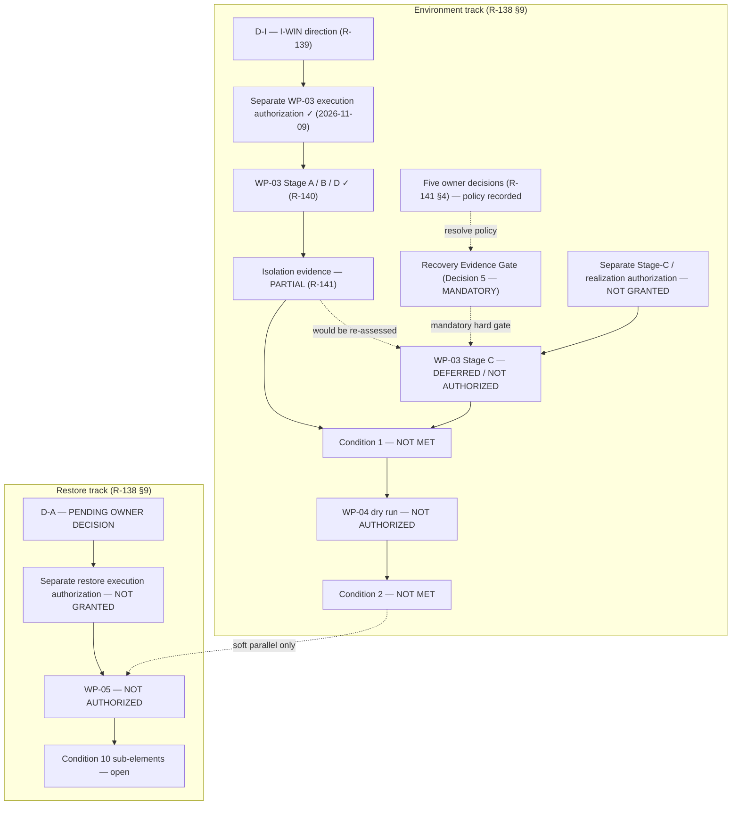

# Phase 12 — R-141: Owner Decisions, PostgreSQL ACL & Windows Firewall/WFP Evidence Addendum

**Status:** `DOCUMENTATION ONLY — EVIDENCE ADDENDUM — NO OPERATIONAL CHANGE — PHASE 12 REMAINS OPEN`

**Repository:** `D:\Default Project\company-ops-system`
**Branch:** `main`
**HEAD:** `f91ed2f9e81db3937e3bcbb1b44e5e2c44e175cf`
**Execution/report date:** `2026-11-09`

**Identifier check:** `R-141` was verified unused repo-wide before this document was written. No existing report was renumbered. No duplicate number was created.

---

## 1. Document metadata and status

| Field | Value |
|---|---|
| Report identifier | `R-141` |
| Series continuation | R-132 → R-133 → R-134 → R-135 → R-136 → R-137 (index correction to R-136) → R-138 → R-139 → R-140 → **R-141** |
| Document type | Addendum — consolidation of owner decisions and post-WP-03-Stage-A/B evidence |
| Operation class | Documentation only (T2 — evidence collection/recording per R-136 §F.1) |
| Authorized by | Owner instruction 2026-11-09, "COS Phase 12 — Owner Decisions, ACL & Firewall Evidence Addendum" |
| Modifies in body | **Nothing** — R-136, R-137, R-138, R-139, R-140, the D-I/I3 addendum, the Docker proposal, and all prior reports are untouched |
| Creates | This document only |
| Git operations | None (no stage, commit, push, reset, stash, clean) |

**Evidence-source convention used throughout this addendum:** material marked **Owner-Supplied** consists of inspection results supplied by the owner in the 2026-11-09 instruction (and its accompanying inspection results) after R-140 closed. They are recorded here as supplied; they were not re-executed by this documentation task, which is prohibited from performing operational inspection commands. Material marked **Verified (R-140)** is the R-140-session evidence, unchanged.

---

## 2. Purpose and scope

This addendum consolidates, without reinterpretation:

1. The owner's **five explicit decisions** following WP-03 Stage A/B (§4).
2. The **PostgreSQL ACL and role findings** (§6).
3. The **Windows Firewall and WFP evidence review**, including its completeness limitation (§7–§8).
4. The **revised assessment of network isolation and Condition 1** (§9–§10).
5. The **mandatory Recovery Evidence Gate** before Stage C (§12).
6. The **exact remaining authorization and execution dependencies** (§13).

**Out of scope (explicit):** any operational change. This report does not create databases, roles, ACLs, HBA rules, firewall rules, WFP filters, evidence directories, files outside this document, or anything else. §14 enumerates the boundary.

---

## 3. References

| Ref | Document | Role |
|---|---|---|
| R-136 | `phase-12-final-evidence-and-owner-decision-pack-r136.md` | Authoritative original Condition 1 wording (§D.1 row 1), option space (§E.9, incl. I4), WP-03 package definition (§G), prohibition on reusing the failed local provisioning approach without diagnosing `0xC0000142` (§G.1), PB-07 |
| R-137 | `phase-12-r136-index-and-sequencing-correction-r137.md` | Index/sequencing corrections to R-136 — preserved |
| R-138 | `phase-12-r137-identifier-and-dependency-integrity-correction-r138.md` | **Controlling dependency and authorization model (§9)**: owner decision ≠ execution authorization; separate WP-03 execution authorization; D-A → separate restore authorization → WP-05; condition 2 soft parallel for WP-05 |
| R-139 | `phase-12-owner-decision-amendment-r139-d-i-windows-native-pg18.md` | D-I amendment: `I-WIN — Windows Native PostgreSQL 18.4 running on the existing Windows host` (environment direction only; not a retro-selection of I4; **not** provisioning or Stage-C authorization) |
| R-140 | `phase-12-wp-03-stage-a-b-windows-native-execution-report-r140.md` | WP-03 Stage A/B/D execution evidence; Stage-A verdicts; **`CONDITIONAL — MORE OWNER DECISIONS OR EVIDENCE REQUIRED`** Stage-B conclusion; the five minimum owner decisions this addendum now answers |

---

## 4. Owner decisions 1–5 — recorded exactly as approved

The five decisions below respond to the five minimum owner decisions enumerated in R-140 §12. Each is recorded with the exact approval wording, its **authorization boundary**, and what it does **not** authorize.

These decisions **resolve the owner's previously outstanding policy choices** (R-140 §12 items 1–5). They do **not** retroactively convert R-140's `CONDITIONAL` Stage-B result into a `PASS`. They do **not** prove Condition 1. They do **not** authorize Stage C, PostgreSQL configuration changes, or database/role creation. Per the R-138 §9 model, an owner decision is not an execution authorization.

### 4.1 Decision 1 — Shared PostgreSQL instance risk — `APPROVED`

**Recorded owner decision:** the owner **accepts the shared-instance failure and blast-radius risk** associated with using the existing Windows host and its native PostgreSQL 18.4 instance.

Scope of this acceptance (R-140 §9.6's recommendations):

- Same Windows host (`PC-01`), same `postgresql-x64-18` service, same postmaster (R-140-verified PID 9168), shared superuser authority, joint service-failure exposure of `cos_db` / `cos_authz_unit` / `postgres` and any future validation database, and shared instance-level configuration/logs.

**Explicit distinctions (binding):**

- This is **acceptance of the shared-instance risk** — the residual R-136 §E.9 itself flags for an existing-managed-instance arrangement.
- It is **not evidence that database isolation has already been achieved.**
- It **does not satisfy Condition 1 automatically.**
- It **does not authorize** database creation, configuration changes, migrations, or Stage C.

Classification: `APPROVED` — owner risk acceptance recorded.

### 4.2 Decision 2 — Evidence storage location — `APPROVED`

**Recorded owner decision:** the approved evidence storage location is:

```
D:\COS\Phase12\WP03\Evidence
```

**Boundaries:**

- This task **documents the decision only**. The directory was **not created** by this documentation task, and no filesystem operations were performed against it, because this task does not carry such authorization.
- No evidence is claimed to have been **copied or placed** there. No source evidence currently exists that any Phase 12 evidence has been deposited in that location. Any future copying/organization of evidence files there requires its own authorization.
- R-140 §9.7's artifact-boundary rationale (separation from operational data and secrets) is unchanged and now has an owner-designated path.

Classification: `APPROVED` — destination designated; placement of evidence `NOT PERFORMED`.

### 4.3 Decision 3 — ACL and Firewall inspection — `APPROVED — INSPECTION REQUIRED`

**Recorded owner decision:** the owner **explicitly rejected skipping ACL and Firewall inspection**. Both inspections must be completed and their evidence **classified before Stage C can be considered**.

**Status against that requirement (as of this addendum):**

- **ACL inspection:** R-140 catalog queries were `NOT VERIFIED` (no credentials within safety rules). The owner has now **supplied** inspection results covering database ACLs (`pg_database.datacl`) and a role capability review (§6). To the extent of the supplied material, the owner's inspection requirement is **evidence-supported**; any items the supplied material does not cover remain `NOT VERIFIED`.
- **Firewall inspection:** R-140 recorded profile state and rule inventories with explicit access limitations; the owner has now **supplied** supplemental profile and rule-filter results and a WFP export (§7–§8). To the extent of the supplied material, reviewed; the **completeness limitation of the WFP export** (§8.2) and **external reachability** (§9) remain open.
- **Classification of every item** continues into §6–§9.

**Distinction recorded as required (binding):**

| Category | Status |
|---|---|
| **Inspection and evidence collection** | `REQUIRED` — read-only; supported by owner-supplied results and, where separately authorized, future read-only collection. Evidence files go to the Decision-2 location |
| **Configuration changes or remediation (ACL edits, HBA edits, firewall rule changes, WFP modifications, service restarts)** | `NOT AUTHORIZED` by R-141 and by this documentation task |

Classification: `APPROVED — INSPECTION REQUIRED`; remediation `NOT AUTHORIZED`.

### 4.4 Decision 4 — PostgreSQL HBA allowlist strategy — `APPROVED AS A DESIGN DIRECTION`

**Recorded owner decision:** the owner approves the strategy of **PostgreSQL HBA allowlisting** to restrict the future validator login to its intended test database, with explicit rejection rules for existing databases.

**Intended security principle (as approved), binding on future implementation:**

1. **Permit** the validator role only to the specifically approved test database.
2. **Explicitly reject** that validator role from existing databases (`cos_db`, `cos_authz_unit`, and appropriately handled maintenance databases).
3. **Order the rules correctly** — PostgreSQL HBA evaluates rules sequentially and applies the **first match**; permissive `all`-scoped rules must not precede the validator-specific rules. The existing active HBA rules already contain broad `host all all 127.0.0.1/32` / `::1/128` entries (§5.3) — rule **placement matters**, and any validated future HBA design must integrate with (not merely append to) the existing rule set, which is why the current broad rules were recorded in R-140 §7.2 and why this is treated as a design problem, not an append problem.
4. **Do not rely on a separate login alone** as sufficient database isolation — a new login role is not, by itself, a database boundary.
5. **Account for PUBLIC CONNECT** when evaluating effective database access — every login role inherits `PUBLIC` membership, and `PUBLIC`'s CONNECT privileges on existing databases are a real component of effective access (R-140 §8; §6.2 below).

**Critical distinction (binding):** this is approval of the **isolation strategy only**. It is **not authorization** to:

- edit `pg_hba.conf`,
- reload or restart PostgreSQL,
- create roles, create databases, or change ACLs,
- apply any configuration.

Implementation of the approved strategy requires its own separate owner authorization, plus the prerequisites recorded in §12/§13 (Recovery Evidence Gate, inspection classification, Stage-B acceptance).

Classification: `APPROVED AS A DESIGN DIRECTION` — implementation `NOT AUTHORIZED`.

### 4.5 Decision 5 — Recovery Evidence Gate — `APPROVED — MANDATORY BEFORE STAGE C`

**Recorded owner decision:** the owner requires **Recovery Evidence** to be **completed and reviewed before Stage C**.

This is a **hard prerequisite, not an optional recommendation**. The dependency remains explicit:

1. Recovery Evidence must be **produced**.
2. It must be **reviewed and accepted**.
3. The applicable owner decisions and **separate execution authorizations** must be in place.
4. **Only then** may Stage C be considered for **separate** authorization.

**Explicit boundaries (binding):**

- This decision is **not** authorization to execute backup or restore operations now. No backup or restore was performed and none is authorized by this addendum (§14).
- The shared-instance risk acceptance (Decision 1) does **not** bypass this gate: the gate exists precisely because the instance is shared — validated recovery of the existing operational databases must be demonstrated **before** new objects are created on that instance.
- §12 records the gate's dependency structure and flags a **sequencing clarification** required from the owner; no new dependency model was invented here.

Classification: `APPROVED — MANDATORY BEFORE STAGE C`; Recovery Evidence production `NOT STARTED — NOT AUTHORIZED BY THIS ADDENDUM`.

### 4.6 Decision-status summary

| # | Decision | Status | Authorizes execution? |
|---:|---|---|---|
| 1 | Shared-instance blast-radius risk | `APPROVED` — owner risk acceptance | No |
| 2 | Evidence location `D:\COS\Phase12\WP03\Evidence` | `APPROVED` — destination designated | No |
| 3 | ACL & Firewall inspection | `APPROVED — INSPECTION REQUIRED` (remediation `NOT AUTHORIZED`) | No |
| 4 | HBA allowlist strategy | `APPROVED AS A DESIGN DIRECTION` (implementation `NOT AUTHORIZED`) | No |
| 5 | Recovery Evidence Gate | `APPROVED — MANDATORY BEFORE STAGE C` | No (gate only) |

---

## 5. PostgreSQL environment summary

Environment facts remain as verified in R-140 (A1–A3) and documented in R-139 §2. PostgreSQL 17 remains untouched.

### 5.1 Services and installations

| Item | PostgreSQL 18 (I-WIN target) | PostgreSQL 17 (untouched) |
|---|---|---|
| Installation | `C:\Program Files\PostgreSQL\18` | `C:\Program Files\PostgreSQL\17` |
| Data directory | `C:\Program Files\PostgreSQL\18\data` | `C:\Program Files\PostgreSQL\17\data` |
| Windows service | `postgresql-x64-18` (`Running`/`Auto`; R-140-verified service PID 6460, postmaster PID 9168) | `postgresql-x64-17` (`Running`/`Auto`; R-140-verified postmaster PID 6172) |
| Port | `5432` | `5433` |
| Client/server tools | 18.4 (`postgres`, `pg_dump`, `pg_restore` — R-140-verified) | Not probed |

The two services are **independent** (R-140 §9.6: separate service processes; PG17 is not incidentally coupled). PostgreSQL 17 must remain untouched.

### 5.2 Existing PostgreSQL 18 databases — existing assets, to be preserved

| Database | Existing evidence |
|---|---|
| `cos_db` | **27 tables, approximately 12 MB, approximately 3,243 rows, 19 recorded migrations** (including `_migrations` ledger) |
| `cos_authz_unit` | **26 tables, approximately 9.4 MB, 36 actual rows, no `_migrations` table** in the inspected table listing |
| `postgres` | Maintenance database |

None of these is a disposable test database. Explicit prohibitions (restated, binding):

- **Do not use `cos_db`** for migration, restore, or validator experiments.
- **Do not connect the application to `cos_authz_unit` as a migration target** — the existing application migration runner may treat the migration files as **unapplied** because **no migration ledger was found** in `cos_authz_unit`; an application start against it could attempt to write migration or operational state.
- **Do not start the COS application** against either existing database.

### 5.3 Listener and HBA evidence (R-140-verified file reads; owner-consistent)

R-140-verified PostgreSQL 18 settings:

- `listen_addresses = '*'` (postgresql.conf line 60)
- `port = 5432` (line 64)
- **SSL is off** (consistent with R-140's file-level scan finding no active `ssl =` line in the main conf and no overrides in `postgresql.auto.conf`; the owner-supplied inspection result confirms **off**)
- Active HBA rules (R-140 §7.2, complete effective file set):

```
local   all             all             scram-sha-256
host    all             all             127.0.0.1/32            scram-sha-256
host    all             all             ::1/128                 scram-sha-256
local   replication     all             scram-sha-256
host    replication     all             127.0.0.1/32            scram-sha-256
host    replication     all             ::1/128                 scram-sha-256
```

Replication rules are restricted to local/loopback access.

**Interpretation (unchanged binding discipline):** `listen_addresses='*'` means PostgreSQL is **configured to listen on available interfaces** — R-140 verified wildcard-bound sockets owned by the PG postmaster. The inspected HBA rules **currently permit ordinary TCP authentication only through loopback addresses**. **Do not conclude that external reachability is proven or disproven by `listen_addresses` alone** — reachability requires the joint evaluation of listener binding, HBA rules, effective firewall/WFP filtering, and routing, and external reachability remains `NOT VERIFIED` (§9).

---

## 6. PostgreSQL ACL and role analysis (Owner-Supplied inspection results)

### 6.1 Evidence status

R-140 §8 recorded database ACLs as `NOT VERIFIED` (catalog unreachable without credentials within the session's safety rules). This gap has now been addressed by **Owner-Supplied inspection results**. Per the §1 convention they are recorded as supplied and are **not re-executed** here. The ACL/roles themselves are **not changed** (§14).

### 6.2 Database-level ACL findings (Owner-Supplied)

| Database | Supplied ACL evidence | Reading |
|---|---|---|
| `cos_db` | `datacl = {=Tc/cos,cos=CTc/cos}` | **`PUBLIC` holds `CONNECT` and `TEMPORARY`** (`=Tc/cos`: grants to `PUBLIC` by owner `cos` — T=TEMPORARY, c=CONNECT). `cos` is the **database owner** (`cos=CTc/cos`: CREATE, TEMPORARY, CONNECT) |
| `cos_authz_unit` | `datacl = NULL` | **Default privileges apply** — i.e., the PostgreSQL default database ACL, which grants `CONNECT`/`TEMPORARY` to `PUBLIC` |
| `postgres` | `datacl = NULL` | **Default privileges apply** — same default `PUBLIC` CONNECT/TEMPORARY posture |

### 6.3 Role finding (Owner-Supplied)

The inspected `cos` role: **not a superuser**, with **`CREATEDB` enabled**.

Classification: `Owner-Supplied` inspection result; recorded as supplied. Broader role-inventory items beyond the supplied material (full `pg_roles` enumeration, other roles' capability flags) remain as R-140 gap #4 — see §15.

### 6.4 Why the future validator needs explicit database-level isolation (required explanation)

The future validator **design** requires explicit database-level isolation for the following evidence-based reasons — this is why Decision 4 was needed and why "a separate login exists" is **not** a database boundary:

1. **A new login inherits `PUBLIC`.** Every login role is implicitly a member of `PUBLIC`. Whether the connection attempt succeeds is therefore governed not by "separate user exists" but by the **effective ACL** of the target database — which, per §6.2, includes **`PUBLIC` CONNECT** on `cos_db` (explicitly present, not assumed) and, under default privileges, on `cos_authz_unit` and `postgres`.
2. **HBA is not database-restricted today.** The active rules grant (from loopback) `all` → `all` with `scram-sha-256` (§5.3). A validly authenticated new role connecting from loopback **matches the existing broad rules** and proceeds to the ACL check — which permits CONNECT per #1.
3. **Effective consequence without remediation:** as-installed, a future validator login could **establish connections to `cos_db` and `cos_authz_unit` from loopback without any modification of those databases' ACLs** — exactly the exposure R-140 §9.4 identified from PostgreSQL's documented default behavior, now **corroborated by supplied ACL inspection** for `cos_db`.
4. **Decision 4's remedy shape follows directly:** because the exposure is created by the *combination* of broad existing HBA rules and `PUBLIC` CONNECT, isolation of the validator must **either** be enforced by ordered, validator-specific HBA rules (permit → test DB; reject → existing DBs; first-match ordering) **and/or** by explicit ACL action on existing databases — both of which are `NOT AUTHORIZED` outside a separate owner decision/authorization. Designing for **both** layers, as Decision 4 does, is defense in depth: HBA blocks the path at the authentication layer, ACL revocation removes the default grant. Neither layer alone is evidence of the other.

**No ACL, role, grant, or password was changed.** The ACLs above are recorded, not applied.

---

## 7. Windows Firewall profile evidence

### 7.1 Profile evidence (Owner-Supplied results; R-140 context preserved)

The owner-supplied PowerShell results show:

- **Domain, Private, and Public profiles are enabled.**
- **`DefaultInboundAction` is `Block` for all three profiles.**

**Reconciliation with R-140 (preserved, not erased):** R-140's non-elevated in-session read (A4-1) rendered `DefaultInboundAction = NotConfigured` on all three profiles and explicitly declined to convert the unconfirmable effective value into assumed safety. The owner's subsequently supplied results read **`Block`**. The two observations are recorded as **observations in different access contexts**; this addendum adopts the owner-supplied **`Block`** reading as the current evidence of record, and notes R-140's non-elevated rendering as the historical in-session observation. The discrepancy does not weaken either safety discipline: under **both** readings, no PostgreSQL program-scoped inbound allow rule and no 5432-scoped inbound rule was ever found (R-140 §6; §7.2 below), and **the effective external-reachability question remains `NOT VERIFIED` regardless of which default-action reading is used** (§9).

### 7.2 Candidate broad `Allow` rules (Owner-Supplied filtering)

The owner-supplied PowerShell filtering identified **31 candidate `Allow` rules** with broad-looking properties such as `Program = Any`, `LocalPort = Any`, `RemoteAddress = Any`, `Service = Any`.

**Binding interpretation:** these 31 candidates are **not** classified as unrestricted inbound permissions for PostgreSQL. Reasons:

1. Rule *properties* being broad in several fields does not mean the rule is broad **in all** fields, nor that it matches the PostgreSQL service — WFP-level parsing (§8) demonstrates that apparently broad candidate rules are in fact **scoped** (package identity, user SID, service SID, callout types).
2. R-140's independent application-filter enumeration found **zero** enabled inbound rules whose program filter matches `*postgres*` (R-140 §6, A4-2 — `Verified`), and the registry complement found **zero** stored rule values referencing `5432` or `postgres` (A4-4 — `Verified`).
3. A candidate-count discrepancy against R-140 is expected and traceable: R-140's in-session broad scan enumerated TCP any-port allow rules through `Get-NetFirewallPortFilter`, whose enumeration was **denied without elevation**, limiting that scan (27 enumerated); the owner-supplied filtering is the more complete enumeration (31 candidates). Neither enumerates a PostgreSQL-permitting rule.

### 7.3 Firewall action conclusion — `NO CHANGES INDICATED — NOT AUTHORIZED` (see §14)

No Windows Firewall change is indicated by the evidence currently available. Explicit non-actions bound to this evidence (and restated in §14): do **not** add a PostgreSQL inbound allow rule; do **not** disable or delete unrelated AppContainer/package-scoped rules; do **not** disable any profile; do **not** change inbound defaults; do **not** modify WFP filters; and (PostgreSQL side) do **not** modify listener or HBA settings as part of this documentation task.

---

## 8. WFP parsed-filter findings and completeness limitation

### 8.1 Completeness limitation (stated first — binding)

The supplied WFP output was **incomplete at its beginning**: the parsed material began **in the middle** of the original output, and the **full WFP XML root/preamble was not present**. Therefore the parsed set **must not be represented as a guaranteed complete export of all effective filters**.

All conclusions in this section apply **to the parsed material only**. Absence of a PostgreSQL-specific filter in the parsed set is **evidence of absence within that parsed set**, not proof that no such filter exists in the unparsed (or unexported) remainder of the effective filter set.

### 8.2 Parsed-entry counts

The parsed material contained **157 complete top-level filter entries**.

| Filter action | Count |
|---|---:|
| PERMIT | 104 |
| BLOCK | 19 |
| CALLOUT_TERMINATING | 16 |
| CALLOUT_INSPECTION | 12 |
| CALLOUT_UNKNOWN | 6 |

Callout-type actions (INSPECTION/UNKNOWN) are not terminal permit/block decisions and are not read as such.

### 8.3 Package-family-scoped filters

- **Eighty** parsed filters included `FWPM_CONDITION_ALE_PACKAGE_FAMILY_NAME`: **64 PERMIT** and **16 CALLOUT_TERMINATING**.
- These were associated with **specific packaged application identities**, including: Microsoft Store, Microsoft 365 Copilot, Microsoft Teams, Game Bar, KYOCERA Print Center, Windows Feature Experience Pack, OOBE, Win32WebViewHost.

**Binding interpretation:** these package-family-scoped filters must **not** be described as general inbound permissions for every ordinary desktop executable. PostgreSQL 18 runs as a `pg_ctl runservice` Windows service under `NT AUTHORITY\NetworkService` (R-140-verified, §4.1) — it is not a Microsoft Store packaged application, and no supplied evidence associates it with any of the listed package families.

### 8.4 User-SID scopes

- **Eighty-six** parsed filters included `FWPM_CONDITION_ALE_USER_ID`.

### 8.5 Port-overlapping entries — inspection callouts, not permits

Exactly **two** parsed filters included `FWPM_CONDITION_IP_LOCAL_PORT`, both IPv4 and IPv6 **FTP Inspection Filter** entries:

- Protocol **TCP**
- Local port range **1024–65535**
- Condition additionally involving `ALE_SIO_FIREWALL_SYSTEM_PORT`
- Action `FWP_ACTION_CALLOUT_UNKNOWN`

**Interpretation:** these two entries **overlap port 5432** numerically, but they are **inspection/callout filters**, not evidence of an explicit PostgreSQL PERMIT or BLOCK rule. They are not read as PostgreSQL permissions.

### 8.6 Negative findings within the parsed set

- **No explicit exact local-port 5432 condition** was found in the parsed WFP entries.
- **No `FWPM_CONDITION_ALE_APP_ID` condition** was found in the parsed entries — meaning no parsed filter was scoped by application executable path (i.e., no parsed filter names `postgres.exe` by application identity).

### 8.7 Specific rules that must not be over-read

1. **`InternetClientServer Inbound Default Rule`** appeared as PERMIT, but its conditions included **package identity** and a user security descriptor associated with an **AppContainer capability SID (`S-1-15-3-2`)**. It must **not** be described as a universal permission for the PostgreSQL desktop service.
2. **`WSH Default Inbound Block`** appeared for **service SIDs**. The evidence **did not establish** that those SIDs map to the PostgreSQL service running under `NetworkService`. No network-isolation claim is built on this entry.

### 8.8 WFP classification summary

| Finding | Status |
|---|---|
| Parsed-entry counts (§8.2) | `Owner-Supplied — parsed set only` |
| Completeness | **`NOT VERIFIED — export incomplete at beginning`** |
| Explicit PostgreSQL APP_ID / exact-5432 PERMIT or BLOCK filter | `NOT FOUND (within parsed set)` — not a proven absence system-wide |
| Package-family / user-SID scoping of broad-looking rules | `Owner-Supplied — Verified within parsed set` |
| FTP inspection callouts overlapping 5432 | `Owner-Supplied — CALLOUT_UNKNOWN, not a PostgreSQL rule` |

---

## 9. Network isolation assessment

### 9.1 Joint evaluation

| Layer | Evidence | Status |
|---|---|---|
| Listener binding | Wildcard bind (`listen_addresses='*'`; sockets `0.0.0.0:5432`, `::5432` owned by PG18 postmaster — R-140) | `Verified (R-140)` |
| HBA authentication rules | Loopback-only TCP rules (`127.0.0.1/32`, `::1/128`), `all`→`all`, `scram-sha-256` — R-140 §7.2, consistent with §5.3 here | `Verified (R-140)` |
| Firewall profiles | All enabled; owner-supplied `DefaultInboundAction = Block` on all three (R-140 rendered `NotConfigured` non-elevated — §7.1) | `Owner-Supplied` |
| Firewall rules | No program or port-scoped PostgreSQL/5432 inbound rule (R-140 application-filter + registry scans; 31 broad-looking candidates exist, §7.2) | `Verified (R-140) + Owner-Supplied` |
| WFP layer | Many broad-looking rules actually package-family/user-SID scoped; no exact-5432 permit found; callout inspection filters overlap 5432; **export incomplete** (§8) | `Owner-Supplied — COMPLETENESS LIMITED` |

### 9.2 Conclusion — restrictive inbound posture is *substantially supported*; external reachability remains `NOT VERIFIED`

**Substantially supported restrictive posture** (each supported by cited evidence):

- Windows Firewall profiles are **enabled** and the owner-supplied default inbound action is **Block** on all three profiles (§7.1).
- **No explicit PostgreSQL-specific inbound allow rule** and **no exact port 5432 PERMIT filter** was identified in the parsed WFP material (§8.5–§8.6), and none was identified at the firewall-rule layer (R-140 §6 + §7.2).
- The broad-looking firewall candidates were **not demonstrated** to be general inbound permits for `postgres.exe`; WFP parsing shows many are scoped to packaged application identities or other security conditions (§8.3, §8.7).
- PostgreSQL **HBA currently restricts the inspected TCP authentication rules to loopback** (§5.3).

**However — binding final status:**

> **External reachability remains `NOT VERIFIED`.**

- **No outside-device or independent external-vantage connection test was performed.** R-140 recorded `NOT VERIFIED — external vantage not authorized/available`; nothing in this addendum changes that classification, because this task performs no network operations.
- The WFP output is **not, by itself, proof that external access is impossible** — and its **completeness limitation** (§8.1) independently prevents any claim that the full effective filter set has been reviewed.
- The distinction between "a restrictive posture is supported" and "external access is proven impossible" is preserved exactly as in R-140: the former is evidence-supported; the latter is **not established**.

**Network-boundary implication for Condition 1:** the "isolated network posture" element remains **incompletely evidenced**; the HBA allowlist strategy (Decision 4) is **approved but not implemented or verified**, so the privilege/network enforcement layer that a future Stage-C assessment would rely on **does not yet exist**.

---

## 10. Condition 1 — exact criteria assessment

### 10.1 Original wording (R-136 §D.1 row 1 — quoted verbatim, unchanged)

> | **1** | Isolated PostgreSQL 18 environment provisioned (VM, separate host, or approved container); isolation evidence reviewed; no `0xC0000142` | **`Not met`** | `phase-12-stage-2b-report.md`: local provisioning crashed `0xC0000142`; clusters stopped. No VM/host/container exists | A working, isolated PG 18 instance and evidence of isolation | Provision **and** review isolation evidence; a local retry that crashes again does not satisfy it | Required — `D-I` | Root dependency for 2, 9, 10 (test), 14 |

Original *Missing evidence* requirement: **"A working, isolated PG 18 instance and evidence of isolation"**. Original closure requirement: "**Provision and review isolation evidence**". No replacement criteria are used; the assessment below is against the original text only.

### 10.2 Criterion-by-criterion assessment

| # | Original criterion | Current evidence | Status | Reason |
|---|---|---|---|---|
| 1a | "Isolated PostgreSQL 18 environment provisioned" | A **working** PG 18.4 instance exists on the host (R-140-verified: service running, accepting connections, correct versions). Whether the arrangement is **isolated** depends on 1b–1c and the remaining unseen criteria. The I-WIN direction is R-139-approved; R-140 §9.2 established that original criteria permit a same-host arrangement only with owner-accepted shared-instance blast radius (I4 lineage) | **`NOT MET` as an *isolated* environment** (the *working* component is `Verified`) | The word "isolated" is not yet earned: database-level enforcement does not exist (validator DB/role absent; HBA allowlist unimplemented; PUBLIC CONNECT exposure corroborated, §6), and network exposure is not fully characterized (§9) |
| 1b | "isolation evidence reviewed" | Isolation evidence now covers: database ACL/role facts (Owner-Supplied, §6), firewall profile/rule evidence (R-140 + Owner-Supplied, §7), WFP parsing with **completeness limitation** (§8), listener/HBA facts (R-140, §5.3). Reviewed here and in R-140 | **`NOT MET` (partially evidenced)** — with one sub-item explicitly `NOT VERIFIED` | Mandatory isolation properties remain unproven: (i) **privilege enforcement** — PENDING the implemented+verified HBA allowlist and X ACL decision; (ii) **effective network exposure** — `NOT VERIFIED` (no external-vantage test; WFP export incomplete); (iii) **recovery/lifecycle** — Recovery Evidence Gate not satisfied (§12) |
| 1c | "no `0xC0000142`" | Under I-WIN there is **no provisioning at all** — no `initdb`/cluster creation, no container. No recurrence of the Stage-2B crash has or could occur | **`VERIFIED` (structural)** | Non-recurrence is structurally satisfied; this remains the only fully-clean criterion |
| — | Criterion that cannot be fully assessed from available evidence (as required by §5 of the task) | **Effective external reachability of port 5432** — cannot be assessed without an external-vantage test (not authorized) and a complete WFP export (not available) | **`NOT VERIFIED`** | Reason: no outside-device or independent external-vantage connection test was performed (§9.2); the supplied WFP export is incomplete at its beginning (§8.1). This criterion element remains explicitly outstanding |

### 10.3 Condition 1 overall status

> **CONDITION 1: NOT MET** — unchanged from R-139/R-140. **This addendum does not change it.**

Explicitly preserved: owner acceptance of the shared-instance blast-radius risk is **documented** (Decision 1), but does **not itself prove isolation**; the HBA allowlist is an **approved design direction, not yet implemented or verified**; ACL and Firewall inspections have been **performed to the extent supported by available evidence**; the supplied WFP material has a **completeness limitation**; external-vantage reachability remains **unverified**; and any original Condition 1 requirement not proven by existing evidence (privilege enforcement, effective network exposure, recovery evidence) must remain **explicitly outstanding** — as tabulated above.

No status label in this addendum reads as `PASS`, and no criterion is assumed satisfied by the owner decisions.

---

## 11. WP-03 stage/status summary (preserved from R-140; effect of the five decisions)

### 11.1 Stage status — preserved

| Stage | Status |
|---|---|
| Stage A — read-only environment re-verification | `COMPLETED` (R-140, with documented access limitations) |
| Stage B — isolation assessment | `COMPLETED WITH LIMITATIONS` — `CONDITIONAL — MORE OWNER DECISIONS OR EVIDENCE REQUIRED` (R-140 §9.10) |
| Stage D — evidence report | `COMPLETED` (R-140) |
| Stage C — validation database/role creation | `DEFERRED — NOT AUTHORIZED` |

### 11.2 Effect of the five owner decisions — clarified (binding)

| The decisions... | ...and not |
|---|---|
| **Resolve** the owner's previously outstanding policy choices (R-140 §12 items 1–5) | ❌ do not retroactively convert R-140's `CONDITIONAL` Stage-B result into a `PASS` |
| Record explicit risk acceptance, an evidence destination, an inspection mandate, a design direction, and a hard gate | ❌ do not prove Condition 1 |
| Create the owner-side preconditions for a future Stage-C decision package | ❌ do not authorize Stage C |
| Permit documented **future evidence collection** where separately authorized | ❌ do not authorize PostgreSQL configuration changes or database/role creation |

R-140 §12's five minimum decisions are thereby **answered in policy**; the evidence and implementation legs they presuppose are tracked in §15 and §13 respectively.

### 11.3 Evidence destination status

The owner-approved destination is `D:\COS\Phase12\WP03\Evidence` (§4.2). **No claim is made that evidence has been copied or placed there.** No source evidence currently proves any Phase 12 evidence has been deposited in that location. Its population is a future, separately-authorized activity.

---

## 12. Recovery Evidence Gate

### 12.1 The gate as approved

**Decision 5 makes Recovery Evidence a `MANDATORY` gate before Stage C.** The gate is a **hard prerequisite**, not an optional recommendation:

```
Recovery Evidence  →  produced  →  reviewed  →  accepted  →  prerequisite owner decisions/authorizations in place
                                                                                        ↓
                                                                       Stage C considered for SEPARATE authorization
```

The gate's purpose follows from Decision 1's acceptance: because the validation environment shares the instance with `cos_db`, `cos_authz_unit`, and `postgres`, **validated recovery of the existing operational databases must be demonstrated before new objects are created on that instance**. The gate is therefore **not bypassable by the risk acceptance** — the risk acceptance is the reason for the gate, not a reason around it.

### 12.2 Dependency model relationships (R-138 preserved)

Governing model remains R-138 §9, unchanged:

| Chain | R-138 model (preserved) | Current status |
|---|---|---|
| Environment | `D-I` (via **I-WIN**, R-139) → **separate WP-03 execution authorization** → WP-03 → isolation evidence → Condition 1 | WP-03 Stage A/B/D executed (R-140); isolation evidence partial (R-141); Condition 1 `NOT MET` |
| Dry run | `Condition 1` → **separate WP-04 authorization** → PG18 migration dry run → Condition 2 | Condition 1 open; WP-04 `NOT AUTHORIZED` |
| Restore | `D-A` → **separate restore execution authorization** → WP-05 → restore rehearsal → condition-10 sub-element reassessment | `D-A` `PENDING OWNER DECISION`; restore authorization absent; WP-05 `NOT AUTHORIZED` |
| Condition 2 → WP-05 | **Soft/recommended parallel**, not a hard dependency (R-138 §9.1 restore path) | Preserved unchanged |

### 12.3 Unresolved sequencing clarification — flagged, not invented

**The exact order and scope of the Recovery Evidence work relative to WP-05 authorization is not fully determined by R-138**, and this addendum preserves R-138's original authorization model rather than inventing a new one. Two readings of Decision 5 exist under the R-138 model, and the owner is asked to specify which applies before the Recovery Evidence work is scoped:

1. **Reading A — Recovery Evidence = WP-05/condition-10-class evidence against the existing shared instance:** under R-138's restore path, a restore requires `D-A` + a **separate restore execution authorization**, and the graph gates the restore rehearsal on an isolated, version-consistent target. If the Recovery Evidence Gate is satisfied by a WP-05-style validated restore, then the ordering question — "gate before Stage C" vs. "WP-05 authorization normally follows Stage C/Condition-1 work" — becomes a genuine **dependency tension that only the owner can resolve** (e.g., by authorizing a bounded, existing-database-protective backup/verification sequence on the shared instance as the gate's evidence, without a full restore rehearsal).
2. **Reading B — Recovery Evidence = a narrower, separately-scoped backup/verification sequence** (bounded, read/verify-class evidence about the existing instance, produced under its own authorization) that precedes Stage C, with the full WP-05 restore rehearsal remaining a later, independent chain.

**Both readings hold Decision 5 as a hard gate.** The addendum **does not select between them**, does **not** define the gate's scope on its own authority, and does **not** authorize either. This ambiguity is flagged as **required owner clarification** in §15. In either reading: **D-A remains pending; a separate Restore execution authorization remains required; no backup/restore is authorized now; the gate must not be bypassed because the shared-instance risk was accepted.**

---

## 13. Updated dependency and authorization matrix

### 13.1 Dependencies (R-138 model preserved; additions are owner-decision overlays, not model rewrites)



Solid arrows are the R-138 model. Dotted arrows are the R-141 owner-decision overlays (policy-level; they grant nothing).

### 13.2 Authorization state

| Item | Status |
|---|---|
| `D-I` / **I-WIN** | `APPROVED` — environment direction only (R-139) |
| I3 (container) | `SUPERSEDED — HISTORICAL` (record preserved; not erased) |
| Separate WP-03 execution authorization | `GRANTED` (2026-11-09) — consumed by R-140's Stage A/B/D |
| Owner decisions 1–5 | `APPROVED` / `APPROVED AS DESIGN DIRECTION` / `APPROVED — MANDATORY` as per §4.6 |
| **Stage C** | **`NOT AUTHORIZED`** — while authorization phases remain: Decision-5 gate unsatisfied + Condition 1 not met + no separate Stage-C authorization |
| WP-04 | `NOT AUTHORIZED` (requires Condition 1 + separate authorization) |
| `D-A` | `PENDING OWNER DECISION` (unchanged) |
| Separate restore execution authorization | `NOT GRANTED` (unchanged) |
| WP-05 | `NOT AUTHORIZED` |
| Stage 3 / Phase 13 | **`NOT AUTHORIZED`** — and no language anywhere in this addendum may be read as approving Phase 13, migration/API adapter, application integration, or production deployment |

---

## 14. Explicit prohibited actions and scope boundary

This task authorized **only** the creation of this documentation addendum. The following are **absolutely prohibited in this task and were not performed** (each confirmed non-action):

| Category | Prohibited non-actions (confirmed) |
|---|---|
| PostgreSQL objects | Creating or dropping databases; creating, altering, dropping roles; changing database ACLs or ownership |
| PostgreSQL configuration | Editing `pg_hba.conf`; editing `postgresql.conf`; **implementing the approved-but-unimplemented HBA allowlist**; reloading or restarting PostgreSQL services; changing ports or listen addresses |
| Windows Firewall / WFP | Adding, deleting, enabling, disabling firewall rules; changing profiles or defaults; editing WFP filters |
| Data operations | Running migrations; running the COS application against any existing database; running backups or restores; running destructive or write-capable database tests |
| Stages/work packages | Executing Stage C; executing WP-04 or WP-05; starting Stage 3 or Phase 13 |
| Application code | Changing backend source code, frontend source code, API contracts, schemas, RBAC, or application behavior |
| Historical record | Modifying historical reports (R-136–R-140, D-I/I3 addendum, Docker proposal) to force consistency with this addendum — none was touched |
| Filesystem (beyond this document) | Creating the evidence directory `D:\COS\Phase12\WP03\Evidence`; moving or copying evidence as an operational action — **neither occurred**; population of that location is a future, separately-authorized activity |
| Git | Staging, committing, pushing, resetting, stashing, cleaning — none performed |

Where additional evidence would help, it is recorded as a **future evidence requirement** (§15), to be collected only under explicit authorization — not collected here through any configuration or system change.

---

## 15. Outstanding evidence and decisions

### 15.1 Outstanding evidence (each with blocking reason)

| # | Item | Status | Blocking reason / next lawful step |
|---|---|---|---|
| 1 | **External reachability of 5432** (outside-device / external-vantage test) | `NOT VERIFIED` | External-vantage testing requires explicit authorization and a designated vantage point; never converted into assumed safety (R-140/R-141 discipline) |
| 2 | **Complete WFP filter export** (with root/preamble) | `NOT VERIFIED` — supplied export incomplete at beginning | Full `netsh wfp` export with preamble under read-only inspection authorization would close the completeness limitation of §8 |
| 3 | **Privilege enforcement demonstration** | `PENDING` — design approved (Decision 4), not implemented | Requires separate authorization to implement + verify the ordered HBA allowlist (and/or ACL action), after which re-verification occurs — none authorized now |
| 4 | **Recovery Evidence** (the Decision-5 gate) | `NOT STARTED` | Requires owner clarification of scope/ordering (§12.3), plus the applicable owner decisions and separate execution authorizations |
| 5 | Full role inventory (`pg_roles`) beyond the supplied `cos` finding | Partially addressed (Owner-Supplied) | Owner-supplied coverage recorded; completeness beyond supplied material unverified |
| 6 | Recovery/lifecycle story for the shared instance before destructive-capable operations | `NOT ESTABLISHED` | Same gate as #4 (R-140 §9.8 preserved) |

### 15.2 Outstanding owner decisions / clarifications required

| # | Decision / clarification | Ask |
|---|---|---|
| 1 | **Recovery Evidence Gate scope/ordering** (§12.3) | Choose Reading A or Reading B (and define the evidence's bounded scope) so the gate can be scoped without inventing a dependency |
| 2 | **ACL enforcement decision** (R-140 §12 item 4, still open) | Whether `REVOKE CONNECT ... FROM PUBLIC` on existing databases (or an alternative ACL measure) is approved as a separate, explicitly scoped decision — `NOT AUTHORIZED` without it |
| 3 | **Private/maintenance database stance** | How `postgres` (and any other databases) should be treated by the future validator-specific HBA rules — needed for the validated HBA design deliverable |
| 4 | **Evidence-deposition authorization** | Whether/when the population of `D:\COS\Phase12\WP03\Evidence` is authorized (Decision 2 designated the location; deposition remains unauthorized) |
| 5 | **External-vantage test authorization** (#15.1-1) | Whether an external reachability test will ever be authorized, and with what designated vantage |

### 15.3 Condition-1 assessment dependency

Only after items 1–4 (privilege enforcement) and 1–2 (network evidence) and 4 (recovery gate) are satisfied can the "isolated environment" and "isolation evidence reviewed" criteria of R-136 Condition 1 be **re-assessed** — never assumed. Until then, Condition 1 remains `NOT MET` and may not be upgraded (§10).

---

## 16. Final owner-facing conclusion

The position below is stated unambiguously:

- The **five owner decisions are now explicitly documented** (§4, exactly as approved).
- The **shared-instance risk has been accepted** by the owner — recorded as explicit risk acceptance, not as proof of isolation.
- The **evidence destination has been approved**: `D:\COS\Phase12\WP03\Evidence` — designated; **not created or populated** by this task.
- **ACL and Firewall inspection is required** and has been **reviewed to the extent supported by available evidence** (Owner-Supplied ACL/role results §6; profile/rule results §7; parsed WFP material §8).
- The **HBA allowlist approach is approved as a future isolation design direction only** — implementation, reload, role/DB creation, and ACL changes are all **not authorized**.
- The **WFP evidence does not justify changing Windows Firewall rules** — no PostgreSQL-specific inbound rule or exact-5432 permit was identified within the parsed set, no change is indicated, and none may be made as a result of this addendum.
- **External reachability remains `NOT VERIFIED`** — no outside-device or independent external-vantage test was performed; the WFP export's completeness limitation stands recorded.
- **Condition 1 remains `NOT MET`** — risk acceptance, design-direction approval, and inspection reviews do not satisfy it; privilege enforcement and recovery evidence remain unrealized.
- **Recovery Evidence is a mandatory gate before Stage C** — hard prerequisite, recorded exactly as Decision 5 states it (`APPROVED — MANDATORY BEFORE STAGE C`); not bypassable via the risk acceptance.
- **`D-A` and separate restore execution authorization remain outstanding.**
- **Stage C remains `NOT AUTHORIZED`.**
- **WP-04, WP-05, Stage 3, and Phase 13 must not be represented as authorized.**
- **This report does not authorize any operational system changes.**

Phase 12 remains open. The next lawful steps are the owner clarifications in §15.2; until those are provided and the pertinent authorizations granted, **no operational action follows from this addendum**.

---

**End of R-141. Stop here.**
