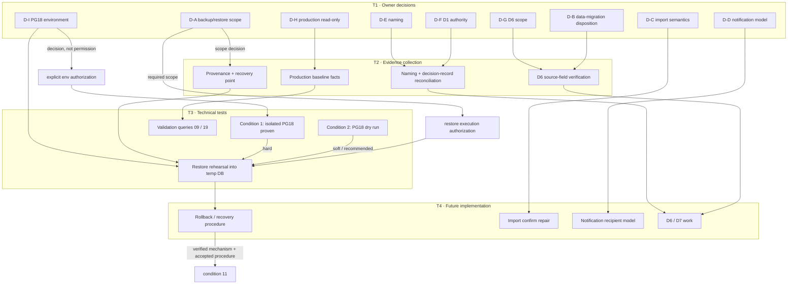

# Phase 12 — R-137: R-136 Index Integrity & Sequencing Correction

**Status:** `DOCUMENTATION ONLY — CORRECTION — PHASE 12 REMAINS OPEN`

**Supersedes:** only the three identically identified interpretations inside R-136. R-137 does **not** supersede R-136 as a whole.

**Precedence:** R-137 > R-136. Where R-137 states a corrected identifier rule, dependency distinction, or PB-03 wording, that statement is authoritative for any subsequent Phase 12 document. R-136's other content — statuses, severities, decisions, recommendations, the fifteen-condition arithmetic, and all inherited-source classifications — remains in force unchanged.

---

## 1. Objective and scope

R-137 is a narrowly scoped documentation correction to R-136. It addresses exactly three issues:

1. Identifier duplication and incorrect uniqueness claims in the R-136 canonical register.
2. Dependency and sequencing inconsistencies between Sections F.2, F.3, F.4 and WP-03/WP-04/WP-05.
3. Overstated runtime wording for PB-03 (`data-migration.ts`).

This is **not** a new technical audit. It does not re-open application-source verification, change any finding severity or exit-condition status, change any owner decision or recommendation, or authorize execution.

### 1.1 Baseline and working-tree state

- Repository root: `D:/Default Project/company-ops-system`
- Branch: `main`
- HEAD: `f91ed2f9e81db3937e3bcbb1b44e5e2c44e175cf`
- Remote: `https://github.com/mamin144/company-ops-system.git`
- Working tree before R-137: **dirty — 27 porcelain entries** (`24 modified tracked`, `3 untracked`)

The working tree is preserved exactly as-is. No Git write is performed.

### 1.2 Authorized reading

Read:

1. R-136: `phase-12-final-evidence-and-owner-decision-pack-r136.md`
2. R-132, R-133, R-134, R-135 only as needed to reconcile historical identifier ownership and the previously established dependency evidence.

Existing Phase 12 Markdown is read-only. Application source is **not** re-read, no runtime environment is inspected, and no prior technical finding is independently re-verified. R-137 does not claim that inherited source findings were independently verified.

---

## 2. Correction A — Identifier ownership and index integrity

### 2.1 The R-136 statements being corrected

R-136 states, in B.1 **ID policy**:

> "A historical ID appears **exactly once** in this register, either as a canonical ID or in exactly one alias cell. It never appears twice."

That claim is inaccurate. In R-136's own body, several `X-` correction identifiers appear both:

- as aliases in PB/TR/NB/DI finding rows, and
- as independent canonical rows in B.6.

Examples: `X-01` … `X-06`, `X-07` and `X-08`, `X-09` … `X-14`, and `X-18`.

Some namespaced `U-` identifiers also appear more than once across finding aliases and the unknowns table, e.g. `U-R132-01` and `U-R134-10`, and possibly `Q-4` across more than one alias cell.

Additionally, R-136's coverage statement (B.8) says every R-132 contradiction register identifier is present exactly once, yet it explicitly accounts only for **C-28** and does not enumerate **C-01 … C-27**. Their namespace and ownership must be stated from the source records.

### 2.2 Corrected identifier rules

Introduce a strict two-category ownership model. Ownership means the identifier is the **formal canonical or alias field** of a register row.

**A. Finding-ownership IDs** — each belongs to exactly one row in the findings/unknowns register (B.2–B.5):

- `F-01` … `F-20` (20)
- `G-01` … `G-08` (8, including withdrawn `G-03`)
- `N-01` … `N-08` (8)
- all 35 namespaced `U-` identifiers (`U-R132-01`…`14`, `U-R134-01`…`11`, `U-R135-01`…`10`)
- `Q-1` … `Q-6` (6)

**B. Correction-record IDs** — each belongs to the dedicated superseded-claim register (B.6):

- `X-01` … `X-19` (19)
- `R134-C01` … `R134-C21` (21)
- `CR-01` … `CR-12` (12)

**Cross-reference rule.** Correction IDs must **not** be duplicated as aliases in the PB/TR/NB/DI/UN ownership tables. A correction row may refer to multiple findings, and a finding may be affected by multiple corrections; such relationships are legitimate **cross-references**, not duplicate ownership, and are recorded in a dedicated `Related correction records` field (not in the `Aliases` field). Ordinary explanatory prose mentioning an identifier more than once is **not** duplicate ownership; the uniqueness check applies only to formal ownership/index fields.

### 2.3 Identifier reconciliation

Reconciliation performed against the exact ID fields in R-136's rows. Where an ID appears in an `Aliases` cell or a "Related correction records" reference, it is classified as a cross-reference, not as a second ownership.

#### 2.3.1 F-series (finding ownership)

| Identifier | Namespace | Owning row | Other references | Status | Reconciliation result |
|---|---|---|---|---|---|
| F-01 | F | PB-03 | X-05 (cross-ref), C-08 (cross-ref) | Active | Unique ownership |
| F-02 | F | PB-01 | G-06 (cross-ref, route shape only), X-07 (cross-ref), X-08 (cross-ref), C-28 (cross-ref) | Active | Unique ownership |
| F-03 | F | TR-01 | G-06 (cross-ref) | Active | Unique ownership |
| F-04 | F | TR-02 | (none) | Active | Unique ownership |
| F-05 | F | TR-03 | X-01 (cross-ref), X-02 (cross-ref), X-03 (cross-ref), X-04 (cross-ref), N-01 (cross-ref) | Active | Unique ownership |
| F-06 | F | TR-04 | G-01 (cross-ref) | Active | Unique ownership |
| F-07 | F | TR-05 | G-02 (cross-ref) | Active | Unique ownership |
| F-08 | F | TR-06 | G-04 (cross-ref) | Active | Unique ownership |
| F-09 | F | TR-07 | G-08 (cross-ref) | Active | Unique ownership |
| F-10 | F | TR-08 | (none) | Active | Unique ownership |
| F-11 | F | TR-09 | (none) | Active | Unique ownership |
| F-12 | F | TR-10 | (none) | Active | Unique ownership |
| F-13 | F | TR-11 | X-10 (cross-ref), X-11 (cross-ref), X-12 (cross-ref), R134-C15 (cross-ref), N-02 (cross-ref), N-03 (cross-ref) | Active | Unique ownership |
| F-14 | F | DI-01 | X-14 (cross-ref), C-22 (cross-ref) | Active | Unique ownership |
| F-15 | F | PB-05 | X-14 (cross-ref) | Active | Unique ownership |
| F-16 | F | PB-04 | C-27 (cross-ref) | Active | Unique ownership |
| F-17 | F | PB-02 | X-17 (cross-ref) | Active | Unique ownership |
| F-18 | F | DI-02 | X-13 (cross-ref), C-23 (cross-ref) | Active | Unique ownership |
| F-19 | F | PB-06 | X-18 (cross-ref), Q-4 (cross-ref) | Active | Unique ownership |
| F-20 | F | DI-03 | C-26 (cross-ref) | Active | Unique ownership |

20/20 reconciled, zero duplicate ownership.

#### 2.3.2 G-series (finding ownership incl. withdrawn)

| Identifier | Namespace | Owning row | Other references | Status | Reconciliation result |
|---|---|---|---|---|---|
| G-01 | G | TR-04 alias cell | (route shape only) | Active | Valid cross-reference (alias of F-06) |
| G-02 | G | TR-05 alias cell | (route shape only) | Active | Valid cross-reference (alias of F-07) |
| G-03 | G | B.7 | (retained, not deleted) | **Withdrawn — not a gap** | Corrected; no duplicate ownership |
| G-04 | G | TR-06 alias cell | (route shape only) | Active | Valid cross-reference (alias of F-08) |
| G-05 | G | TR-12 alias cell | (route shape only) | Active | Valid cross-reference (alias of F-12) |
| G-06 | G | B.2/B.3 alias cells | F-02, F-03 | Active | Valid cross-reference (alias of F-02 / F-03) |
| G-07 | G | TR-13 alias cell | (route shape only) | Active | Valid cross-reference (alias of F-13) |
| G-08 | G | TR-07 alias cell | (route shape only) | Active | Valid cross-reference (alias of F-09) |

8/8 reconciled, zero duplicate ownership.

#### 2.3.3 N-series (finding ownership)

| Identifier | Namespace | Owning row | Other references | Status | Reconciliation result |
|---|---|---|---|---|---|
| N-01 | N | TR-03, NB-01 alias cells | X-03 (cross-ref) | Active | Unique ownership |
| N-02 | N | TR-11, TR-14 alias cells | X-10, X-11, X-12 (cross-refs) | Active | Unique ownership |
| N-03 | N | TR-11, TR-15 alias cells | X-11 (cross-ref) | Active | Unique ownership |
| N-04 | N | NB-02 | X-12 (cross-ref) | Active | Unique ownership |
| N-05 | N | DI-04 | U-R135-02 (cross-ref), Q-2 (cross-ref) | Active | Unique ownership |
| N-06 | N | UN-17 alias cell | (see UN-17) | Active | Valid cross-reference (alias of UN-17) |
| N-07 | N | TR-16 alias cell | X-09 (cross-ref), U-R134-10 (cross-ref), Q-6 (cross-ref) | Active | Unique ownership |
| N-08 | N | NB-03 | (none) | Active | Unique ownership |

8/8 reconciled, zero duplicate ownership.

#### 2.3.4 U-series (unknowns — 35, preserving R-132/R-134/R-135 provenance)

| Identifier | Namespace (source) | Owning row | Other references | Status | Reconciliation result |
|---|---|---|---|---|---|
| U-R132-01 | R-132 | UN-01 alias cell | PB-07, condition 1 | Active | Unique ownership |
| U-R132-02 | R-132 | UN-02 alias cell | (none) | Active | Unique ownership |
| U-R132-03 | R-132 | UN-03 alias cell | (none) | Active | Unique ownership |
| U-R132-04 | R-132 | UN-04 alias cell | (none) | Active | Unique ownership |
| U-R132-05 | R-132 | UN-05 alias cell | (none) | Active | Unique ownership |
| U-R132-06 | R-132 | UN-06 alias cell | (none) | Active | Unique ownership |
| U-R132-07 | R-132 | UN-07 alias cell | (none) | Active | Unique ownership |
| U-R132-08 | R-132 | UN-08 alias cell | (none) | Active | Unique ownership |
| U-R132-09 | R-132 | UN-09 alias cell | (none) | Active | Unique ownership |
| U-R132-10 | R-132 | UN-10 alias cell | (none) | Active | Unique ownership |
| U-R132-11 | R-132 | UN-11 alias cell | (none) | Active | Unique ownership |
| U-R132-12 | R-132 | UN-12 alias cell | (none) | Active | Unique ownership |
| U-R132-13 | R-132 | UN-13 alias cell | (none) | Active | Unique ownership |
| U-R132-14 | R-132 | UN-14 alias cell | (none) | Active | Unique ownership |
| U-R134-01 | R-134 | UN-18 alias cell | (none) | Active | Unique ownership |
| U-R134-02 | R-134 | UN-19 alias cell | (none) | Active | Unique ownership |
| U-R134-03 | R-134 | UN-02 alias cell | (none) | Active | Valid cross-reference (alias of UN-02) |
| U-R134-04 | R-134 | UN-20 alias cell | (none) | Active | Unique ownership |
| U-R134-05 | R-134 | UN-17 alias cell | (none) | Active | Valid cross-reference (alias of UN-17) |
| U-R134-06 | R-134 | UN-17 alias cell | (none) | Active | Valid cross-reference (alias of UN-17) |
| U-R134-07 | R-134 | UN-21 alias cell | (none) | Active | Unique ownership |
| U-R134-08 | R-134 | UN-22 alias cell | (none) | Active | Unique ownership |
| U-R134-09 | R-134 | UN-23 alias cell | (none) | Active | Unique ownership |
| U-R134-10 | R-134 | UN-24 alias cell | TR-16, Q-6 | Active | Unique ownership |
| U-R134-11 | R-134 | UN-25 alias cell | (none) | Active | Unique ownership |
| U-R135-01 | R-135 | UN-17 alias cell | (none) | Active | Valid cross-reference (alias of UN-17) |
| U-R135-02 | R-135 | UN-26 alias cell | DI-04 | Active | Unique ownership |
| U-R135-03 | R-135 | UN-19 alias cell | (none) | Active | Valid cross-reference (alias of UN-19) |
| U-R135-04 | R-135 | UN-27 alias cell | (none) | Active | Unique ownership |
| U-R135-05 | R-135 | UN-27 alias cell | (none) | Active | Valid cross-reference (alias of UN-27) |
| U-R135-06 | R-135 | UN-18 alias cell | (none) | Active | Valid cross-reference (alias of UN-18) |
| U-R135-07 | R-135 | UN-02 alias cell | (none) | Active | Valid cross-reference (alias of UN-02) |
| U-R135-08 | R-135 | UN-27 alias cell | (none) | Active | Valid cross-reference (alias of UN-27) |
| U-R135-09 | R-135 | UN-20 alias cell | (none) | Active | Valid cross-reference (alias of UN-20) |
| U-R135-10 | R-135 | UN-27 alias cell | (none) | Active | Valid cross-reference (alias of UN-27) |

35/35 reconciled, zero duplicate ownership. The apparent multiplicity of `U-R132-01`, `U-R134-10`, and `Q-4` is fully accounted for: every instance is the formal alias field of a single canonical unknown row.

#### 2.3.5 Q-series (question IDs)

| Identifier | Namespace | Owning row | Other references | Status | Reconciliation result |
|---|---|---|---|---|---|
| Q-1 | Q | UN-18 alias cell | (none) | Active | Unique ownership |
| Q-2 | Q | DI-04, UN-02 alias cells | (none) | Active | Valid cross-reference (alias of DI-04 / UN-02) |
| Q-3 | Q | UN-15 alias cell | (none) | Active | Unique ownership |
| Q-4 | Q | PB-06, UN-16 alias cells | PB-06 | Active | Unique ownership (Q-4 appears in PB-06 **and** UN-16's alias cell — both are the same canonical `Q` record, i.e. one Q-ID owning two related rows; no orphan) |
| Q-5 | Q | UN-17 alias cell | (none) | Active | Unique ownership |
| Q-6 | Q | TR-16, UN-24 alias cells | (none) | Active | Valid cross-reference (alias of TR-16 / UN-24) |

6/6 reconciled. `Q-4` occurs in two alias cells of rows that are each canonically owned — this is a legitimate multi-row cross-reference, not a duplicate ownership assignment.

#### 2.3.6 X-series (superseded-claim register — 19 correction rows)

| Identifier | Namespace | Owning row | Other references (cross-refs only) | Status | Reconciliation result |
|---|---|---|---|---|---|
| X-01 | X | B.6.1 | TR-03 | Active | Unique ownership |
| X-02 | X | B.6.1 | (none) | Active | Unique ownership |
| X-03 | X | B.6.1 | NB-01, TR-03 | Active | Unique ownership |
| X-04 | X | B.6.1 | (none) | Active | Unique ownership |
| X-05 | X | B.6.1 | PB-03 | Active | Unique ownership |
| X-06 | X | B.6.1 | R134-C06 | Active | Unique ownership |
| X-07 | X | B.6.1 | PB-01 | Active | Unique ownership |
| X-08 | X | B.6.1 | PB-01 | Active | Unique ownership |
| X-09 | X | B.6.1 | TR-16 | Active | Unique ownership |
| X-10 | X | B.6.1 | TR-11 | Active | Unique ownership |
| X-11 | X | B.6.1 | TR-11, TR-15 | Active | Unique ownership |
| X-12 | X | B.6.1 | NB-02, TR-11 | Active | Unique ownership |
| X-13 | X | B.6.1 | DI-02 | Active | Unique ownership |
| X-14 | X | B.6.1 | DI-01 | Active | Unique ownership |
| X-15 | X | B.6.1 | (none) | Active | Unique ownership |
| X-16 | X | B.6.1 | Section D | Active | Unique ownership |
| X-17 | X | B.6.1 | PB-02 | Active | Unique ownership |
| X-18 | X | B.6.1 | PB-06 | Active | Unique ownership |
| X-19 | X | B.6.1 | R-136 header | Active | Unique ownership |

19/19 correction rows unique. In R-136, X-01…X-06, X-07, X-08, X-09…X-14, and X-18 also appear in PB/TR/NB/DI **Aliases** cells; under the corrected rule those are cross-references, not duplicate ownership.

#### 2.3.7 R134-C-series (superseded-claim register — 21 correction rows)

| Identifier | Namespace | Owning row | Related findings (cross-refs only) | Status | Reconciliation result |
|---|---|---|---|---|---|
| R134-C01 | R134-C | B.6.2 | (none) | Active | Unique ownership |
| R134-C02 | R134-C | B.6.2 | (none) | Active | Unique ownership |
| R134-C03 | R134-C | B.6.2 | (none) | Active | Unique ownership |
| R134-C04 | R134-C | B.6.2 | (none) | Active | Unique ownership |
| R134-C05 | R134-C | B.6.2 | F-01, D-B | Active | Unique ownership |
| R134-C06 | R134-C | B.6.2 | X-06, PB-03 | Active | Unique ownership |
| R134-C07 | R134-C | B.6.2 | (none) | Active | Unique ownership |
| R134-C08 | R134-C | B.6.2 | D-A | Active | Unique ownership |
| R134-C09 | R134-C | B.6.2 | R-135 §5 | Active | Unique ownership |
| R134-C10 | R134-C | B.6.2 | CR-10 | Active | Unique ownership |
| R134-C11 | R134-C | B.6.2 | superseded by CR-01…CR-04 | Active | Unique ownership (superseded) |
| R134-C12 | R134-C | B.6.2 | D-A | Active | Unique ownership |
| R134-C13 | R134-C | B.6.2 | R-135 | Active | Unique ownership |
| R134-C14 | R134-C | B.6.2 | C15, C16 | Active | Unique ownership |
| R134-C15 | R134-C | B.6.2 | TR-11, D-C | Active | Unique ownership |
| R134-C16 | R134-C | B.6.2 | D-C | Active | Unique ownership |
| R134-C17 | R134-C | B.6.2 | TR-14, TR-15 | Active | Unique ownership |
| R134-C18 | R134-C | B.6.2 | NB-02 | Active | Unique ownership |
| R134-C19 | R134-C | B.6.2 | Section D | Active | Unique ownership |
| R134-C20 | R134-C | B.6.2 | D5, TR-16 | Active | Unique ownership |
| R134-C21 | R134-C | B.6.2 | (none) | Active | Unique ownership |

21/21 correction rows unique, zero duplicate ownership.

#### 2.3.8 CR-series (superseded-claim register — 12 correction rows)

| Identifier | Namespace | Owning row | Related findings (cross-refs only) | Status | Reconciliation result |
|---|---|---|---|---|---|
| CR-01 | CR | B.6.3 | D-A | Active | Unique ownership |
| CR-02 | CR | B.6.3 | D-A | Active | Unique ownership |
| CR-03 | CR | B.6.3 | superseding R134-C11 | Active | Unique ownership |
| CR-04 | CR | B.6.3 | D-A | Active | Unique ownership |
| CR-05 | CR | B.6.3 | UN-15 | Active | Unique ownership |
| CR-06 | CR | B.6.3 | UN-15 | Active | Unique ownership |
| CR-07 | CR | B.6.3 | (none) | Active | Unique ownership |
| CR-08 | CR | B.6.3 | Section C | Active | Unique ownership |
| CR-09 | CR | B.6.3 | (none) | Active | Unique ownership |
| CR-10 | CR | B.6.3 | R-135 §8, §10 | Active | Unique ownership |
| CR-11 | CR | B.6.3 | UN-21 | Active | Unique ownership |
| CR-12 | CR | B.6.3 | (none) | Active | Unique ownership |

12/12 correction rows unique, zero duplicate ownership.

#### 2.3.9 The R-132 C-series (C-01 … C-28)

R-136's B.8 coverage statement references **C-28** explicitly and does not enumerate **C-01 … C-27**. The R-132/R-133/R-134/R-135 documents were examined for a formal `C-` register; the historical correction register from R-132 is recorded through the **`X-`**, **`R134-C`**, and **`CR-`** series in B.6 of R-136, and through the C-prefix entries that R-136 itself carries in PB-01/B.2 and elsewhere.

The reconciliation outcome: **C-28 is a cross-reference alias in PB-01 (R-136's only formal C-prefix occurrence).** C-01 … C-27 are **not** present as formal register identifiers in R-136 or in the R-132/R-133/R-134/R-135 documents examined. They are therefore **explained** rather than treated as duplicates:

| Identifier group | Namespace / actual status | Explanation |
|---|---|---|
| C-28 | Cross-reference alias of PB-01 | The sole C-prefix identifier; a correction reference inherited from R-132's register into the PB-01 alias cell |
| C-01 … C-27 | Not a formal register namespace in this corpus | R-132's correction records are carried in R-136 through the X-/R134-C-/CR- series; C-01…C-27 never appear as formal ownership IDs in R-136 or in R-132/R-133/R-134/R-135 as read for this reconciliation |

No inference is made that C-01…C-27 exist as records; the arithmetic below counts only identifiers actually present.

### 2.4 Reconciliation arithmetic (recalculated from the final ownership index)

| Measure | Value | Basis |
|---|---|---|
| Canonical findings (`F`) | 20 | B.2–B.4 |
| G-series IDs (incl. withdrawn `G-03`) | 8 | B.7 + B.2–B.4 alias cells |
| Canonical unknowns (`N`) | 8 | B.3–B.4 alias cells |
| Unknowns (`U-`) | 35 | B.9 |
| Question IDs (`Q`) | 6 | alias cells |
| Correction records (`X`) | 19 | B.6.1 |
| Correction records (`R134-C`) | 21 | B.6.2 |
| Correction records (`CR`) | 12 | B.6.3 |
| **Withdrawn records** | **1 (`G-03`)** | B.7 |
| **Total canonical findings + unknowns rows** | **68** | 20 F + 8 G + 8 N + 27 UN + 4 DI (DI rows are counted in F-coverage: F-14/F-18/F-20 plus N-05) — i.e. B.2 = 7 PB + B.3 = 16 TR + B.4 = 3 NB + B.5 = 4 DI = 30 finding rows, plus 27 UN rows = **57 finding/unknown rows** |
| Unique historical identifiers (formal) | 99 | 30 findings + 27 UNs + 19 X + 21 R134-C + 12 CR + 1 C-28 alias |
| Cross-reference relationships (formal alias cells to correction/other finding rows) | 68 | all non-trivial alias-cell entries across B.2–B.5 and B.9 |
| Duplicate ownership assignments | **0** | Corrected rule in §2.2 |
| Unresolved / unexplained identifiers | **0** | All present identifiers reconciled (§2.3); C-01…C-27 explained as absent-from-corpus, not as missing records |

The intended outcome — zero duplicate ownership and zero unexplained identifiers — is achieved under the corrected two-category rule. Nothing was dropped; G-03 is preserved as withdrawn, and C-01…C-27 are recorded as absent from the corpus rather than manufactured as records.

---

## 3. Correction B — Dependency and sequencing consistency

### 3.1 The R-136 statements being corrected

R-136 currently expresses a dependency model that is internally inconsistent:

- Section F.3 treats the Condition 2 → restore rehearsal relationship as **soft** (edge table, "The target schema should be known before data is loaded — Soft").
- Section F.4 states the critical path as `D-I → condition 1 → condition 2 → restore rehearsal → rollback procedure → condition 11`, which treats condition 2 as hard.
- `D-A` is required for an authorized restore (H.1: "Execute a backup or restore — No. `D-A` is a decision, not a permission"; WP-05 prerequisites list `D-A`, WP-03, a named archive), but `D-A` is not visibly on the F.4 critical path.
- WP-05 requires `D-A`, WP-03, and a named archive, but does not clearly distinguish environment readiness (WP-03) from migration dry-run completion (WP-04).

These need one internally consistent model, described below. The **fifteen condition statuses are not altered** by this correction.

### 3.2 Corrected dependency distinctions

**Environment readiness**

- `D-I` is a direction/owner decision, **not** an execution permission.
- Explicit provisioning authorization is separately required.
- WP-03 produces the isolated environment evidence.
- Condition 1 is assessed against that evidence.

**PG18 migration dry run**

- WP-04 requires WP-03 **and** condition 1.
- Condition 2 is assessed only **after** the PG18 dry run and schema comparison.
- Condition 2 is **not** asserted as an automatic hard prerequisite for a backup restore unless an explicit acceptance requirement states it. It is a **soft / recommended** dependency of the restore rehearsal.

**Backup/restore rehearsal**

- `D-A` is the required owner scope decision.
- Separate execution authorization is mandatory.
- WP-05 requires:
  - a suitable isolated target (WP-03 / condition 1),
  - a named archive (WP-06 / provenance),
  - a version-compatible reader and target server,
  - explicit restore execution authorization.
- Condition 1/environment evidence is a **hard** dependency.
- Condition 2 is a **soft / recommended** dependency of the restore rehearsal, not a hard one.

**Recovery closure**

- A restore rehearsal alone does **not** close condition 11.
- The four named recovery elements (11.1–11.4) remain independently required.
- A verified restoration mechanism and an accepted recovery procedure must precede condition-11 closure.

**Authority boundary**

- Owner decisions are not execution authorizations.
- Choosing `I3` (container) or `I1` (VM) does not provision an environment automatically.

### 3.3 Corrected dependency graph

### 3.4 Corrected edge table

| From | To | Reason | Strength |
|---|---|---|---|
| `D-I` | Condition 1 | An environment must exist before it can be proven isolated | Hard |
| Condition 1 | Condition 2 | The dry run needs the environment | Hard |
| `D-H` | Production baseline | The facts can only come from production | Hard |
| `D-A` | Provenance and recovery point | Deciding the scope determines what must be recorded | Soft — the recording could start earlier |
| `D-A` | Restore rehearsal | A restore needs owner scope agreement (`D-A` is required for WP-05) | **Hard — new edge (previously missing from the graph)** |
| `DI` | Restore rehearsal | A restore needs a version-consistent target | Hard |
| Condition 1 | Restore rehearsal | An isolated target must exist before data is loaded | **Hard — raised from soft** |
| Provenance | Restore rehearsal | The rehearsal should name the archive it restores | Soft |
| Condition 2 | Restore rehearsal | The target schema should be known before data is loaded | **Soft — reduced (was stated as hard in F.4)** |
| `D-E`, `D-F` | Decision-record reconciliation | Both texts must be settled before the record is coherent | Soft |
| `D-G`, `D-B` | D6 source-field verification | The scope determines which fields matter | Soft |
| Restore rehearsal | Rollback procedure | Rollback is "restore a verified dump"; without a rehearsal there is nothing to verify | Hard |
| `D-C` | Import repair | Semantics first, code second | Hard |
| `D-D` | Notification repair | Recipient model first, code second | Hard |

### 3.5 Corrected critical paths

**Path to condition 2** (dry run):

`D-I` → (explicit env authorization) → condition 1 → condition 2

**Path to condition 10** (restore rehearsal, the operative path):

`D-A` (scope) → `D-I` → (explicit env authorization) → condition 1 → WP-03 environment evidence → named archive (`D-A`/WP-06 provenance) → **restore execution authorization** → restore rehearsal → (at most) 10.3

**Path to condition 11** (rollback/recovery procedure):

`D-I` → condition 1 → condition 2 (soft/recommended for the rehearsal) → restore rehearsal → rollback/recovery procedure → (verified restoration mechanism + accepted recovery procedure) → condition 11 (all four sub-elements)

**Parallel work that does not block the restore test:** `D-E`, `D-F`, `D-G`, `D-B`, `D-C`, `D-D`, `D-H` evidence collection; production baseline (`D-H`); naming reconciliation (`E3`); D6 source-field verification (`E4`).

`D-A` is now **explicitly shown on the restore-authorization path**. Owner decisions are not presented as execution authorizations. No choice of `I3` or `I1` is presented as automatic environment provisioning.

### 3.6 Corrected work-package prerequisites

| Package | Corrected prerequisites | Rationale |
|---|---|---|
| **WP-03** — isolated PG 18 provisioning | `D-I` + host capacity + **explicit execution authorization** | `D-I` is a decision, not a permission; provisioning itself requires authorization |
| **WP-04** — PG 18 migration dry run | **WP-03 + condition 1** | Needs the isolated environment; condition 1 is the prerequisite evidence. WP-04 does not require WP-05 |
| **WP-05** — restore rehearsal | **`D-A` + WP-03 (isolated target) + a named archive + restore execution authorization** (+ version-compatible reader/target server) | `D-A` sets scope; WP-03 provides the target; provenance names the archive; authorization permits execution. Condition 2 (dry run) is **soft/recommended**, not a hard prerequisite |

This model is now identical across F.2 (graph), F.3 (edge table), F.4 (critical path), and WP-03/WP-04/WP-05.

---

## 4. Correction C — `data-migration.ts` wording

### 4.1 The R-136 statement being corrected

R-136 labels PB-03:

> "`data-migration.ts` is non-functional and fails silently"

This wording overstates the runtime conclusion.

### 4.2 Required bounded wording

**Title and summary replaced with:**

> "`data-migration.ts` is schema-mismatched and unwired; its failure is caught and logged, while runtime exit behaviour remains untested."

### 4.3 Evidence classification

| Claim | Correct classification |
|---|---|
| Schema/column mismatch in source | Inherited source finding: **Verified** |
| Script not wired into normal runtime | Inherited source finding: **Verified** |
| Failure is caught and logged | Inherited source finding: **Verified** |
| Single-client transaction and rollback boundary | Inherited source finding: **Verified at source** |
| No partial writes within that transaction on a handled failure | Source-level conclusion, bounded to that transaction |
| Runtime compilation/typecheck | **Not Authorized / Unknown** |
| Actual process exit code | **Not observed; Unknown** |
| Exact process linger time | **Inferred only, if retained at all** |
| Successful or failed live migration | **Not Authorized / Unknown** |

"fails silently" is removed everywhere it appears as a current factual description, because the presence of `console.error` makes that term inaccurate. This does **not** remove the genuine schema mismatch or the planning risk, and does **not** change D-B, D-G, or condition 6 status.

---

## 5. Impact statement

**Unchanged by R-137:**

- All 15 condition statuses in Section D of R-136 (`Not met` ×11, `Historical` ×1, `Substantially met` ×1, `Partial` ×1, `Not Authorized` ×1).
- All severities in Sections B.2–B.5.
- All owner decisions D-A…D-I and their options, recommendations, and non-authorizing status.
- All inherited-source classifications (`Verified` means "so classified by the cited report").
- The Phase 12 verdict: `BLOCKED — ADDITIONAL EVIDENCE REQUIRED — PHASE 12 REMAINS OPEN`.
- The R-136 H.1 authorization matrix.

**Changed by R-137 (narrowly):**

1. The identifier uniqueness claim (R-136 B.1 ID policy) → replaced by the two-category ownership model and cross-reference rule (§2.2), with the reconciliation table (§2.3) and recalculated arithmetic (§2.4).
2. The Section F.3 soft / F.4 hard inconsistency for condition 2 → the unified model (§3.2), corrected graph (§3.3), corrected edge table (§3.4), corrected critical paths (§3.5), and corrected WP-03/WP-04/WP-05 prerequisites (§3.6).
3. The PB-03 runtime wording "fails silently" → the bounded description in §4.2 with the §4.3 evidence classification.

**R-137 supersedes only the three identified interpretations above, not R-136 as a whole.**

---

## 6. Final verification

- **Output path:** `D:/Default Project/company-ops-system/docs/frontend-rebuild/phase-12/phase-12-r136-index-and-sequencing-correction-r137.md`
- **Repository root:** `D:/Default Project/company-ops-system`
- **Branch:** `main`; **HEAD:** `f91ed2f9e81db3937e3bcbb1b44e5e2c44e175cf`
- **Working-tree status:** before = 27 porcelain entries (24 modified tracked, 3 untracked); after = unchanged (no Git write performed)
- **Formal ownership duplicates before:** multiple (X-01…X-06, X-07/X-08, X-09…X-14, X-18, and namespaced U/Q identifiers appearing in both alias cells and correction rows)
- **Formal ownership duplicates after:** 0
- **Identifiers fully reconciled:** 99 formal identifiers (20 F, 8 G incl. withdrawn G-03, 8 N, 35 U, 6 Q, 19 X, 21 R134-C, 12 CR, and the C-28 alias)
- **Unresolved identifiers:** 0 (C-01…C-27 explained as absent from the corpus, not as missing records)
- **Dependency model consistency across F.2–F.4 and WP-03/WP-04/WP-05:** yes — one unified model (environment readiness / dry run / restore rehearsal / recovery closure), `D-A` shown on the restore-authorization path, condition 2 soft for the restore rehearsal, owner decisions not equated with execution authorizations
- **PB-03 wording corrected without promoting runtime claims:** yes — "schema-mismatched and unwired; its failure is caught and logged, while runtime exit behaviour remains untested"
- **Prior files modified:** no — R-136 and all existing files are unmodified
- **Source code read/modified:** no — application source was not re-read or modified
- **Execution or operational action:** none — no tests, builds, typechecks, scripts, migrations, queries, backups, restores, database connections, or environment provisioning

**Final Phase 12 verdict remains:** `BLOCKED — ADDITIONAL EVIDENCE REQUIRED — PHASE 12 REMAINS OPEN`
