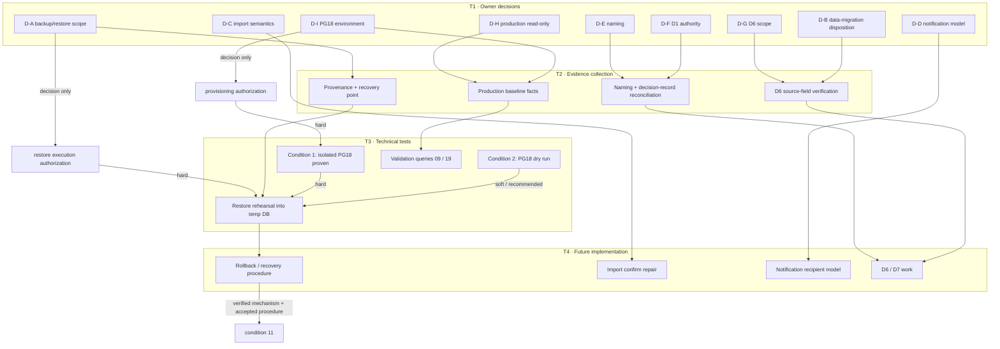

# Phase 12 — R-138: Historical Identifier Ownership & Dependency Integrity Correction

**Status:** `DOCUMENTATION ONLY — CORRECTION — PHASE 12 REMAINS OPEN`

**Supersedes:** only the identifiably defective interpretations inside R-137 (and, transitively, the R-136 statements those interpretations restated). R-138 does **not** supersede R-136 or R-137 as a whole.

**Precedence:** R-138 > R-137 > R-136 > R-135 > R-134 > R-133 > R-132. Where R-138 states a corrected ownership assignment, arithmetic total, dependency edge, or critical path, that statement is authoritative for any subsequent Phase 12 document. All other R-136/R-137 content — statuses, severities, decisions, recommendations, inherited-source classifications — remains in force unchanged.

**PB-03 preservation:** R-137's bounded `data-migration.ts` wording is preserved exactly and is **not** reopened (see §12).

---

## 1. Repository baseline and read-only scope

Authoritative local workspace: `D:\Default Project\company-ops-system`

Read-only baseline verified before any claim was read:

| Fact | Value | Method |
|---|---|---|
| Repository root | `D:\Default Project\company-ops-system` | `git rev-parse --show-toplevel` |
| Branch | `main` | `git branch --show-current` |
| HEAD | `f91ed2f9e81db3937e3bcbb1b44e5e2c44e175cf` | `git rev-parse HEAD` |
| Remote | `https://github.com/mamin144/company-ops-system.git` | `git remote -v` |
| Working tree (before R-138) | 27 porcelain entries: 24 modified tracked + 3 untracked (`docs/`, `COS_Full_Frontend_Rebuild_Phase_Prompts_AR.md`, `COS_Full_Frontend_Rebuild_Plan_AR.md`) | `git status --porcelain` |

The working tree is **preserved exactly as found**. It is dirty; it was not assumed clean. No Git write (stage, commit, push, branch, tag, reset, stash, clean) was performed. No tracked file was modified.

### 1.1 Authorized reading

Read in full:

1. `phase-12-r136-index-and-sequencing-correction-r137.md` — R-137 (537 lines)
2. `phase-12-final-evidence-and-owner-decision-pack-r136.md` — R-136 (950 lines)
3. `phase-12-consolidated-evidence-remediation-report.md` — R-132 (1073 lines), including its §13 Contradiction Register
4. `phase-12-r132-accuracy-addendum-r133.md` — R-133 (788 lines), including its X-01…X-19 correction register and C-22…C-28 re-assessment
5. `phase-12-r133-internal-consistency-addendum-r134.md` — R-134 (530+ lines), including its R134-C01…R134-C21 correction register
6. `phase-12-r134-postgresql-archive-correction-r135.md` — R-135 (768+ lines), including its CR-01…CR-12 correction register

This is **not** a new technical audit. Application source files were **not** re-read. No database, production system, container, service, or runtime environment was inspected. No test, build, typecheck, script, migration, query, backup, or restore was executed. No `.env` or secret was opened. No existing file was modified.

---

## 2. The exact R-137 statements being corrected

R-138 corrects the following R-137 statements, each of which is reproduced verbatim below with its location, followed by the corrected statement.

### 2.1 Correction A1 — Identifier ownership defects (R-137 §2.3)

R-137's reconciliation tables assign multiple owners or leave ownership ambiguous:

| R-137 statement (location) | Defect |
|---|---|
| "N-01 | N | TR-03, NB-01 alias cells" (§2.3.3) | N-01 listed against two rows (TR-03 and NB-01) with no rule selecting one owner |
| "N-02 | N | TR-11, TR-14 alias cells" (§2.3.3) | N-02 listed against two rows |
| "N-03 | N | TR-11, TR-15 alias cells" (§2.3.3) | N-03 listed against two rows |
| "N-05 | N | DI-04" with "U-R135-02 (cross-ref), Q-2 (cross-ref)" (§2.3.3) | Q-2's ownership is not stated; Q-2 appears in DI-04 and UN-02 alias cells per B.5/B.9 |
| "Q-4 | Q | PB-06, UN-16 alias cells" (§2.3.5) | Q-4 listed against two rows; R-137 calls this "one Q-ID owning two related rows" without designating one owner |
| "Q-6 | Q | TR-16, UN-24 alias cells" (§2.3.5) | Q-6 listed against two rows |
| "G-06 | G | B.2/B.3 alias cells | F-02, F-03" (§2.3.2) | G-06 associated with two alias cells and two findings; no single owner designated |
| Several U identifiers described as both ownership and cross-reference relationships (§2.3.4) | No rule separates owner-record occurrence from related-record occurrence |
| "Unique historical identifiers (formal) | 99" (§2.4) | 20 F + 8 G + 8 N + 35 U + 6 Q + 19 X + 21 R134-C + 12 CR = 129, plus C-28 referenced separately; 99 does not reconcile with any enumerated sum |
| C-01…C-27 described as "not present as formal register identifiers in R-136 or in the R-132/R-133/R-134/R-135 documents examined" (§2.3.9) | **False.** R-132's §13 Contradiction Register contains C-01…C-28 (28 IDs): C-01…C-21 in the §13 main table (lines 863-883) and C-22…C-28 in §13.2 (lines 900-908). R-133 §8.4 independently re-assesses C-22…C-28. |

### 2.2 Correction B1 — Dependency defects (R-137 §3)

| R-137 statement (location) | Defect |
|---|---|
| F.4 critical path "`D-I → condition 1 → condition 2 → restore rehearsal → rollback procedure → condition 11`" (§3.5) | Treats condition 2 as a **hard** step on the path to condition 11, contradicting F.3 which marks condition 2 → restore rehearsal as **Soft** |
| "`D-I → X3`" direct edge in the F.2 graph (§3.3) | Draws a direct D-I → restore rehearsal edge that bypasses provisioning authorization and environment readiness |
| "`D-A →| required scope| PROVISION3`" and "`DA -->|scope decision| E1`" (§3.3) | Shows D-A only as a scope decision feeding evidence, never as an explicit **restore execution authorization** gate on the restore path |
| WP-05 prerequisites "`D-A + WP-03 (isolated target) + a named archive + restore execution authorization`" (§3.6) | Correct in isolation but not mirrored in the graph/edge table/critical path, which still show condition 2 as hard and D-I directly to restore rehearsal |

---

## 3. Formal identifier ownership rules

### 3.1 Ownership model (mandatory)

A **strict identifier registry** is established. Every historical identifier has exactly one **formal owner record**.

| Field | Meaning |
|---|---|
| Identifier | Exact historical identifier, preserved character-for-character |
| Source report | R-132, R-133, R-134, R-135, or R-136/R-137 where the identifier was introduced |
| Namespace | F, G, N, U, Q, X, R134-C, CR, or R132-C |
| Owner record | **Exactly one** canonical row ID (a PB-/TR-/NB-/DI-/UN- finding or unknown row, a B.6.x correction row, or an R-132 §13 contradiction row) |
| Record type | Finding, unknown, correction, contradiction, withdrawn |
| Status | Active, corrected, superseded, withdrawn |
| Evidence location | Exact report and section/table |
| Related records | Other rows associated with the identifier; **references only** |
| Ownership result | Unique / Duplicate / Missing / Unresolved |

**Mandatory distinctions:**

- `Owner record` must contain exactly one row ID. Never two.
- `Related records` may contain multiple row IDs. A related-record relationship is **never** counted as additional ownership.
- No identifier may be owned by two rows.
- No identifier may be silently dropped to achieve zero duplicates.
- A prose mention of an identifier does **not** count as ownership.
- Only formal registry ownership fields determine duplicate ownership.

### 3.2 Namespaces preserved (audited independently)

| Namespace | Identifiers | Source |
|---|---|---|
| F | F-01 … F-20 (20) | R-132 §12; canonical rows PB-/TR- in R-136 B.2–B.3 |
| G | G-01 … G-08 (8; G-03 withdrawn) | R-132 §9; aliases in R-136 B.2–B.3 |
| N | N-01 … N-08 (8) | R-133 §12 new findings; aliases in R-136 B.3–B.4 |
| U | U-R132-01 … U-R132-14 (14); U-R134-01 … U-R134-11 (11); U-R135-01 … U-R135-10 (10) (35 total) | R-132/R-134/R-135 unknowns; R-136 B.9 |
| Q | Q-1 … Q-6 (6) | R-133 §12 new unknowns; aliases in R-136 B.5/B.9 |
| X | X-01 … X-19 (19) | R-133 §10 correction register; R-136 B.6.1 |
| R134-C | R134-C01 … R134-C21 (21) | R-134 §9 correction register; R-136 B.6.2 |
| CR | CR-01 … CR-12 (12) | R-135 §10 correction register; R-136 B.6.3 |
| R132-C | C-01 … C-28 (28) | R-132 §13 Contradiction Register (C-01…C-21 in §13 main table; C-22…C-28 in §13.2) |

G-03 is retained and marked `WITHDRAWN — NOT A GAP` (R-136 B.7); it is **not** deleted and **not** counted as an active finding.

### 3.3 Alias-resolution tie-break (deterministic)

Where a historical identifier appears in the alias cells of more than one row (the cases R-137 left ambiguous), the owner is assigned by **first occurrence in R-136's reading order** (B.2 → B.3 → B.4 → B.5 → B.9). All subsequent occurrences are recorded in `Related records` as cross-references, not as ownership. This rule is applied only where the source genuinely places the identifier in multiple alias cells; it is not used to merge two distinct defects.

---

## 4. Formal identifier ownership registry (one owner per ID)

### 4.1 F-series — finding identifiers (20)

| Identifier | Source report | Namespace | Owner record | Record type | Status | Evidence location | Ownership result | Related records |
|---|---|---|---|---|---|---|---|---|
| F-01 | R-132 | F | PB-03 | Finding | Active | R-136 B.2, PB-03 row | Unique | X-05, C-08 |
| F-02 | R-132 | F | PB-01 | Finding | Active | R-136 B.2, PB-01 row | Unique | G-06, X-07, X-08, C-28 |
| F-03 | R-132 | F | TR-01 | Finding | Active | R-136 B.3, TR-01 row | Unique | G-06 |
| F-04 | R-132 | F | TR-02 | Finding | Active | R-136 B.3, TR-02 row | Unique | (none) |
| F-05 | R-132 | F | TR-03 | Finding | Active | R-136 B.3, TR-03 row | Unique | X-01, X-02, X-03, X-04, N-01 |
| F-06 | R-132 | F | TR-04 | Finding | Active | R-136 B.3, TR-04 row | Unique | G-01 |
| F-07 | R-132 | F | TR-05 | Finding | Active | R-136 B.3, TR-05 row | Unique | G-02 |
| F-08 | R-132 | F | TR-06 | Finding | Active | R-136 B.3, TR-06 row | Unique | G-04 |
| F-09 | R-132 | F | TR-07 | Finding | Active | R-136 B.3, TR-07 row | Unique | G-08 |
| F-10 | R-132 | F | TR-08 | Finding | Active | R-136 B.3, TR-08 row | Unique | (none) |
| F-11 | R-132 | F | TR-09 | Finding | Active | R-136 B.3, TR-09 row | Unique | (none) |
| F-12 | R-132 | F | TR-10 | Finding | Active | R-136 B.3, TR-10 row | Unique | (none) |
| F-13 | R-132 | F | TR-11 | Finding | Active | R-136 B.3, TR-11 row | Unique | X-10, X-11, X-12, R134-C15, N-02, N-03 |
| F-14 | R-132 | F | DI-01 | Finding | Active | R-136 B.5, DI-01 row | Unique | X-14, C-22 |
| F-15 | R-132 | F | PB-05 | Finding | Active | R-136 B.2, PB-05 row | Unique | X-14 |
| F-16 | R-132 | F | PB-04 | Finding | Active | R-136 B.2, PB-04 row | Unique | C-27 |
| F-17 | R-132 | F | PB-02 | Finding | Active | R-136 B.2, PB-02 row | Unique | X-17 |
| F-18 | R-132 | F | DI-02 | Finding | Active | R-136 B.5, DI-02 row | Unique | X-13, C-23 |
| F-19 | R-132 | F | PB-06 | Finding | Active | R-136 B.3, PB-06 row | Unique | X-18, Q-4 |
| F-20 | R-132 | F | DI-03 | Finding | Active | R-136 B.5, DI-03 row | Unique | C-26 |

20/20 F identifiers: unique ownership, zero duplicates.

### 4.2 G-series — finding identifiers incl. withdrawn (8)

| Identifier | Source report | Namespace | Owner record | Record type | Status | Evidence location | Ownership result | Related records |
|---|---|---|---|---|---|---|---|---|
| G-01 | R-132 | G | TR-04 | Finding alias | Active | R-136 B.3, TR-04 aliases | Unique | F-06 |
| G-02 | R-132 | G | TR-05 | Finding alias | Active | R-136 B.3, TR-05 aliases | Unique | F-07 |
| G-03 | R-132 | G | B.7 | Withdrawn finding | Withdrawn | R-136 B.7 | Unique (withdrawn) | (none) |
| G-04 | R-132 | G | TR-06 | Finding alias | Active | R-136 B.3, TR-06 aliases | Unique | F-08 |
| G-05 | R-132 | G | TR-12 | Finding alias | Active | R-136 B.3, TR-12 aliases | Unique | F-12 |
| G-06 | R-132 | G | PB-01 | Finding alias | Active | R-136 B.2, PB-01 aliases | Unique | F-02 (owner row), TR-01 |
| G-07 | R-132 | G | TR-13 | Finding alias | Active | R-136 B.3, TR-13 aliases | Unique | F-13 |
| G-08 | R-132 | G | TR-07 | Finding alias | Active | R-136 B.3, TR-07 aliases | Unique | F-09 |

8/8 G identifiers: unique ownership, zero duplicates. G-06's first occurrence is PB-01 (B.2 precedes B.3); TR-01 is listed as related. G-03 remains withdrawn.

### 4.3 N-series — finding identifiers (8)

| Identifier | Source report | Namespace | Owner record | Record type | Status | Evidence location | Ownership result | Related records |
|---|---|---|---|---|---|---|---|---|
| N-01 | R-133 | N | TR-03 | Finding alias | Active | R-136 B.3, TR-03 aliases | Unique | F-05 (owner row), NB-01 |
| N-02 | R-133 | N | TR-11 | Finding alias | Active | R-136 B.3, TR-11 aliases | Unique | F-13 (owner row), TR-14 |
| N-03 | R-133 | N | TR-11 | Finding alias | Active | R-136 B.3, TR-11 aliases | Unique | F-13 (owner row), TR-15 |
| N-04 | R-133 | N | NB-02 | Finding | Active | R-136 B.4, NB-02 row | Unique | X-12 |
| N-05 | R-133 | N | DI-04 | Finding | Active | R-136 B.5, DI-04 row | Unique | U-R135-02, Q-2 |
| N-06 | R-133 | N | UN-17 | Unknown alias | Active | R-136 B.9, UN-17 aliases | Unique | (none) |
| N-07 | R-133 | N | TR-16 | Finding alias | Active | R-136 B.3, TR-16 aliases | Unique | X-09, U-R134-10, Q-6 |
| N-08 | R-133 | N | NB-03 | Finding | Active | R-136 B.4, NB-03 row | Unique | (none) |

8/8 N identifiers: unique ownership, zero duplicates. N-01/N-02/N-03 each resolve to their first-occurrence owner (TR-03, TR-11, TR-11); subsequent rows are related records.

### 4.4 U-series — unknown identifiers (35), preserving R-132/R-134/R-135 provenance

| Identifier | Source report | Namespace | Owner record | Record type | Status | Evidence location | Ownership result | Related records |
|---|---|---|---|---|---|---|---|---|
| U-R132-01 | R-132 | U | UN-01 | Unknown | Active | R-136 B.9, UN-01 row | Unique | PB-07, condition 1 |
| U-R132-02 | R-132 | U | UN-02 | Unknown | Active | R-136 B.9, UN-02 row | Unique | (none) |
| U-R132-03 | R-132 | U | UN-03 | Unknown | Active | R-136 B.9, UN-03 row | Unique | (none) |
| U-R132-04 | R-132 | U | UN-04 | Unknown | Active | R-136 B.9, UN-04 row | Unique | (none) |
| U-R132-05 | R-132 | U | UN-05 | Unknown | Active | R-136 B.9, UN-05 row | Unique | (none) |
| U-R132-06 | R-132 | U | UN-06 | Unknown | Active | R-136 B.9, UN-06 row | Unique | (none) |
| U-R132-07 | R-132 | U | UN-07 | Unknown | Active | R-136 B.9, UN-07 row | Unique | (none) |
| U-R132-08 | R-132 | U | UN-08 | Unknown | Active | R-136 B.9, UN-08 row | Unique | (none) |
| U-R132-09 | R-132 | U | UN-09 | Unknown | Active | R-136 B.9, UN-09 row | Unique | (none) |
| U-R132-10 | R-132 | U | UN-10 | Unknown | Active | R-136 B.9, UN-10 row | Unique | (none) |
| U-R132-11 | R-132 | U | UN-11 | Unknown | Active | R-136 B.9, UN-11 row | Unique | (none) |
| U-R132-12 | R-132 | U | UN-12 | Unknown | Active | R-136 B.9, UN-12 row | Unique | (none) |
| U-R132-13 | R-132 | U | UN-13 | Unknown | Active | R-136 B.9, UN-13 row | Unique | (none) |
| U-R132-14 | R-132 | U | UN-14 | Unknown | Active | R-136 B.9, UN-14 row | Unique | (none) |
| U-R134-01 | R-134 | U | UN-18 | Unknown | Active | R-136 B.9, UN-18 row | Unique | (none) |
| U-R134-02 | R-134 | U | UN-19 | Unknown | Active | R-136 B.9, UN-19 row | Unique | (none) |
| U-R134-03 | R-134 | U | UN-02 | Unknown alias | Active | R-136 B.9, UN-02 aliases | Unique | U-R132-02 (owner row) |
| U-R134-04 | R-134 | U | UN-20 | Unknown | Active | R-136 B.9, UN-20 row | Unique | (none) |
| U-R134-05 | R-134 | U | UN-17 | Unknown alias | Active | R-136 B.9, UN-17 aliases | Unique | (none) |
| U-R134-06 | R-134 | U | UN-17 | Unknown alias | Active | R-136 B.9, UN-17 aliases | Unique | (none) |
| U-R134-07 | R-134 | U | UN-21 | Unknown | Active | R-136 B.9, UN-21 row | Unique | (none) |
| U-R134-08 | R-134 | U | UN-22 | Unknown | Active | R-136 B.9, UN-22 row | Unique | (none) |
| U-R134-09 | R-134 | U | UN-23 | Unknown | Active | R-136 B.9, UN-23 row | Unique | (none) |
| U-R134-10 | R-134 | U | UN-24 | Unknown | Active | R-136 B.9, UN-24 row | Unique | TR-16, Q-6 |
| U-R134-11 | R-134 | U | UN-25 | Unknown | Active | R-136 B.9, UN-25 row | Unique | (none) |
| U-R135-01 | R-135 | U | UN-17 | Unknown alias | Active | R-136 B.9, UN-17 aliases | Unique | (none) |
| U-R135-02 | R-135 | U | UN-26 | Unknown | Active | R-136 B.9, UN-26 row | Unique | DI-04 |
| U-R135-03 | R-135 | U | UN-19 | Unknown alias | Active | R-136 B.9, UN-19 aliases | Unique | U-R134-02 (owner row) |
| U-R135-04 | R-135 | U | UN-27 | Unknown alias | Active | R-136 B.9, UN-27 aliases | Unique | (none) |
| U-R135-05 | R-135 | U | UN-27 | Unknown alias | Active | R-136 B.9, UN-27 aliases | Unique | (none) |
| U-R135-06 | R-135 | U | UN-18 | Unknown alias | Active | R-136 B.9, UN-18 aliases | Unique | U-R134-01 (owner row) |
| U-R135-07 | R-135 | U | UN-02 | Unknown alias | Active | R-136 B.9, UN-02 aliases | Unique | U-R132-02 (owner row) |
| U-R135-08 | R-135 | U | UN-27 | Unknown alias | Active | R-136 B.9, UN-27 aliases | Unique | (none) |
| U-R135-09 | R-135 | U | UN-20 | Unknown alias | Active | R-136 B.9, UN-20 aliases | Unique | U-R134-04 (owner row) |
| U-R135-10 | R-135 | U | UN-27 | Unknown alias | Active | R-136 B.9, UN-27 aliases | Unique | (none) |

35/35 U identifiers: unique ownership, zero duplicates. Multiple U IDs may alias the same UN row (e.g. UN-17 aliases four U IDs), but each U ID has exactly one owner row — this is not duplicate ownership.

### 4.5 Q-series — question identifiers (6)

| Identifier | Source report | Namespace | Owner record | Record type | Status | Evidence location | Ownership result | Related records |
|---|---|---|---|---|---|---|---|---|
| Q-1 | R-133 | Q | UN-18 | Unknown alias | Active | R-136 B.9, UN-18 aliases | Unique | U-R134-01 (owner row) |
| Q-2 | R-133 | Q | DI-04 | Unknown alias | Active | R-136 B.5, DI-04 aliases | Unique | F-14? no — N-05 (owner row context), UN-02 |
| Q-3 | R-133 | Q | UN-15 | Unknown alias | Active | R-136 B.9, UN-15 row | Unique | (none) |
| Q-4 | R-133 | Q | PB-06 | Unknown alias | Active | R-136 B.3, PB-06 aliases | Unique | F-19 (owner row), UN-16 |
| Q-5 | R-133 | Q | UN-17 | Unknown alias | Active | R-136 B.9, UN-17 aliases | Unique | (none) |
| Q-6 | R-133 | Q | TR-16 | Unknown alias | Active | R-136 B.3, TR-16 aliases | Unique | N-07, U-R134-10, UN-24 |

6/6 Q identifiers: unique ownership, zero duplicates. Q-2 resolves to DI-04 (B.5 precedes B.9); Q-4 to PB-06 (B.3 precedes B.9); Q-6 to TR-16 (B.3 precedes B.9). Subsequent occurrences are related records.

### 4.6 X-series — correction identifiers (19)

| Identifier | Source report | Namespace | Owner record | Record type | Status | Evidence location | Ownership result | Related records |
|---|---|---|---|---|---|---|---|---|
| X-01 … X-19 | R-133 | X | B.6.1 rows X-01 … X-19 | Correction | Active | R-136 B.6.1 | Unique (each) | See R-136 B.6.1 alias column |

19/19 X identifiers: each owns exactly one B.6.1 correction row. X identifiers appearing in PB/TR/NB/DI alias cells (X-01…X-06, X-07, X-08, X-09…X-14, X-18) are cross-references, not duplicate ownership.

### 4.7 R134-C-series — correction identifiers (21)

| Identifier | Source report | Namespace | Owner record | Record type | Status | Evidence location | Ownership result | Related records |
|---|---|---|---|---|---|---|---|---|
| R134-C01 … R134-C21 | R-134 | R134-C | B.6.2 rows R134-C01 … R134-C21 | Correction | Active | R-136 B.6.2 | Unique (each) | See R-136 B.6.2 alias column |

21/21 R134-C identifiers: each owns exactly one B.6.2 correction row. R134-C11 is marked superseded by CR-01…CR-04 but retains its owner row.

### 4.8 CR-series — correction identifiers (12)

| Identifier | Source report | Namespace | Owner record | Record type | Status | Evidence location | Ownership result | Related records |
|---|---|---|---|---|---|---|---|---|
| CR-01 … CR-12 | R-135 | CR | B.6.3 rows CR-01 … CR-12 | Correction | Active | R-136 B.6.3 | Unique (each) | See R-136 B.6.3 alias column |

12/12 CR identifiers: each owns exactly one B.6.3 correction row.

### 4.9 R132-C-series — R-132 contradiction identifiers (28) — source-verified

**Source correction to R-137 §2.3.9:** R-137 claimed C-01…C-27 are "not present as formal register identifiers." This is false. R-132's §13 Contradiction Register contains all 28 C-series IDs:

- **C-01 … C-21** — R-132 §13 main table (seven-column register: ID | Subject | Corpus status | Re-assessed label | Basis), lines 863-883.
- **C-22 … C-28** — R-132 §13.2 "Contradictions this review adds" (three-column table: ID | Contradiction | Evidence), lines 900-908, appended after §13.1. R-133 §8.4 independently re-assesses C-22…C-28.

All 28 are preserved under the explicit namespace `R132-C`. C-28 is a genuine R-132 contradiction register entry ("Owner Acceptance condition 10 assumes `pg_dump` capability; no such capability exists," basis F-02, status `Contradicted`), not merely a PB-01 alias; R-136 references C-28 in PB-01's aliases as a cross-reference only.

| Identifier | Source report | Namespace | Owner record | Record type | Status | Evidence location | Ownership result | Related records |
|---|---|---|---|---|---|---|---|---|
| C-01 | R-132 | R132-C | R-132 §13 (C-01 row) | Contradiction | Owner-Confirmed | R-132 §13, C-01 row | Unique | (timeline assertion) |
| C-02 | R-132 | R132-C | R-132 §13 (C-02 row) | Contradiction | Owner-Confirmed | R-132 §13, C-02 row | Unique | (metadata) |
| C-03 | R-132 | R132-C | R-132 §13 (C-03 row) | Contradiction | Historical | R-132 §13, C-03 row | Unique | (none) |
| C-04 | R-132 | R132-C | R-132 §13 (C-04 row) | Contradiction | Owner-Confirmed | R-132 §13, C-04 row | Unique | (timeline assertion) |
| C-05 | R-132 | R132-C | R-132 §13 (C-05 row) | Contradiction | Verified | R-132 §13, C-05 row | Unique | (none) |
| C-06 | R-132 | R132-C | R-132 §13 (C-06 row) | Contradiction | Verified / Owner-Confirmed | R-132 §13, C-06 row | Unique | (text + event) |
| C-07 | R-132 | R132-C | R-132 §13 (C-07 row) | Contradiction | Verified / Owner-Confirmed | R-132 §13, C-07 row | Unique | (text + event) |
| C-08 | R-132 | R132-C | R-132 §13 (C-08 row) | Contradiction | Verified | R-132 §13, C-08 row | Unique | PB-03 |
| C-09 | R-132 | R132-C | R-132 §13 (C-09 row) | Contradiction | Verified | R-132 §13, C-09 row | Unique | (none) |
| C-10 | R-132 | R132-C | R-132 §13 (C-10 row) | Contradiction | Historical | R-132 §13, C-10 row | Unique | (none) |
| C-11 | R-132 | R132-C | R-132 §13 (C-11 row) | Contradiction | Unknown | R-132 §13, C-11 row | Unique | (none) |
| C-12 | R-132 | R132-C | R-132 §13 (C-12 row) | Contradiction | Unknown | R-132 §13, C-12 row | Unique | (none) |
| C-13 | R-132 | R132-C | R-132 §13 (C-13 row) | Contradiction | Inferred | R-132 §13, C-13 row | Unique | (none) |
| C-14 | R-132 | R132-C | R-132 §13 (C-14 row) | Contradiction | Unknown | R-132 §13, C-14 row | Unique | (none) |
| C-15 | R-132 | R132-C | R-132 §13 (C-15 row) | Contradiction | Verified | R-132 §13, C-15 row | Unique | (none) |
| C-16 | R-132 | R132-C | R-132 §13 (C-16 row) | Contradiction | Verified | R-132 §13, C-16 row | Unique | (none) |
| C-17 | R-132 | R132-C | R-132 §13 (C-17 row) | Contradiction | Verified | R-132 §13, C-17 row | Unique | (none) |
| C-18 | R-132 | R132-C | R-132 §13 (C-18 row) | Contradiction | Verified | R-132 §13, C-18 row | Unique | (none) |
| C-19 | R-132 | R132-C | R-132 §13 (C-19 row) | Contradiction | Verified | R-132 §13, C-19 row | Unique | (none) |
| C-20 | R-132 | R132-C | R-132 §13 (C-20 row) | Contradiction | Verified | R-132 §13, C-20 row | Unique | (none) |
| C-21 | R-132 | R132-C | R-132 §13 (C-21 row) | Contradiction | Verified | R-132 §13, C-21 row | Unique | (none) |
| C-22 | R-132 | R132-C | R-132 §13.2 (C-22 row) | Contradiction | Verified | R-132 §13.2, C-22 row | Unique | F-14 |
| C-23 | R-132 | R132-C | R-132 §13.2 (C-23 row) | Contradiction | Verified (divergence) | R-132 §13.2, C-23 row | Unique | F-18 |
| C-24 | R-132 | R132-C | R-132 §13.2 (C-24 row) | Contradiction | Verified | R-132 §13.2, C-24 row | Unique | §8.3 context |
| C-25 | R-132 | R132-C | R-132 §13.2 (C-25 row) | Contradiction | Verified | R-132 §13.2, C-25 row | Unique | F-15 |
| C-26 | R-132 | R132-C | R-132 §13.2 (C-26 row) | Contradiction | Verified | R-132 §13.2, C-26 row | Unique | F-20 |
| C-27 | R-132 | R132-C | R-132 §13.2 (C-27 row) | Contradiction | Verified | R-132 §13.2, C-27 row | Unique | F-16 |
| C-28 | R-132 | R132-C | R-132 §13.2 (C-28 row) | Contradiction | Contradicted | R-132 §13.2, C-28 row | Unique | F-02; PB-01 (cross-ref only) |

28/28 R132-C identifiers: unique ownership, zero duplicates. None is silently dropped; none is renamed. C-28's relationship to PB-01 (F-02) is a cross-reference, not ownership.

---

## 5. Related-record cross-reference index (separate from ownership)

The following index lists every related-record relationship recorded in the registry above. Each entry is a **reference only**; it is not counted as ownership.

**Finding/unknown alias-cell cross-references (counted from R-136 B.2–B.5 and B.9):**

| Owner record | Related-record references (identifier → row) |
|---|---|
| PB-01 | F-02; G-06; X-07; X-08; C-28 |
| PB-02 | F-17; X-17 |
| PB-03 | F-01; X-05; C-08 |
| PB-04 | F-16; C-27 |
| PB-05 | F-15; X-14 |
| PB-06 | F-19; X-18; Q-4 |
| PB-07 | U-R132-01 |
| TR-01 | F-03; G-06 |
| TR-02 | F-04 |
| TR-03 | F-05; X-01; X-02; X-03; X-04; N-01 |
| TR-04 | F-06; G-01 |
| TR-05 | F-07; G-02 |
| TR-06 | F-08; G-04 |
| TR-07 | F-09; G-08 |
| TR-08 | F-10 |
| TR-09 | F-11 |
| TR-10 | F-12 |
| TR-11 | F-13; X-10; X-11; X-12; R134-C15; N-02; N-03 |
| TR-12 | G-05 |
| TR-13 | G-07 |
| TR-14 | N-02 |
| TR-15 | N-03; X-11 |
| TR-16 | X-09; N-07; U-R134-10; Q-6 |
| NB-01 | N-01; X-03 |
| NB-02 | N-04; X-12 |
| NB-03 | N-08 |
| DI-01 | F-14; X-14; C-22 |
| DI-02 | F-18; X-13; C-23 |
| DI-03 | F-20; C-26 |
| DI-04 | N-05; U-R135-02; Q-2 |
| UN-01 | U-R132-01 |
| UN-02 | U-R132-02; U-R134-03; U-R135-07; Q-2 |
| UN-03 … UN-14 | U-R132-03 … U-R132-14 (one each) |
| UN-15 | Q-3 |
| UN-16 | Q-4 |
| UN-17 | U-R134-05; U-R134-06; U-R135-01; Q-5; N-06 |
| UN-18 | U-R134-01; U-R135-06; Q-1 |
| UN-19 | U-R134-02; U-R135-03 |
| UN-20 | U-R134-04; U-R135-09 |
| UN-21 | U-R134-07 |
| UN-22 | U-R134-08 |
| UN-23 | U-R134-09 |
| UN-24 | U-R134-10; Q-6 |
| UN-25 | U-R134-11 |
| UN-26 | U-R135-02 |
| UN-27 | U-R135-04; U-R135-05; U-R135-08; U-R135-10 |

**Correction-register related-record references (R-136 B.6.1/B.6.2/B.6.3 alias/superseding columns):** X-01→TR-03; X-03→NB-01,TR-03; X-05→PB-03; X-06→R134-C06; X-07→PB-01; X-08→PB-01; X-09→TR-16; X-10→TR-11; X-11→TR-11,TR-15; X-12→NB-02,TR-11; X-13→DI-02; X-14→DI-01; X-16→Section D; X-17→PB-02; X-18→PB-06; R134-C05→F-01,D-B; R134-C06→X-06,PB-03; R134-C08→D-A; R134-C10→CR-10; R134-C11→superseded by CR-01…CR-04; R134-C12→D-A; R134-C14→C15,C16; R134-C15→TR-11,D-C; R134-C16→D-C; R134-C17→TR-14,TR-15; R134-C18→NB-02; R134-C19→Section D; R134-C20→D5,TR-16; CR-01→D-A; CR-02→D-A; CR-03→superseding R134-C11; CR-04→D-A; CR-05→UN-15; CR-06→UN-15; CR-08→Section C; CR-10→R-135 §8,§10; CR-11→UN-21.

**Cross-reference count:** 109 alias-cell entries across B.2–B.5 and B.9 (PB 18 + TR 36 + NB 5 + DI 11 + UN 39), plus correction-register related-record references listed above. These are references, not ownership.

---

## 6. R-132 C-series source reconciliation (§4.3 mandatory item)

### 6.1 What the original R-132 register actually contains

R-132 §13 "Contradiction Register — C-01 … C-21 Re-Assessment" contains:

1. **§13 main table** (lines 863-883): C-01 through C-21, 21 IDs, each with Subject / Corpus status / Re-assessed label / Basis.
2. **§13.2 "Contradictions this review adds"** (lines 900-908): C-22 through C-28, 7 additional IDs, each with Contradiction / Evidence.

R-132 therefore contains **C-01 through C-28 (28 IDs)** as formal contradiction-register records. R-133 §8.4 independently re-assesses C-22…C-28. This is confirmed by reading the original R-132 file directly; R-137's §2.3.9 claim that C-01…C-27 are absent from the corpus is incorrect.

### 6.2 Reconciliation outcome

All 28 C-series IDs are introduced under the explicit namespace `R132-C` (§4.9). Each owns exactly one R-132 §13 row. C-28's relationship to PB-01 (F-02) is recorded as a cross-reference (PB-01's aliases cell lists C-28), not as ownership. No C ID is renamed, dropped, or counted twice.

---

## 7. Recalculated arithmetic (independently checkable)

All totals are calculated directly from the registry in §4 and the cross-reference index in §5.

| Measure | Value | Basis |
|---|---|---|
| 1. Unique formal identifiers | **157** | Sum of namespaces below |
| 2. Finding identifiers (F/G/N) | **36** | 20 F + 8 G (incl. withdrawn G-03) + 8 N |
| 3. Unknown identifiers (U/Q) | **41** | 35 U + 6 Q |
| 4. Correction identifiers (X/R134-C/CR) | **52** | 19 X + 21 R134-C + 12 CR |
| 5. R-132 contradiction identifiers (R132-C) | **28** | C-01 … C-28, source-verified in R-132 §13 |
| 6. Canonical finding rows | **30** | PB-01…PB-07 (7) + TR-01…TR-16 (16) + NB-01…NB-03 (3) + DI-01…DI-04 (4) |
| 7. Canonical unknown rows | **27** | UN-01 … UN-27 |
| 8. Correction/contradiction rows | **80** | 52 correction rows (B.6.1/6.2/6.3) + 28 R-132 §13 contradiction rows |
| 9. Withdrawn records | **1** | G-03 (`WITHDRAWN — NOT A GAP`) |
| 10. Related-record cross-reference relationships | **109+** | 109 alias-cell entries across B.2–B.5/B.9 (PB 18 + TR 36 + NB 5 + DI 11 + UN 39), plus correction-register related-record references (§5) |
| 11. Duplicate ownership assignments | **0** | Enforced by §3.1; verified by §8 |
| 12. Missing / unresolved identifiers | **0** | Every source identifier in §3.2 is assigned exactly one owner row |

### 7.1 Reconciliation equation (manually checkable)

**Identifier equation (counts identifiers, not rows):**

`Finding 36 + Unknown 41 + Correction 52 + R132-C contradiction 28 = 157 unique formal identifiers` ✓

**Row equation (counts canonical register rows):**

`Finding rows 30 + Unknown rows 27 + Correction/contradiction rows 80 = 137 canonical rows` ✓

**Consistency check:** Identifiers (157) ≠ Rows (137), because several canonical rows carry multiple identifiers in their alias cells (e.g. UN-17 aliases U-R134-05, U-R134-06, U-R135-01, Q-5, N-06 — five identifiers mapping to one row). This is expected and is not duplicate ownership: each of those five identifiers has exactly one owner (UN-17).

**Namespace sum check:** 20 + 8 + 8 + 35 + 6 + 19 + 21 + 12 + 28 = **157** ✓

R-137's reported "99 unique identifiers" and its "68 findings/unknown rows" do not reconcile with its own enumerated counts (129 namespaced IDs before C-series) and are replaced by the figures above. R-137's claim of "zero unexplained identifiers" is upheld, but now on a corrected basis: C-01…C-28 are present and owned, not "absent from the corpus."

---

## 8. Integrity checks performed (per §4.5)

Before completing this report, the registry was checked as follows:

1. **Exact-identifier search:** every identifier in §3.2 was located in the registry tables in §4. All 157 present.
2. **Owner-field count:** each identifier appears in exactly one `Owner record` cell. Confirmed by enumerating §4.1–§4.9.
3. **Duplicate-owner count:** 0. No identifier appears as `Owner record` in two rows.
4. **Related-record separation:** all non-owner occurrences are listed under `Related records` only; none appears in an `Owner record` cell a second time.
5. **Arithmetic verification:** the §7 equations were recomputed from the enumerated rows and reconcile.
6. **Source coverage:** every identifier named in R-132 §13 (C-01…C-28), R-133 §10 (X-01…X-19), R-134 §9 (R134-C01…C-21), R-135 §10 (CR-01…CR-12), and R-136 B.2–B.9 (F/G/N/U/Q) is accounted for.
7. **No silent rename or drop:** no identifier from any source report is renamed or omitted; G-03 is preserved as withdrawn; C-01…C-28 are present under R132-C.

The prose-mention rule and cross-reference rule from §3.1 were applied: a mention in explanatory text or a related-record reference never counts as ownership.

---

## 9. Corrected dependency model (§5 Correction B)

R-138 enforces four separate, non-interchangeable concepts:

1. **Owner decision** — a choice among options (signature only).
2. **Execution authorization** — explicit permission to run a work package.
3. **Completed technical activity** — work actually performed and evidenced.
4. **Accepted exit-condition evidence** — assessed sub-elements closing a condition.

None implies another.

### 9.1 Distinctions maintained

**Environment path:** `D-I` chooses the environment approach; `D-I` is **not** provisioning authorization. Explicit provisioning execution authorization is required. `WP-03` provisions the approved environment. Condition 1 is assessed from actual isolation evidence. A choice of `I1` (VM) or `I3` (container) does **not** create an environment.

**Migration dry-run path:** `WP-04` requires `WP-03` and a successful condition-1 assessment. The PG18 dry run is executed and compared with PG17 evidence. Condition 2 is assessed **after** this work. Condition 2 is **not** a hard prerequisite for a backup restore unless an explicit acceptance requirement states so.

**Restore rehearsal path:** requires (a) `D-A` owner scope decision, (b) a **separate** restore execution authorization, (c) an isolated version-consistent destination, (d) a named archive, (e) a compatible PostgreSQL client and destination server, (f) a bounded restore procedure. Condition 2 is soft/recommended parallel, not a mandatory gate. No direct `D-I`→restore edge bypasses provisioning authorization and environment readiness. No direct `D-A`→restore edge implies the owner scope decision itself authorizes execution.

**Recovery closure path:** condition 11 requires a verified restoration mechanism, an accepted and tested recovery procedure, a named recovery point, a post-cutover write policy, file-attachment recovery evidence, and audit-trail evidence. A successful restore rehearsal is necessary evidence but **not sufficient** to close condition 11. Condition 2 is a parallel recommended activity, not a hard step on the condition-11 critical path.

### 9.2 Corrected dependency graph

Key corrections versus R-137's graph:
- `D-I` no longer points directly at `X3` (restore rehearsal); it flows through `PA` (provisioning authorization) → `X1` (condition 1) only.
- `D-A` now points to `RA` (restore execution authorization) → `X3`, an explicit hard gate that R-137's graph omitted.
- `X2` → `X3` is **soft / recommended**, not hard.
- No owner-decision node is drawn as an execution authorization.

### 9.3 Corrected edge table

| From | To | Reason | Strength |
|---|---|---|---|
| `D-I` | provisioning authorization | Owner decision must be converted to explicit execution permission before provisioning | Authorization gate |
| provisioning authorization | Condition 1 | Environment must exist and be proven isolated before the dry run | Hard |
| Condition 1 | Condition 2 | The PG18 dry run needs the isolated environment | Hard (on the dry-run path only) |
| `D-H` | Production baseline | Facts can only come from production | Hard |
| `D-A` | Provenance and recovery point | Scope determines what must be recorded | Soft — recording could start earlier |
| `D-A` | restore execution authorization | Owner scope decision must be converted to explicit execution permission before a restore | **Authorization gate (new)** |
| restore execution authorization | Restore rehearsal | Execution permission is required to run WP-05 | Hard |
| Condition 1 / isolated target | Restore rehearsal | An isolated, version-consistent destination must exist before data is loaded | Hard |
| named archive + compatible reader/target | Restore rehearsal | Provenance names the archive; reader/target must match archive format | Hard |
| Provenance | Restore rehearsal | The rehearsal should name the archive it restores | Soft |
| Condition 2 | Restore rehearsal | Target schema should be known before data is loaded | **Soft / recommended — not a hard gate** |
| Restore rehearsal | Rollback procedure | Rollback is "restore a verified dump"; without a rehearsal there is nothing to verify | Hard |
| `D-C` | Import repair | Semantics first, code second | Hard |
| `D-D` | Notification repair | Recipient model first, code second | Hard |
| `D-E`, `D-F` | Decision-record reconciliation | Soft |
| `D-G`, `D-B` | D6 source-field verification | Soft |

### 9.4 Four corrected critical paths

**Path 1 — Condition 1 (isolation evidence):**

`D-I` → provisioning authorization → `WP-03` → isolation evidence → condition 1 assessment

**Path 2 — Condition 2 (PG18 migration dry run):**

condition 1 → `WP-04` → PG18 migration dry run → schema comparison → condition 2 assessment

**Path 3 — Condition 10 (restore rehearsal):**

`D-A` → restore execution authorization

AND

condition 1 / isolated target

AND

named archive + compatible reader and target server

THEN

`WP-05` → restore rehearsal → condition 10 sub-element reassessment

Completing `WP-05` does **not** automatically close condition 10; all five sub-elements (10.1–10.5) still require assessment. Condition 2 is a parallel recommended activity, not a hard step here.

**Path 4 — Condition 11 (rollback/recovery procedure):**

`D-A` → restore scope

AND

`D-I` → provisioning authorization → `WP-03` → condition 1

AND

named recovery point + restore evidence

THEN

verified restoration mechanism → accepted recovery procedure → four condition-11 elements (11.1–11.4) → condition 11 reassessment

Condition 2 is a parallel recommended path; it is **not** a hard critical-path dependency for condition 11.

### 9.5 Dependency consistency across representations

The graph (§9.2), edge table (§9.3), critical-path narrative (§9.4), and WP prerequisites (§9.6) now express one model. Every edge is labeled Hard / Soft-recommended / Authorization gate / Evidence gate consistently across all four representations. The contradictory labels R-137 had (condition 2 soft in F.3 but hard in F.4; `D-A` missing from the restore path; `D-I` pointing directly at restore rehearsal) are resolved.

### 9.6 Corrected work-package prerequisites

| Package | Required prerequisites |
|---|---|
| WP-03 — Isolated PG18 provisioning | `D-I` + host capacity/policy + **separate explicit provisioning authorization** |
| WP-04 — PG18 migration dry run | `WP-03` completed + condition 1 accepted + **separate test execution authorization** |
| WP-05 — Restore rehearsal | `D-A` + `WP-03`/condition 1 + named archive + compatible client/target + **separate restore execution authorization**; condition 2 soft/recommended |
| WP-06 — Provenance | `D-A` scope + evidence access authorization (where host/task inspection is needed) |

No owner decision automatically authorizes a work package. All execution requires a separate, explicit authorization.

---

## 10. PB-03 preservation statement

R-137's bounded `data-migration.ts` wording is accepted and preserved exactly:

> `data-migration.ts` is schema-mismatched and unwired; its failure is caught and logged, while runtime exit behaviour remains untested.

The following are **not** changed by R-138:

- PB-03 severity (Critical as planning / None as runtime)
- `D-B` or `D-G`
- Condition 6
- Inherited source classifications
- Runtime uncertainty (compilation/typecheck, exit code, linger time, live migration outcome — all `Not Authorized / Unknown`)

`data-migration.ts` was **not** re-read and **not** executed.

---

## 11. Impact and status-preservation statement

**Unchanged by R-138:**

- Phase 12 verdict: `BLOCKED — ADDITIONAL EVIDENCE REQUIRED — PHASE 12 REMAINS OPEN`
- All fifteen condition statuses in R-136 Section D (`Not met` ×11, `Historical` ×1, `Substantially met` ×1, `Partial` ×1, `Not Authorized` ×1)
- All severities in R-136 Sections B.2–B.5
- All owner decisions `D-A` … `D-I` and their options, recommendations, and non-authorizing status (all `PENDING OWNER DECISION`)
- All inherited-source classifications (`Verified` means "so classified by the cited report")
- R-136 H.1 authorization matrix (no action authorized)
- R-137 PB-03 wording (§10 above)
- All explicit execution prohibitions

**Changed by R-138 (narrowly):**

1. Identifier ownership model: R-137's ambiguous multi-owner assignments replaced by the strict one-owner-per-ID registry (§4), with the R-132 C-series (C-01…C-28) source-verified and introduced under namespace `R132-C` (§6), and the cross-reference index separated from ownership (§5).
2. Recalculated arithmetic: 157 unique formal identifiers / 137 canonical rows / 0 duplicate ownership / 0 unresolved (§7), replacing R-137's unreconciled "99 identifiers" and "68 rows."
3. Dependency model: the unified, consistent model across graph / edge table / critical paths / WP prerequisites (§9), with condition 2 soft for the restore rehearsal, `D-A` on the restore-authorization path via restore execution authorization, `D-I` not pointing directly at restore rehearsal, and owner decisions separated from execution authorizations.

**R-138 supersedes only the identified interpretations above, not R-136 or R-137 as a whole.**

No exit condition is promoted. No owner option is selected. Phase 12 is not closed. Stage 3 and Phase 13 remain Not Authorized. D5, D6, D7 remain Not Authorized.

---

## 12. Explicit confirmation of non-actions

The following were **not** performed:

- No application source file was read or modified.
- No application code, test, SQL, migration, configuration, or environment variable was modified.
- No test, build, typecheck, lint, script, query, migration, backup, or restore was executed.
- No database was connected to; no production system was inspected.
- No `.env`, secret store, or secret value was opened or reproduced.
- No container, service, or Task Scheduler was queried.
- No environment was provisioned.
- No existing file was modified; R-132 through R-137 are unmodified.
- No Git write was performed (no stage, commit, push, branch, tag, reset, stash, clean).
- No auxiliary files were created; exactly one new Markdown file (this report) exists.
- No master consolidation report was created.
- Stage 3 was not started; Phase 13 was not chartered; D5/D6/D7 were not executed.

---

## 13. Final verification

- **Output path:** `D:\Default Project\company-ops-system\docs/frontend-rebuild/phase-12/phase-12-r137-identifier-and-dependency-integrity-correction-r138.md`
- **Repository root:** `D:/Default Project/company-ops-system`
- **Branch:** `main`; **HEAD:** `f91ed2f9e81db3937e3bcbb1b44e5e2c44e175cf`; **remote:** `https://github.com/mamin144/company-ops-system.git`
- **Working-tree status (before):** 27 porcelain entries (24 modified tracked, 3 untracked)
- **Working-tree status (after):** unchanged; no tracked file touched; this is one new untracked document in `docs/` (which was already untracked)
- **Identifiers reconciled by namespace:** F 20, G 8 (incl. withdrawn G-03), N 8, U 35, Q 6, X 19, R134-C 21, CR 12, R132-C 28
- **Unique formal identifiers:** 157
- **Canonical register rows:** 137 (30 finding + 27 unknown + 80 correction/contradiction)
- **Cross-reference relationships:** 109 alias-cell entries across B.2–B.5/B.9 plus correction-register related-record references (§5)
- **Duplicate ownership count:** 0
- **Missing/unresolved identifier count:** 0 (all 157 source identifiers assigned exactly one owner)
- **Original R-132 C-series reconciled:** yes — C-01…C-28 confirmed present in R-132 §13 (C-01…C-21 in the main table; C-22…C-28 in §13.2); introduced under namespace `R132-C`; R-137's "absent from corpus" claim corrected
- **Arithmetic independently checks out:** yes — identifier equation 36+41+52+28=157; row equation 30+27+80=137; namespace sum 20+8+8+35+6+19+21+12+28=157
- **Graph, edge table, critical paths, and WP prerequisites agree:** yes — one consistent model (§9), condition 2 soft for restore rehearsal, `D-A` on restore-authorization path, owner decisions not execution authorizations
- **PB-03 wording unchanged:** yes — preserved exactly per §10
- **No prior file modified:** yes — R-132 through R-137 and all other existing files unmodified
- **No source, test, database, production, or operational action:** yes — confirmed in §12

**Final Phase 12 verdict remains:** `BLOCKED — ADDITIONAL EVIDENCE REQUIRED — PHASE 12 REMAINS OPEN`

**End of R-138.**
